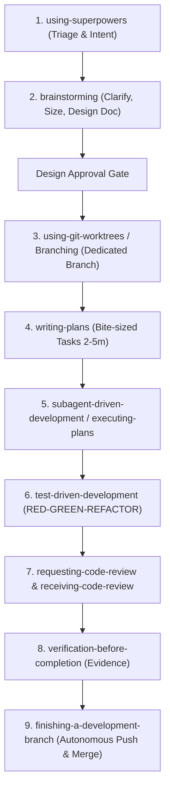

# PIOS Project — Rules for AI Agents (AGENTS.md)

Ref: [obra/superpowers](https://github.com/obra/superpowers)

This file sets the standard operational rules for all AI agents working on the **PIOS Smart City** repository. Every agent session MUST strictly adhere to these guidelines.

---

## 1. Mandatory Workflow: Superpowers Exclusively

All AI agents working on this repository **MUST EXCLUSIVELY USE THE SUPERPOWERS METHODOLOGY AND SKILLS FRAMEWORK**. No improvised, ad-hoc, or non-superpowers workflows are permitted.

> [!IMPORTANT]
> **Extremely Important Rule (`superpowers:using-superpowers`):**
> If you think there is even a 1% chance a Superpowers skill applies to what you are doing, you **ABSOLUTELY MUST** invoke the skill. This is not negotiable. Check and invoke relevant skills **BEFORE** any response, file change, or action.

### 1.1 Superpowers End-to-End Development Lifecycle

---

## 2. Superpowers Skills Matrix & Triggers

| Stage / Problem | Mandatory Superpowers Skill | Trigger & Required Behavior |
| :--- | :--- | :--- |
| **Session Start / Triage** | `using-superpowers` | Check for applicable skills before asking questions, exploring files, or writing code. Announce `"Using [skill] to [purpose]"`. |
| **New Features / Architecture / UI** | `brainstorming` | **HARD GATE:** Understand true goal, explore codebase, lay out 2-3 approaches with tradeoffs, size the work, draft design doc. **Nothing gets built until user approves.** |
| **Branch / Workspace Isolation** | `using-git-worktrees` | Create clean isolated workspace / branch (`feat/...`, `fix/...`, `chore/...`) from primary branch before executing multi-step plans. |
| **Planning & Task Breakdown** | `writing-plans` | Break approved design into bite-sized tasks (2-5 min each) with exact file paths, full code, and verification steps in `docs/superpowers/plans/`. |
| **Implementation Engine** | `subagent-driven-development` or `executing-plans` | Execute tasks strictly against the plan. Dispatch fresh subagents per task with review, or execute inline with final review. |
| **Coding & Changes** | `test-driven-development` | **RED-GREEN-REFACTOR:** Write failing test first, watch it fail, write minimal code, watch it pass, refactor, commit. Code written before tests must be deleted. |
| **Bugs / Test Failures** | `systematic-debugging` | 4-phase root cause analysis before proposing fixes (root-cause tracing, defense-in-depth). No speculative fixes. |
| **Code Review & Quality Gate** | `requesting-code-review` & `receiving-code-review` | Rigorous verification against spec. Verify suggestions technically before implementing. |
| **Pre-Completion Proof** | `verification-before-completion` | **Evidence before assertions:** Run verification test commands (e.g. `php artisan test`) and verify passing output before claiming work is complete. |
| **Task / Branch Completion** | `finishing-a-development-branch` | Run full test suite, commit with conventional commit, push branch, merge into primary branch, and push primary branch to origin. |
| **Parallel Tasks** | `dispatching-parallel-agents` | For 2+ independent tasks that share no mutable state. |
| **Troubleshooting Agent Behavior** | `diagnosing-superpowers` | When a session misbehaves, repeats work, or burns tokens unexpectedly; analyze transcripts with line-level evidence. |
| **Skill Authoring / Modifying** | `writing-skills` | When creating or maintaining skills with TDD and drill evals. |

---

## 3. Operational Rules & Autonomous Execution

The detailed modular rules located in `.agents/rules/` are active and mandatory:

1. **Autonomous File Editing (`.agents/rules/autonomous-editing.md`):**
   - Proactively edit and apply changes to files directly without asking for user confirmation or permission to accept changes.
2. **Full Autonomous Git Workflow (`.agents/rules/git-workflow.md`):**
   - Always create a dedicated branch from primary branch (`main`).
   - Upon verification passing, autonomously commit, push task branch, merge into `main`, and push `main` to remote `origin` immediately.
3. **Architecture Decision Records (`.agents/rules/adr-tracking.md`):**
   - Before writing any ADR in `docs/adr/`, ALWAYS read `docs/adr/template.md` and strictly follow its pattern. Maintain the index table in `docs/adr/README.md`.

---

## 4. Repository-Specific Architecture & Guidelines

- **Primary Branch:** `main`
- **Stack:** PHP 8.2+ / Laravel 11 / Vite / Docker
- **Design System & UI Tokens:**
  - Adhere strictly to Soft UI Dashboard Pro and tokens in `resources/css/tokens.css` (never use arbitrary inline styles).
  - Enforce **Kanit** font hierarchy across all views (ADR-0009).
- **Backend Architecture:**
  - Follow **Vertical Slice Architecture (VSA)** in `app/Features/`.
  - Standardize all API JSON responses using the 3-key envelope: `{ success: boolean, data: any, errors: any }` (ADR-0008).
  - Ensure Multi-Tenancy isolation is respected across all models and queries.
- **Verification Commands:**
  - Unit/Feature testing: `php artisan test` (or inside container: `docker exec pios_app php artisan test`).
