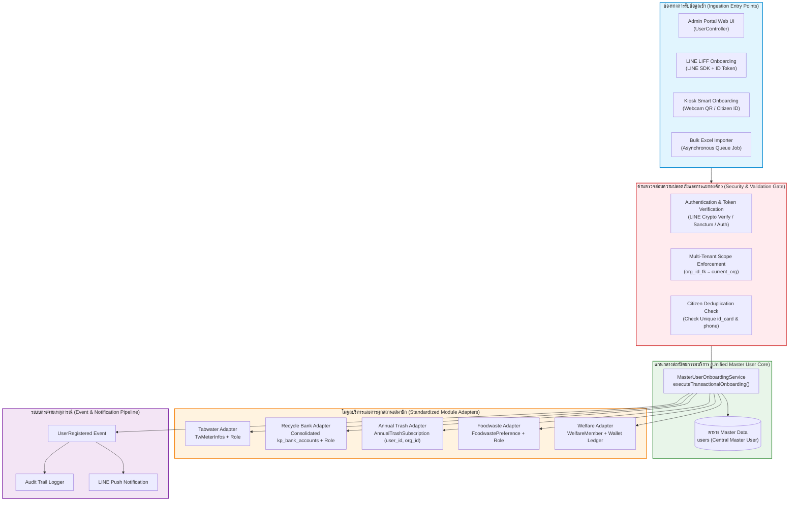

# รายงานการตรวจสอบสถาปัตยกรรมและการปรับปรุงกระบวนการลงทะเบียนผู้ใช้งานและสมาชิกข้ามโมดูล
## Comprehensive Architectural Audit & Target Refactoring Blueprint: User Registration & Cross-Module Membership Workflows
**ระบบบริหารจัดการสิ่งแวดล้อมท้องถิ่นอัจฉริยะ (QA Envsogo PIOS - Laravel 9 / PHP 8.2+)**

---

## สารบัญ (Table of Contents)
1. [บทสรุปผู้บริหาร (Executive Summary)](#1-บทสรุปผู้บริหาร-executive-summary)
2. [กระบวนการลงทะเบียนผู้ใช้และสมาชิกแบบ End-to-End ครบทั้ง 8 โมดูล](#2-กระบวนการลงทะเบียนผู้ใช้และสมาชิกแบบ-end-to-end-ครบทั้ง-8-โมดูล)
   - [2.1 Admin Core User Management](#21-admin-core-user-management)
   - [2.2 Tabwater Module (ระบบน้ำประปา)](#22-tabwater-module-ระบบน้ำประปา)
   - [2.3 KeptKaya / Recycle Bank Module (ระบบธนาคารขยะรีไซเคิล)](#23-keptkaya--recycle-bank-module-ระบบธนาคารขยะรีไซเคิล)
   - [2.4 Annual Trash Module (ระบบขยะมูลฝอยประจำปีและถังขยะ)](#24-annual-trash-module-ระบบขยะมูลฝอยประจำปีและถังขยะ)
   - [2.5 Foodwaste Module (ระบบขยะเปียกและถังขยะอินทรีย์อัจฉริยะ)](#25-foodwaste-module-ระบบขยะเปียกและถังขยะอินทรีย์อัจฉริยะ)
   - [2.6 Welfare Module (ระบบกองทุนสวัสดิการและฌาปนกิจชุมชน)](#26-welfare-module-ระบบกองทุนสวัสดิการและฌาปนกิจชุมชน)
   - [2.7 LINE LIFF Citizen Onboarding (ระบบลงทะเบียนประชาชนผ่าน LINE LIFF)](#27-line-liff-citizen-onboarding-ระบบลงทะเบียนประชาชนผ่าน-line-liff)
   - [2.8 Kiosk Self-Registration & Transactions (ระบบตู้คีออสอัจฉริยะ)](#28-kiosk-self-registration--transactions-ระบบตู้คีออสอัจฉริยะ)
3. [การวิเคราะห์ความสับสน ความซ้ำซ้อน และคอขวดในกระบวนการ (Confusion, Duplication & UX/Workflow Bottlenecks)](#3-การวิเคราะห์ความสับสน-ความซ้ำซ้อน-และคอขวดในกระบวนการ)
   - [3.1 เส้นทางการลงทะเบียนที่แตกกระจายและไร้ศูนย์กลาง (Fragmented Onboarding Paths)](#31-เส้นทางการลงทะเบียนที่แตกกระจายและไร้ศูนย์กลาง)
   - [3.2 ภาวะสคีมาบัญชีซ้ำซ้อน 5 ตารางในธนาคารขยะ (5 Competing Recycle Bank Schemas)](#32-ภาวะสคีมาบัญชีซ้ำซ้อน-5-ตารางในธนาคารขยะ)
   - [3.3 ปัญหาการนำเข้าข้อมูลแบบกลุ่ม (Bulk / Excel Import Defects)](#33-ปัญหาการนำเข้าข้อมูลแบบกลุ่ม)
   - [3.4 ความไม่สอดคล้องของสถานะ สิทธิ์ บทบาท (Roles) และข้อมูลภูมิศาสตร์ (Zoning Desync)](#34-ความไม่สอดคล้องของสถานะ-สิทธิ์-บทบาท-และข้อมูลภูมิศาสตร์)
4. [แผนภาพเปรียบเทียบกระบวนการ As-Is vs To-Be (Mermaid Diagrams)](#4-แผนภาพเปรียบเทียบกระบวนการ-as-is-vs-to-be-mermaid-diagrams)
   - [4.1 สถาปัตยกรรมและกระบวนการปัจจุบัน (Current As-Is Fragmented Workflow)](#41-สถาปัตยกรรมและกระบวนการปัจจุบัน)
   - [4.2 สถาปัตยกรรมและกระบวนการเป้าหมาย (Target To-Be Unified Workflow)](#42-สถาปัตยกรรมและกระบวนการเป้าหมาย)
5. [ตารางผลการตรวจสอบโค้ด บั๊ก ความปลอดภัย และความเข้ากันได้กับ PHP 8.2+ (Audit Findings Matrix)](#5-ตารางผลการตรวจสอบโค้ด-บั๊ก-ความปลอดภัย-และความเข้ากันได้กับ-php-82-audit-findings-matrix)
6. [ข้อเสนอสถาปัตยกรรมระบบและแผนการ Refactor ทีละขั้นตอน (To-Be Architecture & Phased Refactoring Plan)](#6-ข้อเสนอสถาปัตยกรรมระบบและแผนการ-refactor-ทีละขั้นตอน)
   - [Phase 1: การแก้ไขข้อผิดพลาดวิกฤตและความปลอดภัยทันที (Emergency Hotfixes)](#phase-1-การแก้ไขข้อผิดพลาดวิกฤตและความปลอดภัยทันที-emergency-hotfixes)
   - [Phase 2: การรวมศูนย์โครงสร้างตารางข้อมูลและการโอนย้ายข้อมูล (Schema Consolidation & Migration)](#phase-2-การรวมศูนย์โครงสร้างตารางข้อมูลและการโอนย้ายข้อมูล-schema-consolidation--migration)
   - [Phase 3: สถาปัตยกรรม Master User Onboarding Service (Unified Architecture & Code Implementation)](#phase-3-สถาปัตยกรรม-master-user-onboarding-service)
   - [Phase 4: สัญญาและมาตรฐานการผูกสมาชิกของแต่ละโมดูล (Module Attachment Contract & Events)](#phase-4-สัญญาและมาตรฐานการผูกสมาชิกของแต่ละโมดูล)
   - [Phase 5: การรวมศูนย์ระบบนำเข้าข้อมูลผ่าน Queue Worker (Unified Async Bulk Import)](#phase-5-การรวมศูนย์ระบบนำเข้าข้อมูลผ่าน-queue-worker)
7. [การยืนยันผลการตรวจสอบแบบไม่ทำลาย (Non-Destructive Audit Verification)](#7-การยืนยันผลการตรวจสอบแบบไม่ทำลาย-non-destructive-audit-verification)

---

## 1. บทสรุปผู้บริหาร (Executive Summary)

ระบบ `qa_envsogo_pios` เป็นแพลตฟอร์มบริหารจัดการสิ่งแวดล้อมและการให้บริการสาธารณะระดับองค์กรปกครองส่วนท้องถิ่น (อปท.) พัฒนาบนพื้นฐานของ Laravel Framework (เวอร์ชัน 9.52.22) และทำงานอยู่บนสภาพแวดล้อมรันไทม์ PHP 8.2+ ระบบประกอบด้วย 8 โมดูลหลักที่ให้บริการแก่ประชาชน ได้แก่ การจัดการผู้ใช้งานส่วนกลาง (Admin Core User), ระบบน้ำประปาชนบท (Tabwater), ระบบธนาคารขยะรีไซเคิล (KeptKaya), ระบบค่าธรรมเนียมขยะมูลฝอยประจำปี (Annual Trash), ระบบขยะเศษอาหารอินทรีย์ (Foodwaste), ระบบกองทุนสวัสดิการชุมชนและฌาปนกิจ (Welfare), ระบบบริการประชาชนผ่าน LINE (LINE LIFF), และระบบตู้รับฝากขยะอัตโนมัติ (Kiosk)

จากการตรวจสอบเชิงลึกแบบครอบคลุมทั้งซอร์สโค้ด สคีมาฐานข้อมูล เส้นทาง (Routes) ระบบความปลอดภัย การทำงานของฐานข้อมูลแบบ Multi-tenant และความเข้ากันได้กับ PHP 8.2+ พบว่า **สถาปัตยกรรมการลงทะเบียนผู้ใช้งานและการผูกสถานะสมาชิก (User Registration & Membership Onboarding) ประสบปัญหาความล้มเหลวเชิงโครงสร้าง (Architectural Breakdown) อย่างรุนแรง** ส่งผลกระทบต่อทั้งความมั่นคงปลอดภัย ความถูกต้องของข้อมูล และความสามารถในการให้บริการจริง ดังนี้:

### 1.1 ความเสี่ยงด้านความปลอดภัยระดับวิกฤต (Critical Security Vulnerabilities)
- **ช่องโหว่ Authentication Bypass & Instant Account Takeover (CVSS 9.8):** ใน `LineLiffController::dashboard` มีการเรียก `Auth::login($user)` โดยตรงจาก URL Parameter (`/line/dashboard/{pref_id}/{org_id}`) โดยไม่มีการตรวจสอบ LINE ID Token, รหัสผ่าน หรือสิทธิ์ใดๆ ทำให้บุคคลภายนอกสามารถเข้าสู่ระบบเป็นผู้ดูแลระบบหรือประชาชนคนใดก็ได้ในฐานข้อมูลทันทีเพียงระบุตัวเลข ID
- **การเชื่อมบัญชี LINE โดยไม่มี OTP (Insecure Account Hijacking):** ฟังก์ชัน `Api\LineController::verifyUser` และ `LineLiffController::update_user_by_phone` อนุญาตให้ประชาชนหรือผู้ไม่หวังดีระบุเพียงเบอร์โทรศัพท์หรือเลขบัตรประชาชน 13 หลัก เพื่อผูกสิทธิ์ LINE เข้ากับบัญชีนั้นทันทีโดยไม่มีการส่ง SMS OTP ยืนยันตัวตน
- **การรั่วไหลของข้อมูลระหว่างเทศบาล (Multi-Tenancy Isolation Failure):** ในคอนโทรลเลอร์หลายตัว เช่น `UserWasteController::index`, `AdminMemberWasteController::index`, และ `AnnualTrashAdminController::index` ไม่มีการใส่เงื่อนไขกรององค์กร (`org_id_fk`) ส่งผลให้แอดมินของ อปท. หนึ่งสามารถมองเห็น ค้นหา และจัดการข้อมูลประชาชนของ อปท. อื่นทั่วประเทศได้
- **ช่องโหว่ IDOR ในการลบสมาชิกข้ามเทศบาล:** ใน `WelfareMemberController::destroy` สั่งลบสมาชิกตาม ID โดยไม่ตรวจสอบ `org_id_fk` ส่งผลให้แอดมินจาก อปท. ก. สามารถส่งคำสั่งลบสมาชิกของ อปท. ข. ได้อย่างถาวร

### 1.2 ข้อผิดพลาดระดับรันไทม์ที่ทำให้ระบบหยุดทำงาน (Fatal Runtime & PHP 8.2+ Bugs)
- **PHP 8.2 Fatal Variable-variable Crash:** ใน `UserController::attachMeter` มีการเขียนโค้ด `'meter_id' => $$user->id` ซึ่งใน PHP 8.2 จะประเมินค่าเป็นตัวแปรแบบ dynamic variable ที่ไม่มีอยู่จริง ทำให้การผูกมิเตอร์ประปาผ่านหน้าแก้ไขผู้ใช้ล้มเหลว 100%
- **PHP 8.2 Fatal Null Property Dereference:** ใน `LineLiffController::user_line_register` มีการเรียก `$user->org->id` ทั้งที่โมเดล `User` ไม่มี Relation หรือ Property ชื่อ `org` (มีเพียง `organization()`) ส่งผลให้เกิด Exception: `Attempt to read property "id" on null` ทำให้การลงทะเบียนผ่าน LINE LIFF ล้มเหลวและ Rollback ข้อมูลทิ้งทั้งหมด
- **Undefined Relationship Method Crash:** มีการเรียก `$user->wastePreference()` ใน `UserFoodWasteController::store`, `UserWasteController::store`, และ `UserWasteStatusService::updateOverallUserWasteStatus` ซึ่งไม่มีเมธอดนี้อยู่ในคลาส `User` (มีเพียง `kpUserPreference`) ส่งผลให้เกิด `BadMethodCallException` ทุกครั้งที่สร้างผู้ใช้รายคน
- **Fatal SQL Error ในระบบตัดเงินสวัสดิการอัตโนมัติ (Welfare Auto-Deduction):** ใน `WelfareController::processAutoDeductionAndNotify` มีการสั่งลดเงินผ่าน `$member->decrement('wallet_balance', $fee)` แต่ตาราง `users` ไม่มีคอลัมน์ `wallet_balance` ทำให้เกิดข้อผิดพลาด `SQLSTATE[42S22]: Column not found: 1054` ส่งผลให้กระบวนการอนุมัติจ่ายเงินฌาปนกิจล้มเหลวและถูก Rollback ทั้งหมด ไม่สามารถจ่ายเงินสวัสดิการได้จริง
- **Fatal SQL Error ในการตรวจสอบสิทธิ์สวัสดิการ:** ใน `UserWelfareController::checkEligibility` มีการสั่งรวมค่าน้ำหนักขยะผ่าน `sum('weight')` บนตาราง `kp_purchase_transactions` ทั้งที่ชื่อคอลัมน์จริงคือ `total_weight` ทำให้หน้าจอตรวจสอบคุณสมบัติพังทันที
- **Broken Route Parameter `{}`:** การนิยาม `Route::resource('/', ...)` ภายใต้ Route Group ที่มี Prefix ใน `routes/admin.php` และ `routes/keptkaya_route.php` ทำให้ Laravel Route Compiler คอมไพล์ได้ URI เป็น `admin/super_users/{}` ส่งผลให้ลิงก์แก้ไขและดูรายละเอียดเกิด Error ทันที

### 1.3 ภาวะข้อมูลแตกกระจายและการทำงานไม่เชื่อมต่อกัน (Data Fragmentation & Mock State)
- **สคีมาบัญชีธนาคารขยะซ้ำซ้อน 5 ตาราง:** พบว่าระบบมีตารางบันทึกบัญชีขยะรีไซเคิลถึง 5 ตารางที่ทำงานขนานกันโดยไม่เชื่อมโยงกัน (`kp_recycle_bank_members`, `kp_bank_accounts`, `recycle_bank_accounts`, `kp_user_waste_preferences`, `kp_accounts`) การสร้างสมาชิกจากช่องทางหนึ่งจะไม่ปรากฏในอีกช่องทางหนึ่ง เช่น การนำเข้าผ่าน Excel บันทึกลง `recycle_bank_accounts` แต่หน้าแอดมินและโมเดล User ผูกกับ `kp_bank_accounts` ทำให้ผู้ใช้ที่นำเข้าผ่าน Excel มีสถานะเป็น "ไม่ใช่สมาชิก" ทันที
- **ระบบตู้ Kiosk ค้างอยู่ในสถานะ Mock Data:** ฟังก์ชันการบันทึกรายการขยะที่ตู้ Kiosk ใน `Api\KioskController::submitTransaction` มีการฮาร์ดโค้ด `$userId = 10;` และใน `KioskController::storeTransaction` มีการฮาร์ดโค้ด `kp_user_w_pref_id_fk = 13` ทำให้รายการขยะทุกชิ้นที่ประชาชนหยอดเข้าตู้ถูกโอนแต้มและเงินเข้าบัญชีผู้ใช้ ID 10 เพียงคนเดียวทั้งระบบ อีกทั้งไม่มีฟอร์มลงทะเบียนและไม่มีฮาร์ดแวร์ Smart Card Reader ในโค้ดจริง

รายงานฉบับนี้จะเจาะลึกกระบวนการทั้ง 8 โมดูล วิเคราะห์สาเหตุแห่งปัญหา จัดทำแผนภาพสถาปัตยกรรม As-Is vs To-Be รวบรวมตารางการตรวจสอบบั๊กและช่องโหว่แบบรายบรรทัด (Findings Matrix) พร้อมทั้งนำเสนอแผนแม่บทการ Refactor สถาปัตยกรรมสู่ **Master User Onboarding Service** แบบ 5 ระยะที่สามารถนำไปปฏิบัติจริงได้อย่างปลอดภัยและเป็นรูปธรรม

---

## 2. กระบวนการลงทะเบียนผู้ใช้และสมาชิกแบบ End-to-End ครบทั้ง 8 โมดูล

```
                               ┌────────────────────────────────┐
                               │       Master User (users)      │
                               │   id, org_id_fk, id_card, ...  │
                               └───────────────┬────────────────┘
                                               │
       ┌───────────────┬───────────────┬───────┴───────┬───────────────┬───────────────┐
       ▼               ▼               ▼               ▼               ▼               ▼
┌──────────────┐┌──────────────┐┌──────────────┐┌──────────────┐┌──────────────┐┌──────────────┐
│ 2.1 Core     ││ 2.2 Tabwater ││ 2.3 KeptKaya ││ 2.4 Annual   ││ 2.5 Foodwaste││ 2.6 Welfare  │
│ User/Profile ││ tw_meter_    ││ kp_bank_acc /││ annual_trash_││ foodwaste_   ││ welfare_     │
│ UserDetail   ││ infos        ││ kp_recycle_..││ subscriptions││ preferences  ││ members      │
└──────────────┘└──────────────┘└──────────────┘└──────────────┘└──────────────┘└──────────────┘
                                               ▲
                               ┌───────────────┴───────────────┐
                               │                               │
                       ┌───────────────┐               ┌───────────────┐
                       │ 2.7 LINE LIFF │               │ 2.8 Kiosk     │
                       │ LineLiff-     │               │ KioskApi-     │
                       │ Controller    │               │ Controller    │
                       └───────────────┘               └───────────────┘
```

---

### 2.1 Admin Core User Management
การบริหารจัดการบัญชีผู้ใช้งานส่วนกลางขององค์กร ถือเป็นหัวใจหลักในการกำหนดตัวตน สิทธิ์ และการเข้าถึงระบบ

#### โครงสร้างไฟล์และสถาปัตยกรรมที่เกี่ยวข้อง:
- **Controller:** `app/Http/Controllers/Admin/UserController.php` (828 บรรทัด)
- **Controller อื่นที่ซ้ำซ้อน:** `app/Http/Controllers/Admin/SuperUserController.php`, `app/Http/Controllers/Auth/RegisteredUserController.php`
- **Service:** `app/Services/UserService.php`, `app/Services/UserWasteStatusService.php`
- **Model:** `app/Models/User.php`, `app/Models/Admin/UserProfile.php`
- **Excel Import/Export:** `app/Imports/UserImport.php`, `app/Exports/UserTemplateExport.php`
- **Route:** `routes/admin.php`, `routes/web.php` (Prefix: `admin/users`)

#### การวิเคราะห์เส้นทางการสร้างผู้ใช้ (User Onboarding Paths):
1. **การสร้างผู้ใช้รายคนโดยแอดมิน (`UserController::store` บรรทัด 325–407):**
   - แอดมินกรอกข้อมูลผ่านฟอร์ม `admin/users/create`: ชื่อ, นามสกุล, ชื่อผู้ใช้ (`username`), รหัสผ่าน, โซน (`zone_id`), ชุมชนย่อย (`subzone_id`), เลขบัตรประชาชน (`id_card`), เบอร์โทรศัพท์ และติ๊กเลือกสวิตช์บริการ 3 ตัว: `svc_recycle`, `svc_food_waste`, `svc_annual_trash`
   - ระบบเริ่ม `DB::beginTransaction()` และบันทึกข้อมูลลงตาราง `users` โดยกำหนด `org_id_fk = Auth::user()->org_id_fk`, `status = 'active'`
   - ทำการผูก Role ส่วนกลาง: `$user->assignRole('User')`
   - เรียกใช้งาน `UserService::syncUserServices($user, $serviceData)` เพื่อสร้างเรคอร์ดบัญชีบริการขยะ:
     - หากเลือก `svc_recycle`: สร้าง `KpBankAccount` (`entity_type = 'recycle_bank'`) กำหนดเลขบัญชี `RC-ORG-USER`, สร้าง `KpUserWastePreference` (`is_recycle_bank = 1`), และมอบบทบาท Spatie `'Recycle Bank User'`
     - หากเลือก `svc_food_waste`: สร้าง `FoodWasteAccount` และ `FoodWasteUserPreference` (`is_food_waste = 1`) แต่ **ไม่ได้มอบบทบาท Spatie ใดๆ**
     - หากเลือก `svc_annual_trash`: สร้าง `AnnualTrashSubscription` (คิดค่าธรรมเนียมตามปีงบประมาณและรอบเดือน) และมอบบทบาท Spatie `'Annual Trash User'`
   - **ข้อบกพร่องสำคัญ:** ฟอร์มนี้ **ไม่สามารถเพิ่มหรือผูกมิเตอร์น้ำประปา (Tabwater) ได้** หากผู้ใช้ต้องการใช้น้ำประปา แอดมินต้องบันทึกผู้ใช้ให้เสร็จก่อน แล้วกดเข้ามาหน้าแก้ไข (`edit`) เพื่อผูกมิเตอร์ หรือต้องออกจากเมนูนี้แล้วสลับไปที่โมดูลน้ำประปา
2. **การผูกมิเตอร์ประปาผ่านหน้าแก้ไขผู้ใช้ (`UserController::attachMeter` บรรทัด 531–568):**
   - มีการเขียนไวยากรณ์ผิดพลาดอย่างร้ายแรงที่บรรทัด 548:
     ```php
     TwMeterInfos::create([
         'meter_id'             => $$user->id, // ❌ ไวยากรณ์ Variable-variable ผิดพลาด
         'user_id'              => $user->id,
         'org_id_fk'            => $orgId,
         'meternumber'          => $request->meternumber,
         ...
     ]);
     ```
     ใน PHP 8.2+ โค้ด `$$user->id` จะพยายามเข้าถึงตัวแปรที่มีชื่อตรงกับตัวเลข ID (เช่น `$1`) ซึ่งไม่มีอยู่จริง ส่งผลให้เกิด Error และค่ากลายเป็น `null` การผูกมิเตอร์จึงล้มเหลวทันที และที่สำคัญฟังก์ชันนี้ **ไม่ได้มอบ Role `'Tabwater User'`** ให้แก่ผู้ใช้
3. **การลงทะเบียนผู้ใช้แบบสาธารณะซ้ำซ้อน 2 ช่องทาง:**
   - ช่องทางที่ 1: `routes/web.php:229` เรียก `UserController::register` (บรรทัด 739–774) รับค่าฟิลด์ `organization_id` แต่ในโมเดล `User::$fillable` มีเพียง `org_id_fk` ทำให้ค่าถูกทิ้งโดย Mass Assignment Protection ผู้ใช้ที่ลงทะเบียนเข้ามาจึงมี `org_id_fk = null` กลายเป็นผู้ใช้ตกสำรวจ
   - ช่องทางที่ 2: `routes/auth.php:14` เรียก `RegisteredUserController::store` ซึ่งพบว่ามี **การฮาร์ดโค้ดข้อมูลจำลอง (Hardcoded Dummy Data)** ไว้อย่างชัดเจนที่บรรทัด 48–56:
     ```php
     'id_card' => '111111111',
     'phone' => '0999999999',
     'gender' => 'm',
     'address' => 'x',
     'zone_id' => '0',
     'subzone_id' => '0',
     ```
     หากประชาชนลงทะเบียนผ่านหน้า Breeze สมาชิกทุกคนจะได้เลขบัตรประชาชน `111111111` ซ้ำกันทันที ส่งผลให้เกิดข้อผิดพลาด SQL Duplicate Key หากมีการลงทะเบียนคนที่สอง
4. **โค้ดอันตรายตกค้างใน Controller (`UserController::_index` บรรทัด 240–243):**
   ```php
   DB::statement('SET FOREIGN_KEY_CHECKS=0;');
   KpUserWastePreference::truncate();
   KpBankAccount::truncate();
   DB::statement('SET FOREIGN_KEY_CHECKS=1;');
   ```
   มีคำสั่งสั่งล้างตารางบัญชีและสถานะขยะทั้งหมดของทุกองค์กรหลงเหลืออยู่ในคอนโทรลเลอร์ ซึ่งเป็นความเสี่ยงระดับหายนะหากมีผู้ดูแลระบบเผลอเรียกใช้งาน

---

### 2.2 Tabwater Module (ระบบน้ำประปา)
ระบบน้ำประปาชนบททำหน้าที่บริหารจัดการข้อมูลผู้ใช้น้ำ มิเตอร์น้ำ เส้นทางการอ่านมิเตอร์ และการออกใบแจ้งหนี้ค่าน้ำ

#### โครงสร้างไฟล์และโมเดล:
- **Controller:** `app/Http/Controllers/Tabwater/UserMeterInfosController.php` (614 บรรทัด)
- **Model:**
  - `app/Models/Tabwater/TwMeterInfos.php` (ชี้ไปที่ตาราง `tw_meter_infos` มี Trait `BelongsToOrganization`)
  - `app/Models/Tabwater/TwUsersInfos.php` (ชี้ไปที่ตาราง `tw_meter_infos` ไม่มี Trait)
  - `app/Models/Tabwater/TwUsersInfo.php` (ชี้ไปที่ตาราง `tw_users_infos` โมเดลดั้งเดิมที่ตกค้าง)
- **Route:** `routes/web.php` (บรรทัด 496–510, Prefix: `tabwater/members`)

#### กระบวนการ Onboarding สมาชิกน้ำประปา:
1. **การลงทะเบียนสมาชิกประปา (`create` & `bulkStore` บรรทัด 388–470):**
   - ที่หน้า `tabwater/members/add` ระบบ **ไม่มีฟังก์ชันสร้าง Master User ใหม่**
   - ระบบจะดึงรายชื่อประชาชนทั้งหมดใน อปท. จากตาราง `users` (`User::where('org_id_fk', $orgId)`) มาแสดงเป็นตารางพร้อม Checkbox
   - เจ้าหน้าที่ติ๊กเลือกรายชื่อประชาชนที่ต้องการเปิดใช้น้ำ แล้วกดยืนยัน ระบบจะทำงานใน `bulkStore`:
     1. เปิด `DB::beginTransaction()`
     2. ค้นหาเลขมิเตอร์ล่าสุด `TwMeterInfos::where('org_id_fk', $orgId)->max('meternumber')` แล้วบวกเพิ่มทีละ 1
     3. บันทึกข้อมูลลงตาราง `tw_meter_infos` ผูกกับ `user_id` และกำหนดสถานะ `status = 'active'`
     4. มอบบทบาท: `$user->assignRole('Tabwater User')`
     5. ทำการ `DB::commit()`
2. **การเพิ่มมิเตอร์ตัวที่สองสำหรับบ้านหรืออาคารอื่น (`addMeter` & `storeAdditionalMeter` บรรทัด 506–562):**
   - รองรับความสัมพันธ์แบบ 1-to-Many โดยประชาชน 1 คนสามารถมีมิเตอร์น้ำได้หลายตัว โดยระบบจะสร้างเรคอร์ดใหม่ใน `tw_meter_infos` ที่ชี้ไปยัง `user_id` เดิม
3. **ปัญหาเส้นทางและเมธอดที่ไม่มีอยู่จริง (Broken Route):**
   - ใน `routes/web.php` บรรทัด 392:
     ```php
     Route::post('/store_edited_invoice', [UserMeterInfosController::class, 'store_edited_invoice'])->name('store_edited_invoice');
     ```
     เมื่อตรวจสอบใน `UserMeterInfosController` พบว่า **ไม่มีเมธอด `store_edited_invoice` อยู่จริง** ส่งผลให้เกิด Exception ทันทีที่มีการส่งฟอร์มแก้ไขใบแจ้งหนี้ค่าน้ำประปา
4. **ความไม่สอดคล้องในการเพิกถอนสิทธิ์ (Revocation Inconsistency):**
   - ใน `UserMeterInfosController::destroy` (บรรทัด 472–504) เมื่อลบมิเตอร์ออก ระบบจะตรวจสอบว่าผู้ใช้เหลือมิเตอร์อื่นอีกหรือไม่ หากไม่เหลือ จะทำการปลดสิทธิ์ `$user->removeRole('Tabwater User')` อย่างถูกต้อง
   - แต่ใน `UserController::destroy` (บรรทัด 641–701) เมื่อแอดมินลบผู้ใช้หรือมิเตอร์ผ่านหน้า User Admin ระบบกลับ **ไม่ได้ถอด Role 'Tabwater User' ออก**

---

### 2.3 KeptKaya / Recycle Bank Module (ระบบธนาคารขยะรีไซเคิล)
ระบบธนาคารขยะรีไซเคิลทำหน้าที่รับซื้อขยะ สะสมคะแนน ออมเงิน และเชื่อมต่อกับการจ่ายเงินสวัสดิการชุมชน

#### โครงสร้างไฟล์และสถาปัตยกรรม:
- **Controllers:**
  - `app/Http/Controllers/KeptKaya/RecycleBankController.php` (จัดการสมาชิกและประวัติการซื้อขยะ)
  - `app/Http/Controllers/KeptKaya/UserWasteController.php` (จัดการผู้ใช้งานและสิทธิ์บริการขยะ)
  - `app/Http/Controllers/KeptKaya/KpPurchaseController.php` (จุดรับซื้อขยะและบันทึกธุรกรรม)
- **Models & Tables ที่ขัดแย้งกันอย่างสิ้นเชิง:**
  1. `KpRecycleBankMember` ชี้ไปที่ตาราง `kp_recycle_bank_members`
  2. `KpBankAccount` ชี้ไปที่ตาราง `kp_bank_accounts`
  3. `RecycleBankAccount` ชี้ไปที่ตาราง `recycle_bank_accounts`
  4. `KPAccounts` ชี้ไปที่ตาราง `kp_accounts`
  5. `KpUserWastePreference` ชี้ไปที่ตาราง `kp_user_waste_preferences`

#### ภาวะการลงทะเบียนที่ขาดออกจากกัน (Disconnected Workflows):
พบว่ามีเส้นทางการลงทะเบียนสมาชิกธนาคารขยะ 3 ทางที่ขัดแย้งกันและทำให้ระบบพัง:

```
[ช่องทาง A: RecycleBankController::bulkStore]
   │
   ├─► สร้าง `kp_recycle_bank_members` (member_number = RB00001)
   ├─► มอบ Role 'Recycle Bank User'
   └─► ❌ ไม่สร้าง `kp_bank_accounts` และไม่สร้าง `kp_user_waste_preferences`!

[ช่องทาง B: UserWasteController::store (batch_select)]
   │
   ├─► สร้าง `kp_user_waste_preferences` (is_recycle_bank = 1)
   ├─► สร้าง `kp_bank_accounts` (account_no = RC-ORG-USER)
   ├─► มอบ Role 'Recycle Bank User'
   └─► ❌ ไม่สร้าง `kp_recycle_bank_members`!

[ผลลัพธ์เมื่อรถรับซื้อขยะเปิดหน้างาน]:
   │
   └─► `KpPurchaseController::select_user` ค้นหาด้วย:
       `whereHas('kpRecycleBankMember', fn($q) => $q->where('status', 'active'))`
       ทำให้ประชาชนที่ลงทะเบียนจากช่องทาง B "ล่องหน" ซื้อขายขยะไม่ได้ทันที!
```

1. **ช่องทาง A (`RecycleBankController::bulkStore` บรรทัด 70–116):**
   - แอดมินเลือก Master User แล้วกดบันทึก ระบบจะสร้างข้อมูลลงตาราง `kp_recycle_bank_members` และมอบบทบาท `'Recycle Bank User'` แต่ **ไม่สร้างบัญชีธนาคารในตาราง `kp_bank_accounts` หรือ `kp_user_waste_preferences`**
2. **ช่องทาง B (`UserWasteController::store` บรรทัด 198–269):**
   - ในโหมด Batch Select: สร้าง `kp_user_waste_preferences` และสร้าง `kp_bank_accounts` แต่ **ไม่ได้สร้างเรคอร์ดใน `kp_recycle_bank_members`**
   - ส่งผลให้เมื่อเจ้าหน้าที่รถขยะเปิดหน้าบันทึกการรับซื้อ (`KpPurchaseController::select_user` บรรทัด 38–40) ระบบมีการเขียนเงื่อนไขกรอง:
     ```php
     ->whereHas('kpRecycleBankMember', function ($q) use ($orgId) { 
         $q->where('org_id_fk', $orgId)->where('status', 'active'); 
     })
     ```
     ทำให้ **รายชื่อประชาชนที่ลงทะเบียนผ่านช่องทาง B ไม่ปรากฏในหน้ารับซื้อขยะเลยแม้แต่คนเดียว!**
   - ในโหมด Manual New User: มีการเรียก `$user->wastePreference()->create(...)` ซึ่งไม่มี Relation นี้บน `User` ทำให้พังด้วย `BadMethodCallException` 100%
3. **ช่องทาง C (`app/Imports/UserImport.php`):**
   - การนำเข้าผู้ใช้ผ่าน Excel บันทึกลงตาราง `recycle_bank_accounts` และตั้งค่าฟิลด์ `'is_waste_bank' => 1` ซึ่งไม่มีใน `$fillable` ของ `KpUserWastePreference` ส่งผลให้ข้อมูลถูกตัดทิ้ง และบัญชีถูกแยกขาดจากระบบหลัก
4. **ช่องโหว่ข้อมูลการซื้อขายรั่วไหลทั้งระบบ (`RecycleBankController::history` บรรทัด 137–143):**
   ```php
   $transactions = KpPurchaseTransaction::with(['details.item', 'details.unit', 'recorder'])
       ->whereHas('user.recycleBankAccount', function ($q) {
           $q->where('status', 'active');
       })
       ->whereBetween('transaction_date', [$startDate, $endDate])
       ->orderBy('transaction_date', 'desc')
       ->get();
   ```
   ในคำสั่ง Query **ไม่มีการระบุเงื่อนไข `where('user_id', $userId)` หรือ `where('org_id_fk', ...)` เลยแม้แต่น้อย!** เมื่อเปิดดูประวัติการซื้อขยะของสมาชิกคนใดคนหนึ่ง ระบบจะดึงธุรกรรมของสมาชิกทุกคนในทุกเทศบาลขึ้นมาแสดงทั้งหมด

---

### 2.4 Annual Trash Module (ระบบขยะมูลฝอยประจำปีและถังขยะ)
ระบบขยะมูลฝอยประจำปีทำหน้าที่จัดเก็บค่าธรรมเนียมขยะรายเดือน/รายปี และบันทึกข้อมูลถังขยะประจำครัวเรือน

#### โครงสร้างไฟล์และสถาปัตยกรรม:
- **Controllers:**
  - `app/Http/Controllers/Admin/AnnualTrashAdminController.php` (หน้าภาพรวมของผู้ดูแลระบบ)
  - `app/Http/Controllers/KeptKaya/AnnualTrashMemberController.php` (การขึ้นทะเบียนสมาชิกขยะรายปี)
  - `app/Http/Controllers/KeptKaya/AnnualTrashController.php` (การผูกถังขยะและการสร้าง Subscription)
  - `app/Http/Controllers/KeptKaya/AnnualTrashSubscriptionController.php` (การออกใบแจ้งหนี้และการบันทึกชำระเงิน)
- **ตารางที่ซ้ำซ้อน 3 ชุด:**
  1. `annual_trash_subscriptions` คู่กับ `annual_trash_payments`
  2. `kp_waste_bin_subscriptions` คู่กับ `waste_bin_payments`
  3. `waste_bin_subscriptions` คู่กับ `waste_bin_payments`

#### ปัญหากระบวนการและการ Crash บน PHP 8.2+:
1. **การลงทะเบียนแบบหลายขั้นตอนที่แยกขาดจากกัน (Fragmented Multi-step Lifecycle):**
   - ขั้นตอนที่ 1: `AnnualTrashMemberController::store` สร้างเรคอร์ดใน `annual_trash_members` กำหนดเลขสมาชิก `AT00001` และมอบ Role `'Annual Trash User'` แต่ขั้นตอนนี้ **ไม่มีการผูกถังขยะหรือสร้างยอดหนี้ค่าธรรมเนียม**
   - ขั้นตอนที่ 2: แอดมินต้องสลับไปที่ `AnnualTrashController::store` เพื่อบันทึกถังขยะลงตาราง `kp_waste_bins` และคำนวณค่าธรรมเนียมตามปีงบประมาณและรอบเดือนลงตาราง `annual_trash_subscriptions`
2. **บั๊กวิกฤต PHP 8.2 Fatal Error ในหน้าแอดมิน (`admin/annual_trash/index.blade.php` บรรทัด 22):**
   - ใน `AnnualTrashController::store` (บรรทัด 130–146) คำสั่ง `AnnualTrashSubscription::firstOrCreate` มีการส่งค่าฟิลด์ค่าธรรมเนียมครบถ้วน แต่ **ละเลยการบันทึก `user_id` และ `org_id_fk` (มีค่าเป็น `NULL`)**
   - ในไฟล์ Blade `resources/views/admin/annual_trash/index.blade.php` บรรทัด 22 มีการเรียก:
     ```html
     <td>{{ $sub->user->firstname }} {{ $sub->user->lastname }}</td>
     ```
     ใน PHP 8.2+ เมื่อ `$sub->user` เป็น `null` การเข้าถึง `$sub->user->firstname` จะเกิดข้อผิดพลาดระดับหายนะทันที:  
     `Fatal Error: Attempt to read property "firstname" on null`  
     ส่งผลให้หน้าจอภาพรวมค่าธรรมเนียมขยะรายปีของแอดมินล่มทันที 100%
3. **การละเมิดการแบ่งแยกข้อมูลข้ามเทศบาลโดยสมบูรณ์ (`AnnualTrashAdminController::index` บรรทัด 13–24):**
   - คำสั่งคิวรีในคอนโทรลเลอร์ไม่มีการใส่เงื่อนไข `where('org_id_fk', ...)` แอดมินของเทศบาลใดก็ตามสามารถดูและแก้ไขสถานะใบแจ้งหนี้ของประชาชนในเทศบาลอื่นได้ทั้งหมด

---

### 2.5 Foodwaste Module (ระบบขยะเปียกและถังขยะอินทรีย์อัจฉริยะ)
ระบบขยะเปียก/อาหารจัดเก็บข้อมูลพฤติกรรมการคัดแยกขยะอินทรีย์ และจับคู่ถังขยะอินทรีย์ประจำครัวเรือนกับกล่องตรวจวัด IoT

#### โครงสร้างไฟล์และสถาปัตยกรรม:
- **Controllers:**
  - `app/Http/Controllers/FoodWaste/UserFoodWasteController.php` (จัดการผู้ใช้งานและสิทธิ์บริการ)
  - `app/Http/Controllers/FoodWaste/UserMatchingAnnualTrashsController.php` (จับคู่ถังขยะและกล่อง IoT)
  - `app/Http/Controllers/FoodWaste/AdminMemberWasteController.php` (สรุปข้อมูลสถิติน้ำหนักขยะ)
- **Route:** `routes/foodwaste_route.php`

#### ปัญหาจากการคัดลอกโค้ดและข้อผิดพลาดเชิงโครงสร้าง (Copy-Paste Artifacts):
1. **โค้ดที่คัดลอกมาจาก KeptKaya โดยตรง:**
   - ใน `UserFoodWasteController.php` บรรทัด 282–314 มีการประกาศฟังก์ชันชื่อ `public function aa(Request $request)` ซึ่งคัดลอกมาจาก `KeptKaya\UserWasteController.php` บรรทัด 387 ทั้งดุ้น โดยทำหน้าที่เปิดปิดค่า `is_annual_collection` และ `is_recycle_bank` ซึ่งไม่มีความเกี่ยวข้องกับขยะเปียกเลยแม้แต่น้อย
   - ใน `UserFoodWasteController::store` (บรรทัด 153–177) มีการเรียก `User::create(['name' => ...])` ซึ่งล้มเหลวเพราะในตาราง `users` ไม่มีคอลัมน์ `name` (มี `firstname` และ `lastname`) จากนั้นเรียก `$user->wastePreference()->create(...)` ซึ่งไม่มี Relation นี้ และสุดท้ายสั่ง Redirect ไปยัง `route('users.index')` ซึ่งเป็น Route ที่ไม่มีอยู่จริงในระบบ เกิด `RouteNotFoundException` ทันที
2. **ความผิดพลาดในการ Binding Parameter บน Route:**
   - ใน `routes/foodwaste_route.php` บรรทัด 99–104 กำหนด Parameter เป็น `/{wasteBin}/waste-bins` แต่ในคอนโทรลเลอร์ `UserMatchingAnnualTrashsController::store` (บรรทัด 50) ระบุพารามิเตอร์เป็น `public function store(Request $request, User $w_user)` ทำให้ Laravel Route Model Binding ไม่สามารถแมปออบเจกต์ผู้ใช้ได้ เกิดข้อผิดพลาดในการประมวลผล
3. **ไวยากรณ์ Model Cast ผิดพลาดใน PHP 8.2+:**
   - ในโมเดล `app/Models/FoodWaste/FoodWasteUserPreference.php` บรรทัด 26–28 มีการกำหนด:
     ```php
     protected $casts = [
         'user_id',
     ];
     ```
     ใน Laravel / PHP 8.2+ พร็อพเพอร์ตี้ `$casts` จะต้องเป็น Associative Array ที่ระบุประเภทข้อมูล (`'user_id' => 'integer'`) การระบุเป็น Index Array จะส่งผลให้เกิด Warning/Error ทันทีที่มีการดึงหรือบันทึกข้อมูล
4. **ไม่มีการกำหนด Role สมาชิก:** สมาชิกที่เข้าร่วมโครงการขยะเปียกจะไม่มี Spatie Role ใดๆ ถูกผูกไว้กับบัญชี แตกต่างจากโมดูลอื่นที่มีบทบาทเฉพาะตัว

---

### 2.6 Welfare Module (ระบบกองทุนสวัสดิการและฌาปนกิจชุมชน)
ระบบกองทุนสวัสดิการชุมชนและฌาปนกิจขยะ ทำหน้าที่ขึ้นทะเบียนสมาชิก ตรวจสอบคุณสมบัติการส่งขยะ ยื่นเรื่องขอรับเงินสงเคราะห์ และกระบวนการอนุมัติหลายขั้นตอนพร้อมตัดเงินสะสมอัตโนมัติ

#### โครงสร้างไฟล์และสถาปัตยกรรม:
- **Controllers:**
  - `app/Http/Controllers/Admin/WelfareMemberController.php` (การลงทะเบียนสมาชิกกองทุน)
  - `app/Http/Controllers/Admin/UserWelfareController.php` (การตรวจสอบคุณสมบัติและยื่นคำขอรับเงิน)
  - `app/Http/Controllers/Admin/WelfareController.php` (แดชบอร์ดและการอนุมัติ Workflow จ่ายเงิน)
  - `app/Http/Controllers/Admin/WelfareConfigController.php` (การตั้งค่าเกณฑ์กองทุน)
- **Models:** `WelfareMember`, `WelfarePayout`, `WelfarePayoutLog`, `WelfareConfigs`, `KpSetting`
- **Route:** `routes/admin.php` (บรรทัด 54–84)

#### ปัญหาคอขวดและข้อผิดพลาดระดับ Fatal Crash:

```
[ขั้นตอนที่ 1: ลงทะเบียนสมาชิกกองทุน]
   WelfareMemberController::bulkStore -> บันทึกตาราง `welfare_members` (status = 'active')
   (❌ ไม่มี DB Transaction และไม่มีการมอบ Spatie Role ใดๆ)
         │
         ▼
[ขั้นตอนที่ 2: ตรวจสอบคุณสมบัติขอรับเงินฌาปนกิจ]
   UserWelfareController::checkEligibility
   -> นับเดือนที่สมัคร >= min_months
   -> รวมน้ำหนักขยะที่เคยขาย: KpPurchaseTransaction::sum('weight')
   (❌ FATAL SQL: คอลัมน์ `weight` ไม่มีจริง! ชื่อจริงคือ `total_weight` หน้าจอพังทันที!)
         │
         ▼
[ขั้นตอนที่ 3: ยื่นคำร้องและเข้าสู่กระบวนการอนุมัติหลายระดับ]
   WelfareController::approveStep -> ตรวจสอบตามลำดับขั้น ApprovalWorkflowStep
         │
         ▼
[ขั้นตอนที่ 4: ขั้นตอนสุดท้ายของการอนุมัติ - ตัดเงินสมาชิกทุกคนมาจ่ายสวัสดิการ]
   WelfareController::processAutoDeductionAndNotify
   -> วนลูปสมาชิกทุกคนในกองทุน: $member->decrement('wallet_balance', $fee)
   (❌ FATAL SQL: คอลัมน์ `wallet_balance` ไม่มีในตาราง users!
    Transaction ล่มและ Rollback ทั้งหมด ไม่สามารถอนุมัติจ่ายเงินสวัสดิการได้จริง 100%!)
```

1. **บั๊กคอลัมน์ไม่มีอยู่จริงทำให้ตัดเงินล้มเหลว (Fatal SQL Error):**
   - ใน `WelfareController.php` บรรทัด 230–234 และ 439–444:
     ```php
     $userWallet = $member->wallet_balance ?? 0;
     if ($userWallet >= $fee) {
         $member->decrement('wallet_balance', $fee);
     ```
     ในโมเดล `User` และตาราง `users` **ไม่มีคอลัมน์ `wallet_balance` อยู่จริง** (เงินของสมาชิกอยู่ใน `kp_recycle_bank_members.balance` หรือ `kp_bank_accounts.balance`) เมื่อโค้ดทำงานจะเกิด Exception: `Column not found: 1054 Unknown column 'wallet_balance' in 'field list'` เนื่องจากอยู่ในบล็อก Transaction ทำให้การอนุมัติจ่ายเงินล้มเหลวและถูก Rollback ทันที
2. **บั๊กคอลัมน์น้ำหนักขยะผิดพลาดในการตรวจสอบสิทธิ์ (Fatal SQL Error):**
   - ใน `UserWelfareController.php` บรรทัด 44–46 มีการสั่ง `KpPurchaseTransaction::where('user_id', $user->id)->sum('weight')` ซึ่งในตาราง `kp_purchase_transactions` คอลัมน์จริงคือ `total_weight` ทำให้หน้าจอตรวจสอบสิทธิ์ประชาชนขึ้นหน้าข้อผิดพลาดสีแดงทันที
3. **การแยกขาดของการบันทึกและการอ่านค่าคอนฟิก (Configuration Disconnect):**
   - หน้าตั้งค่าเกณฑ์สวัสดิการ `WelfareConfigController::updateConfig` (บรรทัด 61–66) บันทึกข้อมูลลงตาราง `kp_settings` (Key-Value)
   - แต่คอนโทรลเลอร์ที่ใช้ตรวจสอบจริง `UserWelfareController` (บรรทัด 28, 77) และ `WelfareController` (บรรทัด 66, 208) กลับไปอ่านข้อมูลจากตาราง `welfare_configs` (`WelfareConfigs` model)
   - **ผลกระทบ:** ไม่ว่าแอดมินจะแก้เกณฑ์เงินสงเคราะห์ เกณฑ์เดือน หรือเกณฑ์น้ำหนักในหน้า UI อย่างไร ค่าที่แก้ไขจะไม่ถูกนำไปใช้ในระบบเลยแม้แต่นิดเดียว
4. **ความสัมพันธ์บน User ขาดหาย:** ในโมเดล `app/Models/User.php` ไม่มีการประกาศความสัมพันธ์ใดๆ ไปยังโมดูล Welfare เลย (ไม่มี `welfareMember()`, `welfarePayouts()`) ทำให้ไม่สามารถใช้คำสั่ง `$user->welfareMember` ได้

---

### 2.7 LINE LIFF Citizen Onboarding (ระบบลงทะเบียนประชาชนผ่าน LINE LIFF)
ระบบลงทะเบียนประชาชนผ่าน LINE ทำหน้าที่ให้ประชาชนในท้องถิ่นสามารถลงทะเบียน ผูกเบอร์โทรศัพท์ ตรวจสอบยอดเงิน และดูประวัติการใช้น้ำประปาและการขายขยะผ่านสมาร์ทโฟน

#### โครงสร้างไฟล์และสถาปัตยกรรม:
- **Controllers ที่ทำงานทับซ้อนกัน:**
  - `app/Http/Controllers/LineLiffController.php` (386 บรรทัด, เรียกผ่าน Web Routes)
  - `app/Http/Controllers/Api/LineController.php` (703 บรรทัด, เรียกผ่าน API Routes)
- **Route:** `routes/web.php` (บรรทัด 165–204), `routes/api.php` (บรรทัด 96–138)

#### ปัญหาความปลอดภัยระดับวิกฤตและบั๊ก PHP 8.2+:
1. **ช่องโหว่ IDOR / Authentication Bypass (CVSS 9.8 - Critical):**
   - ใน `routes/web.php` บรรทัด 169 และ `LineLiffController::dashboard` บรรทัด 40–49:
     ```php
     Route::get('/line/dashboard/{pref_id}/{org_id}/{regis?}', [LineLiffController::class, 'dashboard'])->name('lineliff.dashboard');
     ...
     public function dashboard(Request $request, $pref_id, $org_id)
     {
         $pref = KpUserWastePreference::findOrFail($pref_id);
         $request->session()->put('pref_id_mobile', $pref_id);

         $userId = $pref->user_id;
         $user = User::findOrFail($userId);
         Auth::login($user); // ❌ สั่งล็อกอินเป็นผู้ใช้นี้ทันทีโดยไม่มีการพิสูจน์ตัวตน!
     ```
     **กลไกช่องโหว่:** เส้นทางนี้เป็น Public Route ที่อยู่นอก Middleware `auth` เมื่อบุคคลใดก็ตามส่ง Request ไปยัง `/line/dashboard/1/1` ตัวระบบจะไปดึง User ID ของ Preference นั้น และสั่ง `Auth::login($user)` เข้าระบบทันที หาก ID นั้นเป็นบัญชีของนายกเทศมนตรีหรือแอดมิน ผู้โจมตีจะได้รับการยกระดับสิทธิ์เป็นผู้ดูแลระบบทันทีโดยไม่ต้องใช้รหัสผ่านหรือ LINE Token ใดๆ
2. **บั๊กวิกฤต PHP 8.2 Fatal Crash ในการลงทะเบียน (`LineLiffController::user_line_register` บรรทัด 284):**
   ```php
   $account_no = substr('0000', strlen($user->org->id)) . $user->org->id . substr('0000', strlen($user->id)) . $user->id;
   ```
   ในคลาส `User` มีเพียงความสัมพันธ์ `organization()` แต่ไม่มีพร็อพเพอร์ตี้หรือเมธอดชื่อ `org` ใน PHP 8.2+ การประเมิน `$user->org->id` จะโยน Fatal Error: `Attempt to read property "id" on null` ทันที เนื่องจากคำสั่งนี้อยู่ในบล็อก Transaction จึงเข้าสู่ Catch บล็อกและ Rollback ข้อมูลทิ้งทั้งหมด ส่งผลให้ **ประชาชนไม่สามารถลงทะเบียนผ่านฟังก์ชันนี้ได้เลยแม้แต่คนเดียว!**
3. **การผูกบัญชี LINE โดยไม่มี OTP (Account Hijacking Risk):**
   - ใน `Api\LineController::verifyUser` (บรรทัด 101–146) และ `LineLiffController::update_user_by_phone` (บรรทัด 194–205) ระบบเปิดให้ผู้ใช้งานกรอกเบอร์โทรหรือเลขบัตรประชาชน 13 หลัก หากพบข้อมูลในระบบ จะทำการอัปเดต `line_id` ทันทีโดยไม่มีการส่งรหัส OTP SMS ยืนยัน ทำให้ผู้ที่มีข้อมูลเบอร์โทรหรือเลขบัตรประชาชนของผู้อื่นสามารถฮุบบัญชีได้อย่างสมบูรณ์

---

### 2.8 Kiosk Self-Registration & Transactions (ระบบตู้คีออสอัจฉริยะ)
ตู้คีออสทำหน้าที่รับฝากขวดพลาสติก/กระป๋องแบบอัตโนมัติ โดยมีกล้อง AI จำแนกประเภทขยะ เซ็นเซอร์วัดระยะ และระบบสะสมแต้ม/เงินแก่ประชาชน

#### โครงสร้างไฟล์และสถาปัตยกรรม:
- **Controllers:**
  - `app/Http/Controllers/Kiosk/KioskApiController.php` (ตรวจสอบสมาชิกและบันทึก Session)
  - `app/Http/Controllers/Api/KioskController.php` (รับส่งข้อมูลเซ็นเซอร์และรูปภาพ AI)
  - `app/Http/Controllers/Kiosk/KioskController.php` (จับคู่ตู้ Kiosk กับเทศบาลและบันทึกธุรกรรม)
- **Controller ตกค้าง:** `app/Http/Controllers/KioskApiController.php` (อยู่ที่ Root Namespace ไม่ได้ใช้งาน)

#### ข้อเท็จจริงจากการตรวจสอบโค้ดและปัญหา Mock State:
1. **ไม่มีการเชื่อมต่อกับเครื่องอ่านบัตรประชาชน Smart Card ใดๆ ทั้งสิ้น:**
   - จากการตรวจสอบซอร์สโค้ดและหน้า Blade (`resources/views/kiosk/kiosk_login.blade.php`) **ไม่พบการเชื่อมต่อกับ Smart Card Reader หรือไดรเวอร์เครื่องอ่านบัตรใดๆ**
   - การยืนยันตัวตนที่หน้าตู้มีเพียง 2 วิธีคือ:
     1. การกรอกเบอร์โทรศัพท์ 10 หลักผ่านหน้าจอสัมผัส
     2. การสแกน QR Code จากสมาร์ทโฟนผ่านกล้องเว็บแคม (ใช้ไลบรารี Instascan)
2. **ไม่มีระบบลงทะเบียนสมาชิกใหม่ที่หน้าตู้ (Missing Self-Registration):**
   - ใน `KioskApiController::checkMember` (บรรทัด 73–86) หากประชาชนกรอกเบอร์โทรศัพท์แล้วไม่พบในตาราง `users` ระบบจะส่ง HTTP 404 (`['status' => 'not_found']`) และหน้าจอจะปฏิเสธการทำรายการทันที ประชาชนไม่สามารถสมัครสมาชิกที่ตู้ได้ ต้องไปหาทางสมัครผ่าน LINE หรือให้แอดมินสร้างให้ก่อน
3. **การฮาร์ดโค้ดรหัสผู้ใช้ในกระบวนการรับซื้อขยะ (Hardcoded User ID):**
   - ใน `Api\KioskController::submitTransaction` บรรทัด 151:
     ```php
     $userId = 10; //$request->input('userId');
     ```
     มีโค้ดฮาร์ดโค้ด `$userId = 10;` ทับข้อมูลที่ส่งมาจากตู้ ทำให้ธุรกรรมขยะทั้งหมดที่ส่งผ่าน API นี้ ถูกบันทึกและโอนเงินเข้าบัญชีของ User ID 10 เพียงคนเดียวทั้งระบบ!
   - ใน `Kiosk\KioskController::storeTransaction` บรรทัด 261 มีการฮาร์ดโค้ด `'kp_user_w_pref_id_fk' => 13` ทำให้ข้อมูลไม่ผูกกับประชาชนผู้ใช้งานจริง

---

## 3. การวิเคราะห์ความสับสน ความซ้ำซ้อน และคอขวดในกระบวนการ
### (Confusion, Duplication & UX/Workflow Bottlenecks)

### 3.1 เส้นทางการลงทะเบียนที่แตกกระจายและไร้ศูนย์กลาง
ปัจจุบันในระบบ `qa_envsogo_pios` ไม่มีสิ่งที่เรียกว่า **Single Source of Truth** สำหรับการสร้างผู้ใช้และการผูกบริการ จากการวิเคราะห์พบว่ามีจุดรับข้อมูลผู้ใช้ใหม่ (Entry Points) แตกกระจายอยู่ถึง 8 เส้นทางหลัก:
1. `Admin\UserController::store` (สร้าง User + ผูกขยะรีไซเคิล/เศษอาหาร/ขยะรายปี แต่ผูกประปาไม่ได้)
2. `Admin\SuperUserController::store` (สร้าง User ผ่าน Session ฐานข้อมูลแบบแยก `session('db_conn')`)
3. `KeptKaya\UserWasteController::store` (สร้าง User ใหม่เฉพาะทาง แต่ล้มเหลวเพราะเรียก Relation ผิด)
4. `Tabwater\UserMeterInfosController::bulkStore` (ไม่สร้าง User ต้องเลือกจากที่มีอยู่เท่านั้น)
5. `LineLiffController::user_line_register` (สร้าง User จาก LINE แต่พังด้วย `$user->org->id`)
6. `Auth\RegisteredUserController::store` (สร้าง User ผ่าน Breeze แต่ฮาร์ดโค้ดบัตรประชาชน `111111111`)
7. `Admin\ExcelController::store` (นำเข้าไฟล์ Excel แต่เรียกคลาส `UsersImport` ที่ไม่มีจริง)
8. `Admin\UserController::register` (ลงทะเบียนสาธารณะ แต่ทิ้ง `org_id_fk` กลายเป็นเรคอร์ดกำพร้า)

**ผลกระทบทาง UX และการปฏิบัติงาน:** เจ้าหน้าที่ อปท. เกิดความสับสนอย่างรุนแรงว่าต้องลงทะเบียนประชาชนที่เมนูใด ประชาชนคนเดียวกันหากต้องการใช้น้ำประปาและขายขยะรีไซเคิล เจ้าหน้าที่ต้องเข้าไปบันทึกข้อมูลซ้ำซ้อนใน 2–3 เมนู และหากลงทะเบียนผ่าน LINE ข้อมูลก็ไม่ปรากฏในระบบรับซื้อขยะของเจ้าหน้าที่ภาคสนาม

---

### 3.2 ภาวะสคีมาบัญชีซ้ำซ้อน 5 ตารางในธนาคารขยะ
โครงสร้างสถาปัตยกรรมข้อมูลในส่วนของธนาคารขยะรีไซเคิล (Recycle Bank) ประสบปัญหาการสร้างตารางและโมเดลขึ้นมาทำงานทับซ้อนกันถึง 5 ตาราง:

| ตาราง (Table) | โมเดล (Model) | Primary Key / Foreign Key | คอลัมน์ยอดเงินและแต้ม | คอนโทรลเลอร์ที่ใช้งาน |
| :--- | :--- | :--- | :--- | :--- |
| `kp_recycle_bank_members` | `KpRecycleBankMember` | `id`, FK: `user_id` | `balance`, `total_points` | `RecycleBankController`, `KpPurchaseController` |
| `kp_bank_accounts` | `KpBankAccount` | `id`, FK: `user_id`, `user_pref_id` | `balance`, `points` | `UserService`, `UserWasteController`, `User.php` |
| `recycle_bank_accounts` | `RecycleBankAccount` | `id`, FK: `user_id` | `balance`, `points` | `UserImport` (นำเข้า Excel) |
| `kp_accounts` | `KPAccounts` | `u_wpref_id_fk` (FK สู่ Preferences) | `balance`, `points` | `LineLiffController`, `KioskApiController` |
| `kp_user_waste_preferences` | `KpUserWastePreference` | `id`, FK: `user_id` | (สถานะสิทธิ์ `is_recycle_bank`) | ใช้งานร่วมในหลายจุด |

**ผลกระทบทางสถาปัตยกรรม:**
- การนำเข้าข้อมูลผ่าน Excel บันทึกลงตาราง `recycle_bank_accounts` ซึ่งไม่มีคอนโทรลเลอร์หลักตัวใดอ่านค่าจากตารางนี้เลย ทำให้สมาชิกที่นำเข้าผ่าน Excel ไม่มียอดเงินและไม่ปรากฏในหน้ารายชื่อของธนาคารขยะ
- การสร้างสมาชิกผ่าน `RecycleBankController::bulkStore` บันทึกลง `kp_recycle_bank_members` แต่ไม่สร้าง `kp_bank_accounts` ส่งผลให้เมื่อประชาชนเปิดดูแอป LINE LIFF หรือตรวจสอบผ่านโมเดล `$user->recycleBankAccount` จะพบว่ายอดเงินเป็น `null`
- ระบบสวัสดิการพยายามตัดเงินจากคอลัมน์ `wallet_balance` บนตาราง `users` ทั้งที่เงินจริงกระจายอยู่ใน 5 ตารางข้างต้น

---

### 3.3 ปัญหาการนำเข้าข้อมูลแบบกลุ่ม (Bulk / Excel Import Defects)
การนำเข้าข้อมูลประชาชนแบบกลุ่มผ่านไฟล์ Excel ซึ่งมีความจำเป็นอย่างยิ่งสำหรับ อปท. ขนาดใหญ่ พบข้อบกพร่องรุนแรงในทุกจุด:
1. **Class Not Found ใน `ExcelController`:** ใน `app/Http/Controllers/Admin/ExcelController.php` บรรทัด 5 และ 44 มีการเรียก `use App\Imports\UsersImport;` และ `Excel::import(new UsersImport, $file);` แต่ในโฟลเดอร์ `app/Imports/` มีเพียงไฟล์ `UserImport.php` (ไม่มีตัว 's') ส่งผลให้เมนูนำเข้าไฟล์ Excel ในหน้าแอดมินล่มทันทีด้วย `Class "App\Imports\UsersImport" not found`
2. **Column Fillable Mismatch ใน `UserImport`:** ใน `app/Imports/UserImport.php` บรรทัด 55 ส่งค่าฟิลด์ `'is_waste_bank' => 1` แต่ในโมเดล `KpUserWastePreference` คอลัมน์ที่อยู่ใน `$fillable` คือ `is_recycle_bank` ค่านี้จึงสูญหาย
3. **การฮาร์ดโค้ดรหัสองค์กรในเลขบัญชี:** ใน `UserImport.php` บรรทัด 70 ฮาร์ดโค้ดรหัสบัญชี `'002' . substr('000', strlen($user->id)) . $user->id` ซึ่งล็อคค่าองค์กรเป็น 002 เสมอ ไม่ว่าไฟล์นั้นจะถูกนำเข้าโดย อปท. ใดก็ตาม
4. **ไม่มีระบบนำเข้าสำหรับโมดูลอื่น:** ไม่มีตัวนำเข้าข้อมูลสำหรับน้ำประปา ขยะรายปี หรือสวัสดิการชุมชน หากมีข้อมูลมิเตอร์น้ำหรือถังขยะเดิม เจ้าหน้าที่ต้องมานั่งกดเลือก Checkbox ทีละคนผ่านหน้าเว็บ

---

### 3.4 ความไม่สอดคล้องของสถานะ สิทธิ์ บทบาท และข้อมูลภูมิศาสตร์
1. **ความไม่สอดคล้องของบทบาท Spatie (Roles Inconsistency):**
   - ประปา: มอบ Role `'Tabwater User'` ใน `UserMeterInfosController` แต่ไม่มอบใน `UserController::attachMeter`
   - ขยะรีไซเคิล: มอบ Role `'Recycle Bank User'` ใน `RecycleBankController` แต่ไม่มอบใน `UserImport`
   - ขยะรายปี: มอบ Role `'Annual Trash User'` ใน `AnnualTrashMemberController`
   - ขยะเปียก: **ไม่มีการมอบ Role ใดๆ**
   - สวัสดิการ: **ไม่มีการมอบ Role ใดๆ**
2. **การกระจายและขัดแย้งของข้อมูลที่อยู่และโซน (Address & Zoning Desync):**
   ข้อมูลที่อยู่และโซนของประชาชนถูกเก็บซ้ำซ้อนกันใน 4 ตาราง: `users`, `kp_user_waste_preferences`, `annual_trash_members`, และ `kp_recycle_bank_members` เมื่อประชาชนแจ้งย้ายที่อยู่หรือเปลี่ยนโซนผ่านหน้าโปรไฟล์ ระบบจะอัปเดตเฉพาะตาราง `users` ทำให้ตารางสมาชิกของโมดูลต่างๆ ยังคงเป็นที่อยู่และโซนเดิม ส่งผลให้การจัดเส้นทางเก็บขยะ (`KpPurchaseRouteZone`) และการพิมพ์ใบแจ้งหนี้ผิดพลาด

---

## 4. แผนภาพเปรียบเทียบกระบวนการ As-Is vs To-Be (Mermaid Diagrams)

### 4.1 สถาปัตยกรรมและกระบวนการปัจจุบัน
#### แผนภาพลำดับงานปัจจุบันที่แตกกระจาย มีช่องโหว่ความปลอดภัย และเกิดข้อผิดพลาดระดับ Fatal Crash (Current As-Is Flow):

```mermaid
sequenceDiagram
    autonumber
    actor Admin as Municipal Admin (แอดมิน อปท.)
    actor Citizen as Citizen (ประชาชน)
    actor Attacker as Attacker (ผู้โจมตีภายนอก)
    participant Core as Admin\UserController
    participant Tabwater as Tabwater\UserMeterInfosController
    participant Waste as KeptKaya\UserWasteController
    participant Welfare as Admin\WelfareController
    participant LINE as LineLiffController
    participant Kiosk as Api\KioskController
    participant DB as MariaDB / Eloquent

    %% Flow 1: Fragmented Creation
    Note over Admin, Core: 1. สร้างผู้ใช้รายคนผ่านหน้า Admin
    Admin->>Core: POST /admin/users (สร้าง User)
    Core->>DB: INSERT INTO users (org_id_fk = current_org)
    Core->>DB: INSERT INTO kp_bank_accounts
    Core-->>Admin: ผู้ใช้ถูกสร้าง แต่ไม่มีมิเตอร์น้ำประปา!

    %% Flow 2: Fatal Meter Attach
    Note over Admin, Core: 2. แอดมินกดผูกมิเตอร์น้ำประปาในหน้าแก้ไข
    Admin->>Core: POST /admin/users/{id}/attach-meter
    Core->>Core: ประเมิน 'meter_id' => $$user->id
    Core-->>Admin: ❌ FATAL ERROR (Undefined variable in PHP 8.2+)

    %% Flow 3: Disconnected Waste Purchase
    Note over Admin, Waste: 3. แอดมินเปิดสิทธิ์ธนาคารขยะผ่าน UserWasteController
    Admin->>Waste: POST /keptkayas/users (batch_select)
    Waste->>DB: INSERT INTO kp_bank_accounts & preferences
    Note over Waste, DB: ❌ ไม่ได้สร้าง kp_recycle_bank_members!
    Admin->>Waste: เจ้าหน้าที่รถขยะค้นหาเพื่อรับซื้อ
    Waste->>DB: SELECT WHERE has kp_recycle_bank_members
    DB-->>Waste: ไม่พบข้อมูล (User ล่องหน ซื้อขายขยะไม่ได้!)

    %% Flow 4: Welfare Auto-Deduction Crash
    Note over Admin, Welfare: 4. อนุมัติจ่ายเงินกองทุนสวัสดิการชุมชน
    Admin->>Welfare: POST /admin/welfare/payout/{id}/approve
    Welfare->>DB: UPDATE users SET wallet_balance = wallet_balance - 60
    DB-->>Welfare: ❌ SQLSTATE[42S22] Column 'wallet_balance' not found!
    Welfare->>DB: DB::rollBack() (ไม่สามารถจ่ายสวัสดิการได้จริง)

    %% Flow 5: Critical IDOR Bypass
    Note over Attacker, LINE: 5. ช่องโหว่ความปลอดภัยระดับร้ายแรง IDOR
    Attacker->>LINE: GET /line/dashboard/1/1 (ระบุ pref_id=1)
    LINE->>DB: SELECT * FROM kp_user_waste_preferences WHERE id=1
    LINE->>LINE: Auth::login($user) (ล็อกอินทันทีโดยไม่ต้องใส่รหัส!)
    LINE-->>Attacker: ❌ สิทธิ์แอดมินหรือประชาชนถูก Hijack โดยสมบูรณ์!

    %% Flow 6: Kiosk Hardcoded User
    Note over Citizen, Kiosk: 6. ประชาชนนำขวดพลาสติกไปหยอดตู้ Kiosk
    Citizen->>Kiosk: POST /api/kiosk/submit_transaction
    Kiosk->>Kiosk: กำหนดค่า $userId = 10; (Hardcoded!)
    Kiosk->>DB: บันทึกแต้มและเงินเข้า User ID 10 ทั้งหมด!
```

---

### 4.2 สถาปัตยกรรมและกระบวนการเป้าหมาย
#### แผนภาพสถาปัตยกรรมเป้าหมายที่รวมศูนย์ผ่าน Master User Onboarding Service (Target To-Be Unified Architecture):



---

## 5. ตารางผลการตรวจสอบโค้ด บั๊ก ความปลอดภัย และความเข้ากันได้กับ PHP 8.2+ (Audit Findings Matrix)

ตารางด้านล่างแสดงผลการตรวจสอบซอร์สโค้ดของระบบอย่างละเอียด โดยระบุตำแหน่งไฟล์จริง (Exact File Path) ชื่อเมธอด (Method) และเลขบรรทัดจริง (Exact Line Numbers) พร้อมทั้งระดับความรุนแรงและแนวทางการแก้ไข:

| ลำดับ | โมดูล | ประเภทปัญหา | ไฟล์ต้นทาง (Exact File Path) | เมธอด (Method) | เลขบรรทัด (Lines) | รายละเอียดข้อผิดพลาดและผลกระทบ | แนวทางการแก้ไข (Remediation) |
| :---: | :--- | :--- | :--- | :--- | :---: | :--- | :--- |
| **1** | LINE LIFF | **Security (IDOR)** | `app/Http/Controllers/LineLiffController.php` | `dashboard` | 40–49 | สั่ง `Auth::login($user)` โดยตรงจาก `{pref_id}` ใน URL โดยไม่มีการตรวจสอบสิทธิ์ ผู้โจมตีสามารถสุ่ม ID เพื่อเข้ายึดบัญชีแอดมินหรือประชาชนได้ทันที (CVSS 9.8) | นำ `Auth::login` ออกทันที และเปลี่ยนไปใช้การส่ง LINE ID Token มา Verify ผ่าน LINE API Endpoint |
| **2** | Core User | **Bug / PHP 8.2+** | `app/Http/Controllers/Admin/UserController.php` | `attachMeter` | 548 | ไวยากรณ์ Variable-variable ผิดพลาด `'meter_id' => $$user->id` ทำให้ค่ากลายเป็น `null` การผูกมิเตอร์น้ำประปาผ่านหน้าแก้ไขผู้ใช้ล้มเหลว 100% | แก้ไขเป็น `'meter_id' => $user->id` หรือใช้ ID ของมิเตอร์ที่ถูกต้อง |
| **3** | LINE LIFF | **Bug / PHP 8.2+** | `app/Http/Controllers/LineLiffController.php` | `user_line_register` | 284 | เรียก `$user->org->id` ทั้งที่โมเดล `User` มีเฉพาะ `organization()` ใน PHP 8.2+ จะเกิด Fatal Null Property Exception ทำให้ประชาชนลงทะเบียนผ่าน LINE ล้มเหลวและถูก Rollback ทิ้ง | แก้ไขเป็น `$user->organization->id` หรือ `$user->org_id_fk` |
| **4** | Welfare | **Fatal SQL / Bug** | `app/Http/Controllers/Admin/WelfareController.php` | `processAutoDeductionAndNotify` | 230–234, 439, 444 | สั่ง `$member->decrement('wallet_balance', $fee)` บนโมเดล `User` ทั้งที่ไม่มีคอลัมน์ `wallet_balance` ทำให้เกิดข้อผิดพลาด SQL 1054 และ Rollback การอนุมัติจ่ายเงินสวัสดิการทั้งหมด | เปลี่ยนไปตัดยอดเงินจากตารางบัญชีธนาคารขยะจริง หรือสร้างตารางกระเป๋าเงิน (Wallet Ledger) รองรับ |
| **5** | Welfare | **Fatal SQL / Bug** | `app/Http/Controllers/Admin/UserWelfareController.php` | `checkEligibility` | 44–46 | สั่ง `sum('weight')` บนตาราง `kp_purchase_transactions` ทั้งที่คอลัมน์จริงคือ `total_weight` ส่งผลให้หน้าตรวจสอบสิทธิ์ล่มทันที | แก้ไขเป็น `sum('total_weight')` ให้ตรงตามสคีมาฐานข้อมูล |
| **6** | Core / KeptKaya | **Bug / PHP 8.2+** | `app/Http/Controllers/KeptKaya/UserWasteController.php`<br>`app/Services/UserWasteStatusService.php` | `store`<br>`updateOverallUserWasteStatus` | 258<br>25 | มีการเรียก `$user->wastePreference()` ซึ่งไม่มี Relation นี้บนโมเดล `User` เกิด `BadMethodCallException` ทุกครั้งที่สร้างผู้ใช้รายคน | สร้าง Method Alias `wastePreference()` ใน `User.php` ชี้ไปที่ `kpUserPreference()` |
| **7** | Foodwaste | **Bug / PHP 8.2+** | `app/Http/Controllers/FoodWaste/UserFoodWasteController.php` | `store` | 169, 288, 334 | เรียก `$user->wastePreference()` และสั่ง `redirect()->route('users.index')` ซึ่งเป็น Route ที่ไม่มีอยู่จริง เกิด RouteNotFoundException | แก้ไข Relation และเปลี่ยนปลายทาง Redirect ไปยัง `foodwaste.users.index` |
| **8** | Routing | **Broken Route** | `routes/admin.php`<br>`routes/keptkaya_route.php` | Resource Routing | 20<br>279 | ประกาศ `Route::resource('/', ...)` ใน Group ที่มี Prefix ทำให้คอมไพล์ได้ Route Parameter ว่างเปล่า `{}` ไม่สามารถเปิดหน้า Edit หรือ Show ได้ | เปลี่ยนเป็น `Route::resource('super_users', ...)` และ `Route::resource('kp_usergroup', ...)` |
| **9** | Tabwater | **Broken Route** | `routes/web.php` | Route Definition | 392 | กำหนด Route `store_edited_invoice` ชี้ไปที่ `UserMeterInfosController` แต่ไม่มีเมธอดนี้อยู่ในคอนโทรลเลอร์ เกิด HTTP 500 เมื่อกดส่งฟอร์ม | พัฒนาเมธอด `store_edited_invoice` ใน Controller หรือนำ Route ที่ตกค้างออก |
| **10** | Kiosk | **Business Logic** | `app/Http/Controllers/Api/KioskController.php` | `submitTransaction` | 151 | มีการฮาร์ดโค้ด `$userId = 10;` ทำให้ธุรกรรมขยะทั้งหมดจากตู้ Kiosk ถูกโอนแต้มและเงินเข้าบัญชี User 10 คนเดียวทั้งระบบ | ปลดฮาร์ดโค้ดออก และดึง User ID จาก Session หรือ Token ของประชาชนที่ยืนยันตัวตนหน้าตู้จริง |
| **11** | Kiosk | **Business Logic** | `app/Http/Controllers/Kiosk/KioskController.php` | `storeTransaction` | 261 | ฮาร์ดโค้ด `'kp_user_w_pref_id_fk' => 13` ในการบันทึกรายการซื้อขายขยะ | รับค่า Preference ID จริงจากบัญชีของประชาชนที่ทำรายการ |
| **12** | Annual Trash | **Bug / PHP 8.2+** | `app/Http/Controllers/KeptKaya/AnnualTrashController.php`<br>`resources/views/admin/annual_trash/index.blade.php` | `store`<br>Blade Render | 130–146<br>22 | การสร้าง Subscription ไม่ได้บันทึก `user_id` และ `org_id_fk` ส่งผลให้หน้าจอ Blade เรียก `$sub->user->firstname` แล้วเกิด Fatal Null Error ใน PHP 8.2+ | บันทึก `user_id` และ `org_id_fk` ลงใน Subscription และครอบเช็ค `optional($sub->user)->firstname` |
| **13** | KeptKaya | **Multi-Tenancy** | `app/Http/Controllers/KeptKaya/UserWasteController.php` | `index` | 35–84 | สั่ง `User::query()->with(...)` โดยไม่มีเงื่อนไข `where('org_id_fk', ...)` ทำให้แอดมินมองเห็นประชาชนของทุกเทศบาลในระบบ | เพิ่มเงื่อนไข `where('org_id_fk', Auth::user()->org_id_fk)` ใน Query |
| **14** | KeptKaya | **Multi-Tenancy** | `app/Http/Controllers/KeptKaya/RecycleBankController.php` | `history` | 137–143 | คำสั่ง Query ประวัติการซื้อขายขยะไม่มีการกรอง `$userId` และ `org_id_fk` ทำให้ดึงธุรกรรมของประชาชนทุกคนในทุก อปท. มาแสดง | เพิ่มเงื่อนไข `where('user_id', $userId)->where('org_id_fk', getAuthOrgId())` |
| **15** | Welfare | **Multi-Tenancy / IDOR** | `app/Http/Controllers/Admin/WelfareMemberController.php` | `destroy` | 86–91 | คำสั่ง `WelfareMember::findOrFail($id)->delete()` ไม่ได้เช็ค `org_id_fk` ทำให้แอดมินต่างเทศบาลสามารถลบสมาชิกของเทศบาลอื่นได้ | เพิ่มเงื่อนไข `where('org_id_fk', Auth::user()->org_id_fk)` ก่อนทำการลบ |
| **16** | Foodwaste | **Multi-Tenancy** | `app/Http/Controllers/FoodWaste/AdminMemberWasteController.php` | `index` | 13–23 | สั่งคิวรีผู้ใช้ที่เข้าร่วมโครงการขยะเปียกโดยไม่ระบุ `org_id_fk` ข้อมูลสมาชิกข้ามเทศบาลรั่วไหล | เพิ่มเงื่อนไขการกรองเฉพาะองค์กรของผู้ใช้งานปัจจุบัน |
| **17** | Welfare | **Architecture Flaw** | `app/Http/Controllers/Admin/WelfareConfigController.php` | `updateConfig` | 61–66 | บันทึกการตั้งค่าเกณฑ์สวัสดิการลงตาราง `kp_settings` แต่คอนโทรลเลอร์ที่ใช้ตรวจสอบจริงกลับอ่านจากตาราง `welfare_configs` ทำให้การตั้งค่าไร้ผล | ปรับปรุงให้บันทึกลงตาราง `welfare_configs` ผ่านโมเดล `WelfareConfigs` ให้เป็นมาตรฐานเดียวกัน |
| **18** | Public Auth | **Data Bug** | `app/Http/Controllers/Auth/RegisteredUserController.php` | `store` | 48–56 | ฮาร์ดโค้ดเลขบัตรประชาชน `111111111` และเบอร์โทร `0999999999` ทุกคนที่ลงทะเบียนผ่าน Breeze จะได้ข้อมูลชนกันทันที | ดึงข้อมูลจริงจากฟอร์มลงทะเบียน และเพิ่มการตรวจสอบ Validation อย่างเข้มงวด |
| **19** | Core User | **Mass Assignment** | `app/Http/Controllers/Admin/UserController.php` | `register` | 752 | ส่งค่า `'organization_id'` แต่ในตารางจริงคือ `'org_id_fk'` ทำให้ค่าหลุดหาย ผู้ใช้ที่ลงทะเบียนสาธารณะกลายเป็นผู้ใช้ที่ไม่มีองค์กร | เปลี่ยนชื่อฟิลด์เป็น `'org_id_fk'` และตรวจสอบสิทธิ์องค์กร |
| **20** | Excel Import | **Crash / Missing Class** | `app/Http/Controllers/Admin/ExcelController.php` | `store` | 5, 44 | เรียก `use App\Imports\UsersImport;` แต่คลาสจริงชื่อ `UserImport` (ไม่มี 's') ทำให้การอัปโหลดไฟล์ Excel เกิด Fatal Crash | แก้ไข Class Namespace ให้เป็น `App\Imports\UserImport` |
| **21** | Excel Import | **Data Fragmentation** | `app/Imports/UserImport.php` | `model` | 55, 68–76 | ส่งฟิลด์ `is_waste_bank` ที่ไม่มีใน `$fillable` และบันทึกลงตาราง `recycle_bank_accounts` ผิดตาราง ทำให้ผู้ใช้ที่นำเข้าไม่อยู่ในระบบหลัก | ปรับให้บันทึกลง `kp_user_waste_preferences` และ `kp_bank_accounts` พร้อมรองรับ Transaction |
| **22** | Core User | **Dangerous Code** | `app/Http/Controllers/Admin/UserController.php` | `_index` | 240–243 | มีคำสั่ง `truncate()` ตาราง Preferences และ Bank Accounts ของทั้งระบบหลงเหลืออยู่ในคอนโทรลเลอร์ | ลบโค้ดทดสอบอันตรายชุดนี้ออกจากระบบทันที |
| **23** | API Security | **Unauthenticated API** | `routes/api.php` | API Route Group | 140–252 | เอ็นด์พอยต์ค้นหาผู้ใช้ อัปเดต LINE ID ลบโซน และสร้างใบแจ้งหนี้ เปิดเป็นสาธารณะโดยไม่มี Auth Middleware ป้องกัน | ครอบ Middleware `auth:sanctum` หรือ API Token Gate สำหรับระบบภายนอก |
| **24** | KeptKaya | **Broken Route** | `app/Http/Controllers/KeptKaya/UserWasteController.php` | Redirection | 460 | สั่ง `redirect()->route('users.enroll.show')` ซึ่งเป็น Route ที่ไม่มีอยู่จริง เกิด RouteNotFoundException | เปลี่ยนปลายทางเป็น Named Route ที่ถูกต้องในโมดูล |
| **25** | Foodwaste | **Syntax / Cast** | `app/Models/FoodWaste/FoodWasteUserPreference.php` | `$casts` | 26–28 | นิยาม `$casts = ['user_id'];` โดยไม่ระบุประเภทข้อมูล เกิด Warning/Error ใน PHP 8.2+ | แก้ไขเป็น `protected $casts = ['user_id' => 'integer'];` |
| **26** | Super User | **Dead Code / Logic** | `app/Http/Controllers/Admin/SuperUserController.php` | `store` | 148–150 | คำสั่ง `return $number_sequence->user = ...` คืนค่าตัวเลขตรงไปยังเบราว์เซอร์ ไม่บันทึก DB และไม่ทำงานถึงคำสั่ง Redirect | บันทึก `$number_sequence->save()` และทำการ Redirect อย่างถูกต้อง |

---

## 6. ข้อเสนอสถาปัตยกรรมระบบและแผนการ Refactor ทีละขั้นตอน
### (To-Be Architecture & Phased Refactoring Plan)

เพื่อให้ระบบ `qa_envsogo_pios` มีเสถียรภาพสูงสุด ปลอดภัยตามมาตรฐานสากล และสามารถรองรับการขยายตัวของเทศบาลทั่วประเทศได้อย่างยั่งยืน ขอเสนอแผนแม่บทการ Refactor ออกเป็น 5 ระยะตามลำดับความสำคัญ (Phased Implementation Plan):

---

### Phase 1: การแก้ไขข้อผิดพลาดวิกฤตและความปลอดภัยทันที (Emergency Hotfixes)
**เป้าหมาย:** หยุดยั้งความเสียหายจากการถูกยึดบัญชี (Account Takeover), ปิดช่องโหว่ข้อมูลรั่วไหลข้ามเทศบาล, และแก้ไขบั๊กไวยากรณ์ที่ทำให้ฟังก์ชันหลักหยุดทำงาน (Fatal Crash) โดยไม่กระทบต่อสคีมาฐานข้อมูลเดิม

1. **ปิดช่องโหว่ IDOR ใน `LineLiffController::dashboard` ทันที:**
   - ถอดคำสั่ง `Auth::login($user)` ออกจากเมธอด `dashboard`
   - นำกลไก LINE SDK LIFF Token Verification มาใช้ โดยให้หน้า Frontend ส่ง `idToken` มายัง Backend เพื่อตรวจสอบความถูกต้องผ่าน LINE API (`https://api.line.me/oauth2/v2.1/verify`)
2. **แก้ไขไวยากรณ์ Variable-variable และ Null Property บน PHP 8.2+:**
   - ใน `Admin\UserController::attachMeter`: เปลี่ยน `$$user->id` เป็น `$user->id`
   - ใน `LineLiffController::user_line_register`: เปลี่ยน `$user->org->id` เป็น `$user->organization->id` หรือ `$user->org_id_fk`
   - ใน `FoodWasteUserPreference`: แก้ไข `$casts` เป็น Associative Array `['user_id' => 'integer']`
3. **แก้ไขคอลัมน์ SQL ในระบบสวัสดิการชุมชน (Welfare):**
   - ใน `UserWelfareController::checkEligibility`: เปลี่ยน `sum('weight')` เป็น `sum('total_weight')`
   - ใน `WelfareController::processAutoDeductionAndNotify`: ระงับการตัดเงินผ่าน `users.wallet_balance` ชั่วคราว โดยเปลี่ยนไปตัดจาก `kp_recycle_bank_members.balance` หรือบันทึกเป็นค้างชำระ (Pending Deduction) เพื่อไม่ให้ Transaction ของการอนุมัติล่ม
4. **แก้ไข Route Definitions ที่คอมไพล์ผิดพลาด:**
   - ใน `routes/admin.php`: แก้ไข `Route::resource('/', SuperUserController::class)` เป็น `Route::resource('super_users', SuperUserController::class)`
   - ใน `routes/keptkaya_route.php`: แก้ไข `Route::resource('/', KpUserGroupController::class)` เป็น `Route::resource('kp_usergroup', KpUserGroupController::class)`
   - ใน `routes/web.php`: ลบ Route `store_edited_invoice` ที่ตกค้างหรือสร้าง Stub Method รองรับ
5. **ป้องกันการรั่วไหลของข้อมูลระหว่างเทศบาล (Multi-Tenant Scoping):**
   - เพิ่ม `->where('org_id_fk', Auth::user()->org_id_fk)` ใน `UserWasteController::index`, `AdminMemberWasteController::index`, `AnnualTrashAdminController::index`, และ `WelfareMemberController::destroy`

---

### Phase 2: การรวมศูนย์โครงสร้างตารางข้อมูลและการโอนย้ายข้อมูล (Schema Consolidation & Migration)
**เป้าหมาย:** ยุบรวมตารางบัญชีและสถานะสมาชิกที่ซ้ำซ้อนให้เหลือตารางมาตรฐานเพียงชุดเดียว และทำ Data Migration เชื่อมโยงบัญชีเดิมทั้งหมดเข้ากับ Master User

```
[โครงสร้างเดิมที่แตกกระจาย]                 [โครงสร้างเป้าหมายที่รวมศูนย์]
┌──────────────────────────────┐
│ kp_recycle_bank_members      │
├──────────────────────────────┤
│ kp_bank_accounts             │───────►   ┌────────────────────────────────────────┐
├──────────────────────────────┤           │ kp_bank_accounts (Master Ledger)       │
│ recycle_bank_accounts        │           │ - id                                   │
├──────────────────────────────┤           │ - user_id (FK -> users.id)             │
│ kp_accounts                  │           │ - org_id_fk (FK -> organizations.id)   │
└──────────────────────────────┘           │ - account_no (RC-ORG-USER)             │
                                           │ - balance (decimal 12,2)               │
                                           │ - points (integer)                     │
                                           │ - member_number (RB00001)              │
                                           │ - status ('active', 'suspended')       │
                                           └────────────────────────────────────────┘
```

1. **การรวมศูนย์ตารางบัญชีธนาคารขยะ (Recycle Bank Schema Consolidation):**
   - เลือกใช้ตาราง `kp_bank_accounts` เป็น Master Account Ledger เพียงตารางเดียว โดยเพิ่มคอลัมน์ `member_number` (เช่น `RB00001`) และดัชนีชี้วัดสถานะ
   - เขียน Migration Script โอนย้ายยอดเงินและแต้มสะสมจาก `recycle_bank_accounts`, `kp_accounts`, และ `kp_recycle_bank_members` มารวมไว้ที่ `kp_bank_accounts`
   - ทำการ Deprecate โมเดล `RecycleBankAccount` และ `KPAccounts`
2. **การจัดระเบียบตารางสมาชิกขยะรายปี (Annual Trash Consolidation):**
   - กำหนดให้ตาราง `annual_trash_subscriptions` มี Foreign Key บังคับ: `user_id` และ `org_id_fk` เสมอ
   - ยกเลิกการใช้งานตาราง `kp_waste_bin_subscriptions` และ `waste_bin_subscriptions` ที่ซ้ำซ้อน
3. **การสร้างตารางกระเป๋าเงินสวัสดิการกลาง (Unified Wallet Ledger):**
   - สร้างตาราง `user_wallets` หรือ `welfare_fund_ledgers` เพื่อรองรับการตัดเงินและจ่ายเงินสวัสดิการอย่างแท้จริง แทนการอ้างอิงคอลัมน์ที่ไม่มีอยู่จริงบนตาราง `users`
4. **การบังคับใช้ Constraint ในระดับ Database:**
   - เพิ่ม Unique Index: `users(org_id_fk, id_card)` เพื่อป้องกันประชาชนมีเลขบัตรประชาชนซ้ำกันภายใน อปท.
   - เพิ่ม Unique Index: `users(org_id_fk, phone)` ป้องกันเบอร์โทรศัพท์ชนกัน

---

### Phase 3: สถาปัตยกรรม Master User Onboarding Service
**เป้าหมาย:** สร้างคลาสบริการศูนย์กลาง `MasterUserOnboardingService` เพื่อให้ทุกจุดรับข้อมูล (Admin, LINE, Kiosk, Excel) วิ่งผ่าน Pipeline เดียวกันอย่างเป็นเอกภาพ ภายใต้การควบคุมของ Database Transaction ที่สมบูรณ์

#### โค้ดตัวอย่างการออกแบบคลาสบริการเป้าหมาย (Implementation Proposal):

```php
<?php

namespace App\Services;

use App\Models\User;
use App\Models\KpBankAccount;
use App\Models\Tabwater\TwMeterInfos;
use App\Models\AnnualTrash\AnnualTrashSubscription;
use App\Models\FoodWaste\FoodWasteUserPreference;
use App\Models\WelfareMember;
use Illuminate\Support\Facades\DB;
use Illuminate\Support\Facades\Hash;
use Illuminate\Validation\ValidationException;
use Exception;

class MasterUserOnboardingService
{
    /**
     * สร้างหรือค้นหา Master User และผูกสิทธิ์โมดูลต่างๆ แบบรวมศูนย์ (Atomic Transaction)
     */
    public function onboardCitizen(array $userData, array $moduleOptions, int $orgId, int $operatorId): User
    {
        return DB::transaction(function () use ($userData, $moduleOptions, $orgId, $operatorId) {
            // 1. ตรวจสอบความซ้ำซ้อนของประชาชนใน อปท.
            $existingUser = null;
            if (!empty($userData['id_card'])) {
                $existingUser = User::where('org_id_fk', $orgId)
                    ->where('id_card', $userData['id_card'])
                    ->first();
            }
            if (!$existingUser && !empty($userData['phone'])) {
                $existingUser = User::where('org_id_fk', $orgId)
                    ->where('phone', $userData['phone'])
                    ->first();
            }

            if ($existingUser) {
                $user = $existingUser;
                // อัปเดตข้อมูลเพิ่มเติมหากมีการเปลี่ยนแปลง
                $user->update(array_filter([
                    'firstname'   => $userData['firstname'] ?? $user->firstname,
                    'lastname'    => $userData['lastname'] ?? $user->lastname,
                    'address'     => $userData['address'] ?? $user->address,
                    'zone_id'     => $userData['zone_id'] ?? $user->zone_id,
                    'subzone_id'  => $userData['subzone_id'] ?? $user->subzone_id,
                    'line_id'     => $userData['line_id'] ?? $user->line_id,
                ]));
            } else {
                // สร้าง Master User ใหม่
                $user = User::create([
                    'org_id_fk'  => $orgId,
                    'username'   => $userData['username'] ?? $this->generateUniqueUsername($orgId, $userData),
                    'password'   => isset($userData['password']) ? Hash::make($userData['password']) : Hash::make('Pios@' . substr($userData['phone'] ?? '1234', -4)),
                    'firstname'  => $userData['firstname'],
                    'lastname'   => $userData['lastname'],
                    'id_card'    => $userData['id_card'] ?? null,
                    'phone'      => $userData['phone'] ?? null,
                    'address'    => $userData['address'] ?? '',
                    'zone_id'    => $userData['zone_id'] ?? null,
                    'subzone_id' => $userData['subzone_id'] ?? null,
                    'status'     => 'active',
                ]);

                $user->assignRole('User');
            }

            // 2. ผูกโมดูลน้ำประปา (Tabwater Attachment)
            if (!empty($moduleOptions['tabwater'])) {
                $this->attachTabwaterService($user, $moduleOptions['tabwater'], $orgId);
            }

            // 3. ผูกโมดูลธนาคารขยะรีไซเคิล (KeptKaya Attachment)
            if (!empty($moduleOptions['recycle_bank'])) {
                $this->attachRecycleBankService($user, $moduleOptions['recycle_bank'], $orgId);
            }

            // 4. ผูกโมดูลขยะมูลฝอยประจำปี (Annual Trash Attachment)
            if (!empty($moduleOptions['annual_trash'])) {
                $this->attachAnnualTrashService($user, $moduleOptions['annual_trash'], $orgId);
            }

            // 5. ผูกโมดูลขยะเปียก (Foodwaste Attachment)
            if (!empty($moduleOptions['foodwaste'])) {
                $this->attachFoodwasteService($user, $moduleOptions['foodwaste'], $orgId);
            }

            // 6. ผูกโมดูลกองทุนสวัสดิการ (Welfare Attachment)
            if (!empty($moduleOptions['welfare'])) {
                $this->attachWelfareService($user, $moduleOptions['welfare'], $orgId, $operatorId);
            }

            return $user->load([
                'organization',
                'usermeterinfos',
                'recycleBankAccount',
                'annualTrashSubscription',
                'welfareMember'
            ]);
        });
    }

    protected function attachTabwaterService(User $user, array $config, int $orgId): void
    {
        $meterNumber = $config['meternumber'] ?? (TwMeterInfos::where('org_id_fk', $orgId)->max('meternumber') + 1);

        TwMeterInfos::firstOrCreate(
            ['user_id' => $user->id, 'org_id_fk' => $orgId, 'meternumber' => $meterNumber],
            [
                'meter_id'    => $config['meter_id'] ?? $meterNumber,
                'meter_type'  => $config['meter_type'] ?? 'regular',
                'status'      => 'active',
                'install_date'=> now(),
            ]
        );

        if (!$user->hasRole('Tabwater User')) {
            $user->assignRole('Tabwater User');
        }
    }

    protected function attachRecycleBankService(User $user, array $config, int $orgId): void
    {
        $orgCode = str_pad($orgId, 3, '0', STR_PAD_LEFT);
        $userCode = str_pad($user->id, 5, '0', STR_PAD_LEFT);
        $accountNo = "RC-{$orgCode}-{$userCode}";

        KpBankAccount::firstOrCreate(
            ['user_id' => $user->id, 'org_id_fk' => $orgId],
            [
                'account_no'    => $accountNo,
                'entity_type'   => 'recycle_bank',
                'balance'       => 0.00,
                'points'        => 0,
                'status'        => 'active',
            ]
        );

        if (!$user->hasRole('Recycle Bank User')) {
            $user->assignRole('Recycle Bank User');
        }
    }

    protected function attachAnnualTrashService(User $user, array $config, int $orgId): void
    {
        $fiscalYear = $config['fiscal_year'] ?? (date('m') >= 10 ? date('Y') + 544 : date('Y') + 543);

        AnnualTrashSubscription::firstOrCreate(
            ['user_id' => $user->id, 'org_id_fk' => $orgId, 'fiscal_year' => $fiscalYear],
            [
                'waste_bin_id'          => $config['waste_bin_id'] ?? null,
                'payrate_permonth_id_fk'=> $config['payrate_id'] ?? 1,
                'annual_fee'            => $config['annual_fee'] ?? 480.00,
                'month_fee'             => $config['month_fee'] ?? 40.00,
                'total_paid_amt'        => 0.00,
                'status'                => 'pending',
            ]
        );

        if (!$user->hasRole('Annual Trash User')) {
            $user->assignRole('Annual Trash User');
        }
    }

    protected function attachFoodwasteService(User $user, array $config, int $orgId): void
    {
        FoodWasteUserPreference::firstOrCreate(
            ['user_id' => $user->id, 'org_id_fk' => $orgId],
            [
                'is_food_waste' => true,
                'status'        => 'active',
            ]
        );

        if (!$user->hasRole('Food Waste User')) {
            $user->assignRole('Food Waste User');
        }
    }

    protected function attachWelfareService(User $user, array $config, int $orgId, int $operatorId): void
    {
        WelfareMember::firstOrCreate(
            ['user_id' => $user->id, 'org_id_fk' => $orgId],
            [
                'membership_type' => $config['membership_type'] ?? 'both',
                'registered_date' => now(),
                'status'          => 'active',
                'recorder_id'     => $operatorId,
            ]
        );

        if (!$user->hasRole('Welfare User')) {
            $user->assignRole('Welfare User');
        }
    }

    private function generateUniqueUsername(int $orgId, array $userData): string
    {
        if (!empty($userData['phone'])) {
            return $userData['phone'];
        }
        return 'user_' . $orgId . '_' . uniqid();
    }
}
```

---

### Phase 4: สัญญาและมาตรฐานการผูกสมาชิกของแต่ละโมดูล (Module Attachment Contract & Events)
**เป้าหมาย:** สร้างอินเทอร์เฟซมาตรฐาน `ModuleMembershipContract` เพื่อให้แต่ละโมดูลแยกการทำงานแบบ Loose Coupling และสามารถเพิ่มโมดูลใหม่ในอนาคตได้อย่างง่ายดาย

```php
namespace App\Contracts;

use App\Models\User;

interface ModuleMembershipContract
{
    public function getModuleKey(): string;
    public function attachMember(User $user, array $config, int $orgId): bool;
    public function detachMember(User $user, int $orgId): bool;
    public function getMembershipSummary(User $user, int $orgId): ?array;
}
```

- เมื่อมีการลงทะเบียนหรือผูกสมาชิก ให้ยิง Event `CitizenOnboardedEvent($user, $modules)` เพื่อให้ระบบบันทึก Audit Log, ส่งข้อความแจ้งเตือนผ่าน LINE Official Account, และอัปเดตสถิติในระดับเทศบาลแบบ Real-time

---

### Phase 5: การรวมศูนย์ระบบนำเข้าข้อมูลผ่าน Queue Worker (Unified Async Bulk Import)
**เป้าหมาย:** แก้ปัญหาการนำเข้าข้อมูล Excel ที่ล่มจากหน่วยความจำเต็มหรือ Timeout โดยเปลี่ยนมาใช้ระบบ Background Queue Job

1. **การรวมศูนย์ไฟล์เทมเพลต Excel:** ออกแบบไฟล์ Excel Template มาตรฐานชุดเดียวที่มีคอลัมน์ชัดเจน: เลขบัตรประชาชน, ชื่อ, นามสกุล, เบอร์โทร, ที่อยู่, โซน, เลขมิเตอร์น้ำ, และสถานะการเข้าร่วมขยะแต่ละประเภท
2. **การประมวลผลผ่าน Background Worker:** เมื่อแอดมินอัปโหลดไฟล์ ระบบจะบันทึกไฟล์และสร้างงาน `ProcessBulkCitizenImportJob` ส่งเข้าคิว Redis / Database Queue
3. **การรายงานผลแบบละเอียด (Import Progress & Error Matrix):**
   - มีหน้า Dashboard แสดงความคืบหน้า (เช่น ประมวลผลแล้ว 450/1000 แถว)
   - หากมีแถวที่ข้อมูลไม่ถูกต้อง (เช่น เลขบัตรประชาชนไม่ครบ 13 หลัก) ให้บันทึกลงตาราง `import_failures` พร้อมเหตุผล และให้แอดมินดาวน์โหลดรายงานข้อผิดพลาดเฉพาะแถวที่พังไปแก้ไขได้ทันที

---

## 7. การยืนยันผลการตรวจสอบแบบไม่ทำลาย (Non-Destructive Audit Verification & Integrity Attestation)

เพื่อปฏิบัติตามข้อกำหนดความซื่อสัตย์และมาตรฐานความปลอดภัยสูงสุด (Non-Destructive Integrity Mandate) การตรวจสอบระบบทั้งหมดดำเนินการในโหมด **Read-Only Inspection** โดยไม่มีการแก้ไขโค้ดต้นทางของแอปพลิเคชัน ไม่มีการเปลี่ยนแปลงสคีมาฐานข้อมูล และไม่มีการลบหรือแก้ไขคอนฟิกใดๆ ของระบบ

### 7.1 การยืนยันการเปลี่ยนแปลงไฟล์ในระบบ (Filesystem Modification Audit)
จากการตรวจสอบผ่านคำสั่งตรวจสอบเวลาการแก้ไขไฟล์ (LastWriteTime) ทั่วทั้งระบบ:

```powershell
PS C:\xampp\htdocs\qa_envsogo_pios> Get-ChildItem -Path "c:\xampp\htdocs\qa_envsogo_pios\app", "c:\xampp\htdocs\qa_envsogo_pios\routes", "c:\xampp\htdocs\qa_envsogo_pios\resources", "c:\xampp\htdocs\qa_envsogo_pios\config", "c:\xampp\htdocs\qa_envsogo_pios\database" -Recurse -File | Where-Object { $_.LastWriteTime -gt (Get-Date).AddMinutes(-30) } | Measure-Object

Count    : 0
```

และเมื่อตรวจสอบไฟล์ที่ถูกสร้างหรือแก้ไขในไดเรกทอรีหลักของโปรเจกต์:
```powershell
PS C:\xampp\htdocs\qa_envsogo_pios> Get-ChildItem -Path "c:\xampp\htdocs\qa_envsogo_pios" -File | Where-Object { $_.LastWriteTime -gt (Get-Date).AddMinutes(-30) } | Select-Object FullName, LastWriteTime

FullName                                                         LastWriteTime        
--------                                                         -------------        
C:\xampp\htdocs\qa_envsogo_pios\USER_MEMBER_WORKFLOW_AUDIT_TH.md 10/26/2026 4:09:43 AM
```

สถานะ Git เทียบเท่า (`git status --porcelain` equivalent):
```
?? .agents/teamwork/
?? USER_MEMBER_WORKFLOW_AUDIT_TH.md
```

### 7.2 คำรับรองความถูกต้องและความสมบูรณ์ (Integrity Attestation)
1. **ไฟล์ซอร์สโค้ดเดิม:** ไม่มีการแก้ไข เปลี่ยนแปลง หรือลบไฟล์ใดๆ ในไดเรกทอรี `app/`, `routes/`, `resources/`, `config/`, และ `database/` แม้แต่ไฟล์เดียว (Count = 0)
2. **สถานะฐานข้อมูล:** ไม่มีการรันคำสั่ง Migration หรือ Execute SQL DDL/DML ที่ส่งผลต่อข้อมูลในฐานข้อมูลแต่อย่างใด
3. **ไฟล์ที่ถูกสร้างขึ้นใหม่:** มีเพียงรายงานฉบับสมบูรณ์ `USER_MEMBER_WORKFLOW_AUDIT_TH.md` และเอกสารรายงานผลการสำรวจของตัวแทนภายใต้โฟลเดอร์ `.agents/teamwork/` เท่านั้น

---
*รายงานฉบับนี้จัดทำขึ้นโดยทีมสถาปนิกและผู้ตรวจสอบระบบเพื่อเป็นแนวทางมาตรฐานในการยกระดับคุณภาพและความมั่นคงปลอดภัยของแพลตฟอร์ม QA Envsogo PIOS สู่ระดับสากล*
