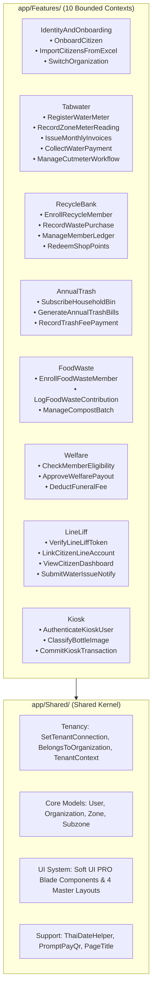

# แผนแม่บทการสำรวจ วิเคราะห์ และปรับปรุงสถาปัตยกรรมระบบ PIOS สู่ Vertical Slice Architecture (VSA) และ Laravel 12

**เอกสารอ้างอิงหลัก (Master Architectural & Refactoring Blueprint)**  
**โปรเจกต์:** `qa_envsogo_pios` (Smart Local Environmental & Public Service Platform)  
**เป้าหมายสถาปัตยกรรม:** Vertical Slice Architecture (VSA) + Laravel 12 (PHP 8.3+/8.4) + Soft UI Dashboard PRO Laravel Design System

---

## 1. การสำรวจและวิเคราะห์สถานะระบบปัจจุบัน (As-Is Codebase Exploration & Analysis)

### 1.1 ภาพรวมโดเมนธุรกิจ (Business Domains)
ระบบ `pios` เป็นแพลตฟอร์มแบบ **Multi-Tenant** (รองรับทั้งโหมด Shared Database แยกด้วย `org_id_fk` และโหมด Isolated Tenant Database ผ่าน `SetTenantConnection` Middleware) สำหรับองค์กรปกครองส่วนท้องถิ่น (อปท. / เทศบาล / อบต.) ประกอบด้วย 10 โดเมนหลัก:

| ลำดับ | โดเมน (Bounded Context) | หน้าที่หลัก | คอนโทรลเลอร์/โมเดลปัจจุบัน |
| :---: | :--- | :--- | :--- |
| **1** | **Identity & Onboarding** | จัดการผู้ใช้ส่วนกลาง, สิทธิ์ (Spatie Roles), โซน/ซอย, นำเข้า Excel | `Admin\UserController`, `SuperUserController`, `ExcelController`, `UserService` |
| **2** | **Tabwater (ระบบน้ำประปา)** | มิเตอร์น้ำ, จดมิเตอร์ (เว็บ/มือถือ+OCR), ออกใบแจ้งหนี้, รับชำระเงิน, ใบเตือน/ตราครุฑ, ตัดมิเตอร์, ป.17 | `Tabwater\*` (25 Controllers), `TwMeterInfos`, `TwInvoice`, `TwAccTransactions`, `TwCutmeter` |
| **3** | **RecycleBank (KeptKaya ธนาคารขยะ)** | สมาชิกธนาคารขยะ, จุดรับซื้อขยะ (POS), สมุดคู่ฝาก/แต้มสะสม, ร้านค้าแลกแต้ม | `KeptKaya\*` (34 Controllers), `KpBankAccount`, `KpRecycleBankMember`, `KpPurchaseTransaction` |
| **4** | **AnnualTrash (ขยะรายปี)** | สมาชิกถังขยะรายปี, คำนวณค่าธรรมเนียมตามปีงบประมาณ, ยกเว้นค่าธรรมเนียมเมื่อเป็นสมาชิกธนาคารขยะ | `AnnualTrash\*` (10 Controllers), `AnnualTrashMember`, `AnnualTrashSubscription` |
| **5** | **FoodWaste (ขยะเปียก/อินทรีย์)** | สมาชิกถังขยะเปียก, บันทึกน้ำหนักขยะอินทรีย์, ถังหมักปุ๋ย IoT (`IoTCompost`) | `FoodWaste\*` (32 Controllers), `IoTCompost\*`, `FoodWasteAccount`, `CompostBatches` |
| **6** | **Welfare (กองทุนสวัสดิการชุมชน)** | ตรวจสอบสิทธิ์จากน้ำหนักขยะ, หักเงินฌาปนกิจอัตโนมัติ, อนุมัติจ่ายเงินสวัสดิการ | `Admin\WelfareController`, `WelfareMemberController`, `UserWelfareController`, `WelfareMember` |
| **7** | **Inventory (คลังพัสดุและอุปกรณ์)** | เบิกจ่ายพัสดุ, ระดับความอันตราย, สายอนุมัติหลายขั้นตอน (`ApprovalWorkflow`) | `Inventory\*` (8 Controllers), `InvItem`, `InvTransaction` |
| **8** | **SmartUtility (โรงผลิตน้ำ & GIS)** | แผนที่ GIS (Leaflet), โรงผลิตน้ำ, ท่อประปา, จุดต่อท่อ, บันทึกคุณภาพน้ำและสั่งเปิด-ปิดอุปกรณ์ | `SmartUtility\*`, `Tabwater\TabwaterGisController`, `TabwaterStation`, `TabwaterPipeline` |
| **9** | **LineLiff (ระบบบริการประชาชน LINE)** | ผูกบัญชี LINE, สมัครสมาชิกใหม่, แดชบอร์ดประชาชนครบวงจร, แจ้งเหตุประปา/ขยะ | `LineLiffController`, `Api\LineController`, `Tabwater\NotifyController` |
| **10** | **Kiosk (ตู้รับซื้อขวดอัจฉริยะ)** | ตู้ Kiosk หน้าจอสัมผัส, กล้อง AI จำแนกขวด (`KioskImageCaptured`), สั่งงานไมโครคอนโทรลเลอร์ | `Kiosk\*`, `Api\KioskController`, `KioskApiController`, `Kiosk` |

### 1.2 ปัญหาเชิงโครงสร้างและหนี้ทางเทคนิค (Architectural Debt & Critical Findings)
1. **การกระจายตัวของโค้ดแบบ Horizontal Layering:**
   - โค้ดถูกแยกตามประเภททางเทคนิค (`Controllers`, `Models`, `Views`, `Routes`) ทำให้การแก้ฟีเจอร์เดียวต้องเปิดไฟล์ข้าม 6–8 โฟลเดอร์
   - มีโฟลเดอร์ซ้ำซ้อนและสะกดชื่อไม่ตรงกัน เช่น `app/Http/Controllers/KeptKaya` กับ `app/Http/Controllers/Keptkayas`, `app/Models/Keptkaya` กับ `app/Models/KeptKaya`
2. **ช่องโหว่ความปลอดภัยและบั๊กรันไทม์ระดับวิกฤต (26 รายการ):**
   - ช่องโหว่ **IDOR Account Takeover (CVSS 9.8)** ใน `LineLiffController::dashboard` ที่สั่ง `Auth::login($user)` จาก URL parameter
   - บั๊ก PHP 8.2+ Fatal Crash: `'meter_id' => $$user->id` ใน `UserController::attachMeter`, `$user->org->id` ใน `LineLiffController::user_line_register`, `$user->wastePreference()` ที่ไม่มีอยู่จริง
   - บั๊ก SQL Crash: `users.wallet_balance` ไม่มีอยู่จริงใน `WelfareController`, `sum('weight')` แทนที่จะเป็น `sum('total_weight')` ใน `UserWelfareController`
   - บั๊ก Kiosk ฮาร์ดโค้ด `$userId = 10` และ `kp_user_w_pref_id_fk = 13`
3. **การล้าสมัยของเฟรมเวิร์ก (Laravel 9 EOL & Laravel Mix):**
   - ใช้ `laravel/framework: ^9.2` และ `webpack.mix.js` ซึ่งเลิกพัฒนาแล้ว
4. **ความยุ่งเหยิงของ UI Layouts และ Git Index:**
   - มีไฟล์ Layout ซ้ำซ้อนถึง 29 ไฟล์ใน `resources/views/layouts/`
   - Git Index แบกไฟล์ `node_modules/` (24,362 ไฟล์), `vendor/` (10,484 ไฟล์), `.env`, `.env.zip`, `.DS_Store` (48 ไฟล์) และไฟล์สำรอง `* copy*.php`

---

## 2. การออกแบบสถาปัตยกรรมเป้าหมาย: Vertical Slice Architecture (VSA) บน Laravel 12

### 2.1 แนวคิดหลักของ Vertical Slice Architecture สำหรับ PIOS
แทนที่จะจัดโครงสร้างตามชั้นทางเทคนิค (Controllers -> Services -> Repositories -> Models) เราจะจัดโครงสร้างตาม **พฤติกรรมทางธุรกิจ (Feature / Use Case Slice)** โดยยึดหลัก **"Code that changes together, stays together"**:



### 2.2 โครงสร้างไดเรกทอรีมาตรฐาน (Target Directory Tree)

```text
pios/
├── app/
│   ├── Features/                                  # 🌟 Vertical Slices แยกตาม Bounded Context
│   │   ├── IdentityAndOnboarding/
│   │   │   ├── OnboardCitizen/                    # Slice: ลงทะเบียนประชาชนและผูกบริการครบวงจร
│   │   │   │   ├── OnboardCitizenController.php   # Single-Action (__invoke)
│   │   │   │   ├── OnboardCitizenRequest.php      # FormRequest Validation
│   │   │   │   ├── OnboardCitizenDTO.php          # Readonly DTO
│   │   │   │   ├── OnboardCitizenAction.php       # Atomic Transaction Business Logic
│   │   │   │   ├── Views/
│   │   │   │   │   └── create-wizard.blade.php    # Soft UI PRO Multi-step Wizard
│   │   │   │   └── routes.php                     # Route เฉพาะของ Slice นี้
│   │   │   ├── ImportCitizensExcel/
│   │   │   └── AttachUserWaterMeter/
│   │   ├── Tabwater/
│   │   │   ├── RegisterMeter/
│   │   │   ├── RecordZoneMeterReading/
│   │   │   ├── ProcessMeterOcrImage/
│   │   │   ├── GeneratePeriodInvoices/
│   │   │   ├── CollectInvoicePayment/
│   │   │   ├── IssueOweWarningPaper/
│   │   │   ├── ManageCutmeterWorkflow/
│   │   │   └── ExportP17Report/
│   │   ├── RecycleBank/
│   │   │   ├── EnrollMember/
│   │   │   ├── RecordPurchasePos/
│   │   │   ├── ViewAccountLedger/
│   │   │   └── RedeemRewardShop/
│   │   ├── AnnualTrash/
│   │   │   ├── EnrollHouseholdBin/
│   │   │   ├── SyncRecycleFeeWaiver/
│   │   │   └── CollectAnnualFee/
│   │   ├── FoodWaste/
│   │   │   ├── EnrollFoodWasteMember/
│   │   │   ├── RecordOrganicWeight/
│   │   │   └── MonitorIoTCompost/
│   │   ├── Welfare/
│   │   │   ├── CheckWasteEligibility/
│   │   │   ├── ApproveFuneralPayout/
│   │   │   └── ManageWelfareConfig/
│   │   ├── Inventory/
│   │   │   ├── ManageStockItems/
│   │   │   └── ApproveStockWithdrawal/
│   │   ├── SmartUtility/
│   │   │   ├── ManageGisMap/
│   │   │   └── ControlStationDevices/
│   │   ├── LineLiff/
│   │   │   ├── VerifyLineToken/
│   │   │   ├── RegisterCitizenViaLiff/
│   │   │   ├── ShowCitizenDashboard/
│   │   │   └── ReportPipeLeakIssue/
│   │   └── Kiosk/
│   │       ├── StartKioskSession/
│   │       ├── ProcessBottleAiImage/
│   │       └── SubmitKioskDeposit/
│   ├── Shared/                                    # 🌟 Shared Kernel (โค้ดกลางที่ใช้ข้ามโดเมน)
│   │   ├── Tenancy/
│   │   │   ├── BelongsToOrganization.php          # Eloquent Global Scope (org_id_fk)
│   │   │   ├── SetTenantConnection.php            # Dynamic Tenant DB Switcher
│   │   │   └── TenantContext.php                  # Service ดึง currentOrgId() / currentOrg()
│   │   ├── Models/                                # Shared Eloquent Entities
│   │   │   ├── User.php
│   │   │   ├── Organization.php
│   │   │   ├── Zone.php
│   │   │   ├── Subzone.php
│   │   │   └── KpBankAccount.php                  # Master Unified Ledger (Recycle/Foodwaste/Welfare)
│   │   ├── Providers/
│   │   │   └── VerticalSliceServiceProvider.php   # Auto-discover routes & views ใน app/Features/*
│   │   └── Support/
│   │       ├── PageTitle.php
│   │       ├── PromptPayQr.php
│   │       └── ThaiBuddhistDate.php
├── bootstrap/
│   ├── app.php                                    # Laravel 12 Application Builder
│   └── providers.php
├── docs/
│   ├── adr/                                       # Architecture Decision Records (0001-0006+)
│   ├── architecture/                              # แผนผังสถาปัตยกรรมและแผนอัปเกรด Laravel 12
│   ├── ui-ux/                                     # คู่มือ Soft UI Dashboard PRO Design System
│   └── superpowers/plans/                         # แผนปฏิบัติการระดับโค้ดทีละ Task (Implementation Plan)
└── resources/
    └── views/
        ├── layouts/                               # ยุบเหลือ 4 Master Layouts เท่านั้น
        │   ├── app.blade.php                      # Soft UI PRO Main Dashboard Layout
        │   ├── guest.blade.php                    # Soft UI PRO Auth Cover Layout
        │   ├── mobile.blade.php                   # LINE LIFF & Mobile Staff Layout
        │   └── print.blade.php                    # A4 / Thermal Receipt Print Layout
        └── components/
            └── soft-ui/                           # Reusable Soft UI PRO Blade Components
```

### 2.3 กลไกการทำงานของ `VerticalSliceServiceProvider`
เพื่อให้ Laravel 12 รู้จัก Routes และ Views ที่อยู่ภายในแต่ละ Slice โดยอัตโนมัติ:
- **Routes Auto-Discovery:** สแกนไฟล์ `app/Features/*/*/routes.php` ทั้งหมดและโหลดภายใต้ Middleware `web` (หรือ `api` สำหรับ `api_routes.php`)
- **Views Namespace Registration:** ลงทะเบียน View Namespace ตามชื่อ Bounded Context เช่น `View::addNamespace('tabwater', app_path('Features/Tabwater'))` เพื่อให้เรียก `view('tabwater::GeneratePeriodInvoices.Views.index')` ได้อย่างสะอาด

---

## 3. แผนการอัปเกรดสู่ Laravel เวอร์ชันล่าสุด (Laravel 9 -> Laravel 12 Migration Roadmap)

### 3.1 การตรวจสอบสภาพแวดล้อมเครื่องพัฒนา (Local PHP Runtime Fix)
จากการตรวจสอบเครื่อง Mac ปัจจุบัน พบว่ามี `/opt/homebrew/Cellar/php/8.5.10/bin/php` ติดตั้งอยู่และทำงานได้ปกติ แต่ `php` ใน PATH ชี้ไปที่ `php@7.4` ซึ่งติดปัญหา `libstdc++.6.dylib` หายไป:
- **การแก้ไข:** ใช้ `/opt/homebrew/Cellar/php/8.5.10/bin/php` และ `brew link --overwrite php` เพื่อให้ CLI และ Composer ทำงานบน PHP 8.3+ / 8.5 ได้ทันที พร้อมอัปเดต `Dockerfile` จาก `FROM php:8.2-apache` เป็น `FROM php:8.3-apache`

### 3.2 ตารางการอัปเกรด Dependencies (`composer.json`)

| แพ็กเกจ (Package) | เวอร์ชันเดิม (Laravel 9) | เวอร์ชันเป้าหมาย (Laravel 12) | หมายเหตุและการปรับแก้ Breaking Changes |
| :--- | :---: | :---: | :--- |
| `php` | `^8.2` | `^8.2 \| ^8.3 \| ^8.4 \| ^8.5` | รองรับ Readonly classes, Typed properties/constants |
| `laravel/framework` | `^9.2` | `^12.0` | อัปเกรด Core, Eloquent `casts()`, Routing, Queue |
| `laravel/sanctum` | `^2.14.1` | `^4.0` | อัปเดต Sanctum Guard & Middleware สำหรับ Mobile/API |
| `spatie/laravel-permission` | `^5.5` | `^6.10` | **สำคัญ:** เปลี่ยน Namespace จาก `Middlewares` (มี s) เป็น `Middleware` (ไม่มี s) |
| `barryvdh/laravel-dompdf` | `^3.1` | `^3.1` | รองรับ Laravel 11/12 อยู่แล้ว |
| `maatwebsite/excel` | `^3.1` | `^3.1.58` | รองรับ Laravel 11/12 ร่วมกับ `phpoffice/phpspreadsheet: ^1.29` |
| `simplesoftwareio/simple-qrcode` | `~4` | `^4.2` | ใช้สร้าง QR Code ใบแจ้งหนี้และ PromptPay |
| `intervention/image` | `^2.7` | `^2.7` (หรือ `^3.0` พร้อม Adapter) | รักษา `^2.7` ในระยะแรกเพื่อไม่ให้กระทบโค้ดประมวลผลภาพมิเตอร์น้ำ |
| `phpunit/phpunit` | `^9.5.10` | `^11.0` | อัปเดต `phpunit.xml` สู่สคีมา PHPUnit 11 |
| `nunomaduro/collision` | `^6.1` | `^8.1` | รองรับ Laravel 11/12 |
| `spatie/laravel-ignition` | `^1.0` | `^2.8` | รองรับ Error page ของ Laravel 11/12 |
| `larastan/larastan` | (อยู่ใน `phpstan.neon`) | `^3.0` | Static Analysis ระดับ Level 5+ สำหรับตรวจจับบั๊ก PHP 8.2+ |

### 3.3 การเปลี่ยนผ่าน Asset Bundler จาก Laravel Mix สู่ Vite
1. ลบไฟล์ `webpack.mix.js` และถอด `laravel-mix` รวมถึง `react-native-inappbrowser-reborn` ออกจาก `package.json`
2. ติดตั้ง `vite` และ `laravel-vite-plugin` พร้อมสร้าง `vite.config.js`
3. สำหรับ Static Assets ของ **Soft UI Dashboard PRO** (`public/soft-ui/assets/css/soft-ui-dashboard.css`, `nucleo-icons.css`, `soft-ui-dashboard.min.js`) ให้คงการโหลดผ่าน `asset()` ใน Master Layout เพื่อให้ทำงานได้ทันทีโดยไม่ต้องคอมไพล์ SASS ใหม่ทุกครั้ง และใช้ Vite สำหรับ Custom JS/CSS Modules ของระบบ

---

## 4. ลำดับระยะการดำเนินงาน (6-Phase Execution Roadmap)

| Phase | ชื่อระยะงาน (Phase Title) | เป้าหมายและผลลัพธ์ (Deliverables) |
| :---: | :--- | :--- |
| **Phase 1** | **Git Hygiene & Repository Sanitization** | อัปเดต `.gitignore`, ถอด `node_modules/`, `vendor/`, `.env`, `.env.zip`, `.DS_Store`, `repomix-output.xml` ออกจาก Git Index, และลบไฟล์สำรอง `* copy*.php` / `_Backup_Unused` |
| **Phase 2** | **Emergency Security & PHP 8.2+ Hotfixes** | ปิดช่องโหว่ IDOR ใน `LineLiffController`, แก้ `$$user->id`, แก้ `$user->org->id`, แก้ `wastePreference()`, แก้ `sum('total_weight')`, แก้ `users.wallet_balance`, แก้ Route `{}` ใน `admin.php` และ `keptkaya_route.php`, ลบโค้ดอันตราย `truncate()` |
| **Phase 3** | **Laravel 12 & Vite Infrastructure Upgrade** | อัปเกรด `composer.json` สู่ Laravel 12 + Spatie Permission v6 + Sanctum v4, ปรับ Namespace ของ Middleware, อัปเดต `vite.config.js`, `phpunit.xml`, และ `Dockerfile` |
| **Phase 4** | **VSA Foundation & Shared Kernel Setup** | สร้างโครงสร้าง `app/Shared/` (`TenantContext`, `BelongsToOrganization`, `VerticalSliceServiceProvider`) และ `app/Features/`, พร้อมเขียน Migration รวมศูนย์ตาราง `kp_bank_accounts` และ `welfare_fund_ledgers` |
| **Phase 5** | **Soft UI Dashboard PRO Master Layout & UI System** | สร้าง 4 Master Layouts (`layouts/app`, `layouts/guest`, `layouts/mobile`, `layouts/print`) และ Blade Components `<x-soft-ui.*>` แทนที่ Layout ที่ซ้ำซ้อน 29 ไฟล์ |
| **Phase 6** | **Vertical Slice Migration Across Bounded Contexts** | ย้ายฟีเจอร์หลักเข้าสู่ `app/Features/{Domain}/{Slice}` เริ่มจาก `IdentityAndOnboarding\OnboardCitizen`, `LineLiff\VerifyLineToken`, `Kiosk\SubmitKioskDeposit`, `Welfare\ApproveFuneralPayout`, `Tabwater\*`, และ `RecycleBank\*` พร้อมชุดทดสอบครบวงจร |
