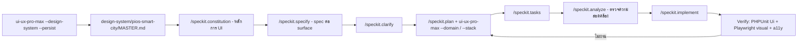
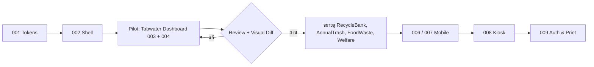

# แผน Re-design UX/UI ด้วย Spec Kit + ui-ux-pro-max (UX/UI Redesign Plan)

> **สถานะ:** ร่างแผน (Draft) — ยังไม่ลงมือทำ รอการตัดสินใจในหัวข้อ [§7 ประเด็นที่ต้องตัดสินใจ](#7-ประเด็นที่ต้องตัดสินใจก่อนเริ่ม-open-decisions)
> **เอกสารอ้างอิง:** [ADR-0005 Soft UI PRO](../../adr/0005-soft-ui-dashboard-pro-design-system-standardization.md), [ADR-0009 Kanit](../../adr/0009-standardizing-typography-with-kanit-font.md), [Soft UI Design System](../../ui-ux/soft-ui-dashboard-pro-design-system.md), [Testing Master Plan](./2026-11-05-testing-suite-implementation-plan.md)
> **เครื่องมือ:** `specify` CLI 1.3.1 (GitHub Spec Kit) และ skill `ui-ux-pro-max`

---

## 1. หลักการ: ใครทำหน้าที่อะไร

สองเครื่องมือนี้ทำงานคนละชั้น ไม่ทับซ้อนกัน

| ชั้นงาน | เครื่องมือ | ผลลัพธ์ (Artifact) |
| :--- | :--- | :--- |
| **กระบวนการ (Process)**: อะไร/ทำไม → แผน → งานย่อย → ลงมือ | **Spec Kit** | `.specify/memory/constitution.md`, `specs/NNN-*/spec.md`, `plan.md`, `tasks.md` |
| **ความรู้ด้านดีไซน์ (Design Intelligence)**: style, สี, ฟอนต์, UX/A11y rules, stack guideline | **ui-ux-pro-max** | `design-system/pios-smart-city/MASTER.md`, `design-system/pios-smart-city/pages/*.md` |

**กติกาเชื่อมต่อ:** ทุก `spec.md` / `plan.md` ของงาน UI ต้องอ้างอิง `MASTER.md` (+ page override ถ้ามี) และทุกข้อสรุปจาก ui-ux-pro-max ต้องผ่านการตรวจสอบ (verify) ก่อนบันทึกลงไฟล์ ตามกฎของ skill



---

## 2. ขอบเขต: 4 Surfaces หลักของ PIOS

| # | Surface | ผู้ใช้ | Viewport | Layout ปัจจุบัน | Page override |
| :-: | :--- | :--- | :--- | :--- | :--- |
| S1 | **Backoffice Dashboard** (Tabwater, RecycleBank, AnnualTrash, FoodWaste, Welfare, SuperAdmin) | เจ้าหน้าที่ อปท. | Desktop 1440 / Tablet 1024 | `layouts.soft-ui-pro` + 9 legacy layouts | `pages/dashboard.md`, `pages/data-table.md`, `pages/forms.md` |
| S2 | **Mobile Field Staff / LINE LIFF** | พนักงานจดมิเตอร์, ประชาชน | 375–390 | `tabwater_staff_mobile`, `user_mobile`, `lineliff/index` | `pages/mobile-liff.md` |
| S3 | **AI Recycle Kiosk** | ประชาชนทุกวัย (รวมผู้สูงอายุ) | 1080×1920 touch | `kiosk/index1`, `kiosk/monitor` | `pages/kiosk.md` |
| S4 | **Auth & Print** (Login, ใบแจ้งหนี้ A4, Thermal receipt) | ทุกกลุ่ม | 1440 / A4 / 80mm | `layouts.login`, `layouts.print` | `pages/auth.md`, `pages/print.md` |

---

## 3. ผลการค้นจาก ui-ux-pro-max (Discovery รอบแรก — ยังไม่ persist)

คำสั่งที่รัน:
```bash
python3 scripts/search.py "government municipal utility billing dashboard" \
  --design-system -p "PIOS Smart City" --variance 3 --motion 3 --density 7
```

| หัวข้อ | ข้อเสนอจาก skill | ข้อสังเกตเมื่อเทียบกับโปรเจกต์ |
| :--- | :--- | :--- |
| Style | **Minimalism & Swiss Style** (enterprise, dashboard) | เข้ากับงานราชการ แต่เรียบกว่า Soft UI ปัจจุบัน |
| Palette | Navy `#0F172A` / Slate `#334155` / Accent `#0369A1` / BG `#F8FAFC` / Destructive `#DC2626` | ⚠️ **ขัดกับ** Soft UI primary gradient ม่วง-ชมพู (`#7928CA → #FF0080`) |
| Typography | Atkinson Hyperlegible | ❌ **ไม่มีอักษรไทย** → คง **Kanit** ตาม ADR-0009 |
| Avoid | Ornate, low contrast, heavy motion, **AI purple/pink gradients** | ชี้ตรงไปที่ `.tenant-badge` และ `bg-gradient-primary` |
| Checklist | SVG icons (no emoji), focus visible, contrast ≥ 4.5:1, `prefers-reduced-motion`, responsive 375/768/1024/1440 | ใช้เป็น Definition of Done ใน constitution |
| Kiosk UX | Touch target ≥ 44–48px, spacing ≥ 8px | สำหรับตู้ Kiosk แนะนำยกเป็น ≥ 64px (ผู้สูงอายุ/ยืนกด) |

> [!IMPORTANT]
> ผลลัพธ์ข้างต้นเป็นเพียง **ข้อเสนอ** ต้องให้ทีมยืนยันทิศทางใน §7 ก่อนรัน `--persist` เพื่อไม่ให้บันทึกข้อมูลที่ยังไม่ผ่านการตรวจสอบ

---

## 4. แผนงาน 7 เฟส (Phased Roadmap)

### Phase 0 — Bootstrap เครื่องมือ (0.5 วัน)

1. Initialize Spec Kit ในโปรเจกต์ (ทำบน branch ใหม่ `feat/ux-redesign-speckit`):
   ```bash
   specify init --here --integration <ตัวเลือกใน §7-D> --script sh --non-interactive
   ```
   - ตรวจว่าไม่ทับไฟล์เดิมใน `docs/`, `.gitignore`, `GEMINI.md`/`CLAUDE.md`
2. Persist design system ที่ตกลงแล้ว:
   ```bash
   python3 ~/.gemini/config/skills/ui-ux-pro-max/scripts/search.py "<query ที่ตกลง>" \
     --design-system --persist -p "PIOS Smart City" --output-dir "$(pwd)" \
     --variance 3 --motion 3 --density 7
   ```
3. สร้าง page overrides ทีละ surface (`--page dashboard`, `--page kiosk`, `--page mobile-liff`, `--page auth`, `--page print`)
4. แก้ `MASTER.md` ให้ typography = **Kanit** และ map token เข้ากับ Soft UI (ดู Phase 1)

**Exit criteria:** มี `.specify/`, `specs/`, `design-system/pios-smart-city/MASTER.md` + 5 page files, commit แยก

---

### Phase 1 — Constitution & Design Tokens (1 วัน)

`/speckit.constitution` — บันทึกหลักการที่ "ห้ามละเมิด" ของงาน UI:

1. **Single source of truth:** สี/ระยะ/ฟอนต์ ใช้ CSS variables จาก `MASTER.md` เท่านั้น ห้าม hardcode hex ใน Blade
2. **Thai-first typography:** Kanit 300–700 ผ่าน `layouts.partials.head-fonts` (ADR-0009)
3. **Accessibility baseline:** WCAG 2.2 AA — contrast ≥ 4.5:1, focus visible, keyboard nav, `prefers-reduced-motion`, ป้าย `aria-label` บน icon button
4. **Component-first:** ทุกหน้าใหม่ประกอบจาก `<x-soft-ui.*>` (ขยายชุด component ได้ แต่ห้าม inline markup ซ้ำ)
5. **VSA alignment:** หน้าของแต่ละ slice อยู่ใน slice นั้น และใช้ master layout เดียว
6. **API envelope:** หน้าจอที่เรียก API ต้องรองรับ ADR-0008 (`success`/`data`/`errors`) รวมถึง empty/error/loading state
7. **Definition of Done:** PHPUnit `Ui` + Playwright 3 viewports + axe a11y ผ่าน + screenshot ใหม่ใน `docs/screenshots/`

งาน token:
- สร้าง `resources/css/tokens.css` (primitive → semantic → component) จาก `MASTER.md`
- Override ตัวแปร Soft UI (`--bs-primary`, `bg-gradient-*`) ให้ชี้ semantic token
- เพิ่ม density scale 2 ระดับ: `--density-comfortable` (S2/S3) และ `--density-compact` (S1 data table)

---

### Phase 2 — Specify ต่อ Surface (1.5 วัน)

รัน `/speckit.specify` 1 ครั้งต่อ feature → ได้ `specs/NNN-*/spec.md` (เน้น *What/Why*, user story, acceptance criteria — ยังไม่พูดถึงเทคนิค)

| Spec | หัวข้อ | User stories หลัก |
| :--- | :--- | :--- |
| `001-design-tokens-foundation` | Tokens + base components | ทีมพัฒนาเปลี่ยนธีมได้จากจุดเดียว |
| `002-backoffice-shell` | Sidebar, Navbar, Breadcrumb, Tenant switcher | เจ้าหน้าที่รู้เสมอว่าอยู่ อปท./โมดูลไหน |
| `003-backoffice-dashboard-kpi` | KPI cards + charts ต่อโมดูล | ผู้บริหารเห็นยอดค้างชำระ/ปริมาณขยะใน 5 วินาที |
| `004-data-table-pattern` | ตาราง, filter, bulk action, export | ค้นหาผู้ใช้น้ำ 10,000 ราย ได้ใน 2 คลิก |
| `005-forms-and-validation` | ฟอร์ม, error summary, wizard (OnboardCitizen) | กรอกผิดแล้วรู้ทันทีว่าผิดตรงไหน |
| `006-mobile-meter-reading` | จดมิเตอร์ภาคสนาม | จดมิเตอร์มือเดียว แสงแดดจ้า สัญญาณอ่อน |
| `007-line-liff-member-portal` | พอร์ทัลประชาชน | ดูบิล/แต้มขยะ/สวัสดิการ ใน LINE |
| `008-kiosk-recycle-flow` | ตู้รับซื้อขยะ AI | ผู้สูงอายุใช้ได้ไม่ต้องมีคนช่วย |
| `009-auth-and-print` | Login, ใบแจ้งหนี้ A4, ใบเสร็จ 80mm | พิมพ์ได้ถูกต้องตามแบบฟอร์มราชการ |

ตามด้วย `/speckit.clarify` ทุก spec เพื่อปิดช่องว่าง (เช่น จำนวนแถวต่อหน้า, ภาษาที่รองรับ, offline mode ของ Kiosk)

---

### Phase 3 — Plan + Design Intelligence (2 วัน)

`/speckit.plan` ต่อ spec โดย **บังคับ** ให้ plan อ่าน `MASTER.md` + page override และดึงข้อมูลเสริมจาก ui-ux-pro-max:

| Spec | คำค้น ui-ux-pro-max ที่ใช้ประกอบ plan (ค้นทีละ intent) |
| :--- | :--- |
| 003 | `"real-time kpi dashboard" --domain chart`, `"kpi card trend" --domain ux` |
| 004 | `"sortable data table" --domain ux`, `"table sticky header" --stack laravel` |
| 005 | `"error summary validation" --domain ux`, `"multi step form progress" --domain ux` |
| 006/007 | `"one handed thumb zone" --domain ux`, `"offline sync status" --domain ux` |
| 008 | `"touch target size" --domain ux`, `"timeout warning session" --domain ux`, `"high contrast large text" --domain style` |
| 009 | `"accessible authentication" --domain ux`, `"print stylesheet" --stack html-tailwind` |
| ทุก spec | `"<topic>" --stack laravel` สำหรับแนวปฏิบัติ Blade |

Plan แต่ละฉบับต้องมี: wireframe (mermaid/ASCII), รายการ component ที่ใช้/สร้างใหม่, token ที่ใช้, state matrix (default/hover/focus/disabled/loading/empty/error), และแผนทดสอบ

---

### Phase 4 — Tasks & Analyze (0.5 วัน)

1. `/speckit.tasks` → `tasks.md` แตกงานเป็นชิ้นละ ≤ 2 ชม. เรียงตาม dependency (tokens → components → shell → pages)
2. `/speckit.analyze` → ตรวจว่า spec/plan/tasks สอดคล้องกับ constitution (เช่น ไม่มี task ที่ hardcode สี, ทุกหน้ามี task a11y)

---

### Phase 5 — Implement แบบ Pilot ก่อนขยาย (5–8 วัน)

ลำดับการ implement (`/speckit.implement` ทีละ spec):



- **Pilot = Tabwater** เพราะเป็นโมดูลที่ใช้งานมากที่สุดและมี E2E billing flow อยู่แล้ว
- legacy layout เดิมยังอยู่ระหว่างเปลี่ยนผ่าน (ใช้ `@extends('layouts.soft-ui-pro')` ตาม ADR-0005) เพื่อไม่ให้ view 400+ ไฟล์พัง

---

### Phase 6 — Verification & Rollout (2 วัน)

| ชั้นทดสอบ | สิ่งที่เพิ่ม |
| :--- | :--- |
| PHPUnit `Ui` | assert ว่า layout ใช้ `tokens.css`, ไม่มี hex hardcode ใน component ใหม่ |
| Playwright visual | `toHaveScreenshot()` baseline ต่อ surface × 3 viewports |
| Accessibility | เพิ่ม `@axe-core/playwright` — 0 violation ระดับ serious/critical |
| Kiosk usability | ทดสอบจริงกับผู้ใช้ 5 คน (รวมผู้สูงอายุ ≥ 2) วัด task success / เวลา |
| Performance | Lighthouse: LCP < 2.5s บน mobile, CLS < 0.1 (ฟอนต์ใช้ `display=swap` แล้ว) |

Rollout: feature flag ต่อโมดูล (`config('ui.redesign.tabwater')`) → เปิดทีละ อปท. → เก็บ feedback 1 สัปดาห์ → เปิดทั้งหมด

---

## 5. โครงสร้างไฟล์หลังจบ Phase 0–2

```
pios/
├── .specify/
│   ├── memory/constitution.md        # หลักการ UI (Phase 1)
│   ├── templates/                    # spec/plan/tasks templates
│   └── scripts/
├── specs/
│   ├── 001-design-tokens-foundation/{spec,plan,tasks}.md
│   ├── 002-backoffice-shell/...
│   └── ... 009-auth-and-print/
├── design-system/pios-smart-city/
│   ├── MASTER.md                     # Source of truth จาก ui-ux-pro-max (แก้ฟอนต์เป็น Kanit)
│   └── pages/{dashboard,data-table,forms,mobile-liff,kiosk,auth,print}.md
├── resources/css/tokens.css          # Phase 1
└── docs/superpowers/plans/2026-11-05-ux-ui-redesign-speckit-uipromax-plan.md  # เอกสารนี้
```

---

## 6. ประมาณการเวลา

| Phase | งาน | ระยะเวลา |
| :-: | :--- | :-: |
| 0 | Bootstrap Spec Kit + persist design system | 0.5 วัน |
| 1 | Constitution + Tokens | 1 วัน |
| 2 | Specify + Clarify 9 specs | 1.5 วัน |
| 3 | Plan + design intelligence | 2 วัน |
| 4 | Tasks + Analyze | 0.5 วัน |
| 5 | Implement (pilot → rollout) | 5–8 วัน |
| 6 | Verification + rollout | 2 วัน |
| | **รวม** | **≈ 12.5–15.5 วันทำงาน** |

---

## 7. ประเด็นที่ต้องตัดสินใจก่อนเริ่ม (Open Decisions)

| # | ประเด็น | ตัวเลือก | ข้อแนะนำ |
| :-: | :--- | :--- | :--- |
| **A** | **ทิศทางสี** | (1) คง Soft UI magenta gradient (2) เปลี่ยนเป็น Navy/Blue ตาม skill (3) Hybrid: Navy เป็น primary, คงสีประจำโมดูล (info/success/warning/danger) | **(3) Hybrid** — ได้ความน่าเชื่อถือแบบราชการ + ยังแยกโมดูลด้วยสีได้ ต้องออก ADR ใหม่ทับ ADR-0005 บางส่วน |
| **B** | **ระดับการ redesign** | (1) Re-skin (token + component) (2) Re-structure (IA/navigation ใหม่ด้วย) | **(1) ก่อน** แล้วทำ (2) เฉพาะ Kiosk และ LIFF |
| **C** | **ฟอนต์** | คง Kanit / เปลี่ยนตาม skill | **คง Kanit** (Atkinson ไม่มีภาษาไทย) |
| **D** | **Spec Kit integration** | `antigravity` / `gemini` / `claude` / `copilot` / `generic` | ใช้ agent หลักที่ทีมใช้จริง; ถ้าใช้ Antigravity เป็นหลักให้ลอง `--integration antigravity --ignore-agent-tools` |
| **E** | **Pilot module** | Tabwater / RecycleBank | **Tabwater** |
| **F** | **Dark mode** | ทำ / ไม่ทำในรอบนี้ | ไม่ทำรอบนี้ แต่ออกแบบ token ให้รองรับ |

---

## 8. ความเสี่ยงและวิธีรับมือ

| ความเสี่ยง | ผลกระทบ | วิธีรับมือ |
| :--- | :--- | :--- |
| `specify init --here` เขียนทับไฟล์เดิม | กลาง | รันบน branch ใหม่, ตรวจ `git diff` ก่อน commit, ไม่ใช้ `--force` โดยไม่ตรวจ |
| ข้อเสนอจาก skill ไม่เหมาะกับบริบทไทย/ราชการ | กลาง | verify ทุกผล, ปรับ `MASTER.md` ด้วยมือ, บันทึกเหตุผลใน ADR |
| View legacy 400+ ไฟล์แสดงผลเพี้ยนหลังเปลี่ยน token | สูง | feature flag ต่อโมดูล + Playwright visual baseline ก่อนเปลี่ยน |
| Kiosk offline ไม่มี Google Fonts | กลาง | self-host Kanit WOFF2 ใน `public/fonts/kanit/` (ค้างจาก ADR-0009 Task 1) |
| Scope creep จาก re-structure | สูง | ล็อก scope ตามข้อ B, งานนอก scope เข้า backlog |
