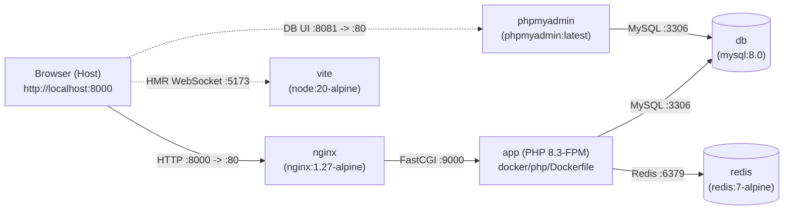

# การออกแบบระบบ Local Docker Compose แบบ Micro-containers (Design Spec)

**วันที่:** 2026-11-05  
**สถานะ:** รอการอนุมัติ (Pending User Approval)  
**Spec Kit อ้างอิง:** `specs/010-local-docker-compose/spec.md`

---

## 1. เจตนารมณ์และเหตุผล (Intent & Why)

โปรเจกต์ `pios` ปัจจุบันมีไฟล์ `docker-compose.yml` ที่ใช้งานไม่ได้จริง เนื่องจากตั้งค่า Path (`/var/www`) และ Port (`8000:8000`) ขัดแย้งกับ `Dockerfile` (`/var/www/html/public` พอร์ต `8080`) อีกทั้งยังไม่มี Container สำหรับฐานข้อมูล, Redis, และ Frontend Bundler (Vite)

เป้าหมายของการออกแบบนี้คือการสร้างสภาพแวดล้อมการพัฒนาบนเครื่อง Local ด้วยสถาปัตยกรรม **Micro-containers เต็มรูปแบบ (แนวทางที่ 3 เท่านั้น)** ที่นักพัฒนาสามารถสั่ง `docker compose up -d` เพียงคำสั่งเดียว แล้วเปิดเบราว์เซอร์เข้าใช้งานระบบได้ทันที (`Out-of-the-Box`) โดยไม่ต้องติดตั้ง PHP, Composer, Node.js หรือ MySQL บนเครื่องโฮสต์

---

## 2. เป้าหมาย ขอบเขต และข้อห้าม (Goals, Non-Goals, Anti-Goals)

### Goals (สิ่งที่ต้องทำได้)
1. **แยกบริการเป็น Micro-containers ชัดเจน:** ประกอบด้วย `nginx`, `app` (PHP-FPM), `db` (MySQL 8.0), `redis` (Redis 7), `vite` (Node 20 สำหรับビルド/HMR), และ `phpmyadmin` (สำหรับจัดการและ Import ฐานข้อมูลผ่านเว็บ)
2. **สั่งรันครั้งเดียวพร้อมใช้งานทันที (Zero-Manual Setup):** เมื่อรัน `docker compose up -d` ระบบต้องเตรียมไฟล์ `.env`, ติดตั้ง `vendor/` และ `node_modules/` (หากยังไม่มีบนโฮสต์), สร้าง `APP_KEY`, สร้าง Storage symlink และเตรียมฐานข้อมูลให้พร้อมล็อกอินโดยอัตโนมัติ
3. **รองรับข้อมูลฐานข้อมูลแบบ Dual-Mode (SQL Dump + Auto Seeder Fallback):**
   - **โหมด SQL Dump:** หากมีไฟล์ `.sql` หรือ `.sql.gz` วางอยู่ในโฟลเดอร์ `docker/mysql/initdb.d/` ให้ MySQL นำเข้าข้อมูลอัตโนมัติเมื่อสร้าง Container ครั้งแรก พร้อมรองรับการสลับฐานข้อมูลรายองค์กร (`org_database`) ตามกลไกของ `SetTenantConnection`
   - **โหมด Seeder อัตโนมัติ (Fallback):** หากยังไม่มีไฟล์ `.sql` ในโฟลเดอร์ข้างต้น ให้ Container `app` รัน `php artisan migrate --seed` อัตโนมัติ พร้อมสร้างข้อมูลองค์กรตั้งต้น สิทธิ์การใช้งาน และบัญชี `superadmin` / `swadmin1` (รหัสผ่าน `123456`) ให้ล็อกอินได้ทันที

### Non-Goals (สิ่งที่อยู่นอกขอบเขต)
- ไม่รื้อหรือทำลาย `Dockerfile` ตัวเดิมที่หน้าบ้าน (Root) ซึ่งตั้งค่า `php:8.3-apache` ไว้สำหรับ Deploy ขึ้น Google Cloud Run (เราจะแยก Dockerfile ของ PHP-FPM ไว้ที่ `docker/php/Dockerfile` เพื่อไม่ให้กระทบ Cloud Run)
- ไม่แก้ไข Business Logic ของฟีเจอร์ในระบบ

### Anti-Goals (สิ่งที่ห้ามทำโดยเด็ดขาด)
- **ห้ามใช้แนวทางที่ 1 (Apache รวมในก้อนเดียว) หรือแนวทางที่ 2 (SQLite)** สำหรับ Docker Compose ชุดนี้ ตามข้อกำหนดชัดเจนของผู้ใช้ที่ให้ใช้แนวทางที่ 3 เท่านั้น
- ห้ามปล่อยให้ Container `app` พังเมื่อโฟลเดอร์ `vendor/` บนเครื่องโฮสต์ว่างเปล่าจากการทำ Bind Mount

---

## 3. ข้อจำกัดทางเทคนิคจากโค้ดปัจจุบัน (Constraints)

1. **โครงสร้าง Database Connections ใน `config/database.php`:**
   - ระบบใช้ชื่อ Connection หลักว่า `envsogo_main` (ผ่านตัวแปร `DB_HOST_S_ADMIN`, `DB_PORT_S_ADMIN`, `DB_DATABASE_S_ADMIN`, `DB_USERNAME_S_ADMIN`, `DB_PASSWORD_S_ADMIN`) และ `tenant` (ผ่าน `DB_*_TENANT`)
   - ใน `config/database.php` ปัจจุบันไม่มีคีย์ `'mysql'` แม้ใน `.env.example` จะระบุ `DB_CONNECTION=mysql` ดังนั้นต้องเพิ่มคีย์ `'mysql'` ที่ชี้ไปใช้ตัวแปรชุดเดียวกันเพื่อความเข้ากันได้ และตั้งค่าเริ่มต้นใน Docker ให้ตรงกับ `envsogo_main`
2. **การสลับฐานข้อมูลราย อปท. (`SetTenantConnection.php`):**
   - เมื่อผู้ใช้ล็อกอิน ระบบจะอ่านคอลัมน์ `organizations.org_database` หากมีชื่อฐานข้อมูลแยก (เช่น `envsogo_hs1`) จะสลับ Connection `tenant` ไปยังฐานข้อมูลนั้นทันที ดังนั้นผู้ใช้ MySQL ใน Docker ต้องได้รับสิทธิ์ `GRANT ALL PRIVILEGES ON *.*` เพื่อเข้าถึงฐานข้อมูลของทุก อปท. ที่อาจถูกสร้างหรือ Import เข้ามา
3. **PHP Extensions ที่ระบบต้องการ (`composer.json`):**
   - ต้องใช้ PHP 8.3-FPM พร้อมติดตั้ง `pdo_mysql`, `mbstring`, `exif`, `pcntl`, `bcmath`, `gd` (พร้อมรองรับ FreeType/JPEG/WebP สำหรับสร้าง QR Code และจัดการรูปภาพ), `zip`, `xml`, `intl`, และ `redis` (ผ่าน PECL) รวมถึงติดตั้ง Binary `tesseract-ocr` และ `tesseract-ocr-tha` เพื่อให้สอดคล้องกับแพ็กเกจ `thiagoalessio/tesseract_ocr`
4. **ปัญหา `DatabaseSeeder.php` ปัจจุบัน:**
   - ใน `database/seeders/DatabaseSeeder.php` มีการคอมเมนต์ปิด `OrganizationsSeeder`, `RolesSeeder`, `PermissionsSeeder`, และ `AdminSeeder` ไว้ ทำให้รัน `db:seed` แล้วไม่มีตารางองค์กรและไม่มีบัญชีแอดมินสำหรับล็อกอิน ต้องปรับให้รันครบและทำงานแบบ Idempotent (รันซ้ำได้ไม่พัง)

---

## 4. ทางเลือกที่พิจารณา (Approaches Considered)

| แนวทาง | รายละเอียด | ข้อดี / ข้อเสีย | การตัดสินใจ |
| :--- | :--- | :--- | :--- |
| **แนวทางที่ 1: Apache App + MySQL 8.0** | ใช้ `php:8.3-apache` ตัวเดียวคู่กับ MySQL | ดูแลไฟล์น้อย แต่รวม Web Server กับ PHP Runtime ไว้ใน Container เดียว | ❌ ไม่เลือก |
| **แนวทางที่ 2: Single Container + SQLite** | รัน Apache + PHP คู่กับไฟล์ SQLite | เปิดเร็วและกินแรมน้อย แต่ไม่รองรับคำสั่งเฉพาะของ MySQL และการสลับ DB รายองค์กร | ❌ ไม่เลือก |
| **แนวทางที่ 3: Full Micro-containers Stack** | แยก `nginx`, `app` (PHP-FPM), `db` (MySQL 8.0), `redis` (Redis 7), `vite` (Node 20), `phpmyadmin` | แยกส่วนความรับผิดชอบชัดเจน ใกล้เคียงสถาปัตยกรรมมาตรฐานระดับองค์กร ดู Log และปรับจูนแยกแต่ละส่วนได้อิสระ | ✅ **เลือกใช้แนวทางนี้เท่านั้น (ตามความต้องการของผู้ใช้)** |

---

## 5. รายละเอียดสถาปัตยกรรมที่ออกแบบ (Architecture & Behaviour)

### 5.1 รายละเอียดของแต่ละ Container ใน `docker-compose.yml`

| ชื่อ Service | Base Image / Dockerfile | พอร์ต (Host:Container) | หน้าที่และการทำงานหลัก |
| :--- | :--- | :---: | :--- |
| **`nginx`** | `nginx:1.27-alpine` | `8000:80` | รับ HTTP Request จากเบราว์เซอร์ เสิร์ฟไฟล์ Static จาก `/var/www/html/public` และส่งคำขอ PHP ไปยัง `app:9000` ผ่าน FastCGI (ใช้ไฟล์ตั้งค่า `docker/nginx/default.conf`) |
| **`app`** | `docker/php/Dockerfile` (`php:8.3-fpm`) | `9000` (Internal) | ประมวลผลโค้ด Laravel มี `docker/php/entrypoint.sh` ทำหน้าที่ Bootstrap ระบบอัตโนมัติก่อนเริ่ม `php-fpm` |
| **`db`** | `mysql:8.0` | `3306:3306` | ฐานข้อมูลหลัก ตั้งค่า Character Set เป็น `utf8mb4` เก็บข้อมูลลง Named Volume `mysql_data` และมีโฟลเดอร์ `docker/mysql/initdb.d/` สำหรับวางไฟล์ `.sql` เพื่อ Import อัตโนมัติ |
| **`redis`** | `redis:7-alpine` | `6379:6379` | จัดการ Cache, Session, และ Queue ภายในระบบ เก็บข้อมูลลง Named Volume `redis_data` |
| **`vite`** | `node:20-alpine` | `5173:5173` | ติดตั้ง `npm install` (หากยังไม่มี `node_modules`) สร้างไฟล์ Build เริ่มต้น (`npm run build` เพื่อให้หน้าเว็บที่ไม่เปิดโหมด HMR มี `public/build/manifest.json` พร้อมใช้เสมอ) และรัน `npm run dev -- --host 0.0.0.0` สำหรับ Hot Reload |
| **`phpmyadmin`** | `phpmyadmin:latest` | `8081:80` | หน้าเว็บจัดการฐานข้อมูลเชื่อมต่อกับ `db` อัตโนมัติ (ตั้งค่า `UPLOAD_LIMIT=256M` เพื่อให้ผู้ใช้กดอัปโหลดไฟล์ `.sql` ขนาดใหญ่ผ่านหน้าเว็บที่ `http://localhost:8081` ได้ทันที) |

### 5.2 ลำดับการทำงานอัตโนมัติใน `docker/php/entrypoint.sh` (Zero-Touch Bootstrap)

เมื่อ Container `app` เริ่มทำงาน สคริปต์ Entrypoint จะดำเนินการตามลำดับดังนี้:
1. **ตรวจสอบไฟล์ `.env`:**
   - หากยังไม่มีไฟล์ `.env` จะคัดลอกจาก `.env.docker` ที่ตั้งค่าเชื่อมต่อไปยัง `db` (`DB_HOST_S_ADMIN=db`, `DB_DATABASE_S_ADMIN=pios`) และ `redis` (`REDIS_HOST=redis`) ไว้ให้เรียบร้อย
   - หากมีไฟล์ `.env` อยู่แล้ว (เช่น ไฟล์เดิมในโปรเจกต์ที่ตั้ง `DB_HOST_S_ADMIN=127.0.0.1`) ใน `docker-compose.yml` จะฉีด Environment Variables ของ Docker (`DB_HOST_S_ADMIN=db`, `DB_HOST_TENANT=db`, `REDIS_HOST=redis`) ทับให้ในระดับ Container โดยไม่ทำลายไฟล์ `.env` เดิมบนเครื่องโฮสต์
2. **ตรวจสอบ `vendor/`:**
   - หากไม่พบ `/var/www/html/vendor/autoload.php` จะสั่งรัน `composer install --no-interaction --prefer-dist` อัตโนมัติ
3. **ตรวจสอบ `APP_KEY` และ Storage Permissions:**
   - หาก `APP_KEY` ว่างอยู่ จะรัน `php artisan key:generate --force`
   - สร้างโฟลเดอร์ `storage/framework/{cache,sessions,views}`, `storage/logs`, `bootstrap/cache` ตั้งสิทธิ์ให้ `www-data` และรัน `php artisan storage:link` (ถ้ายังไม่มี)
4. **รอฐานข้อมูลและตรวจสอบข้อมูลตั้งต้น (Dual-Mode DB Check):**
   - รอจนกว่า `db:3306` จะตอบรับการเชื่อมต่อ
   - ตรวจสอบว่าตาราง `users` ในฐานข้อมูล `pios` มีข้อมูลอยู่แล้วหรือไม่ (เช่น กรณีที่ MySQL เพิ่ง Import ไฟล์ `.sql` จาก `docker/mysql/initdb.d/` เข้ามา)
   - **ถ้ามีตารางและข้อมูลอยู่แล้ว:** ข้ามการ Seed เพื่อไม่ให้ทับข้อมูลจริงจากไฟล์ Dump และรันเฉพาะ `php artisan migrate --force` (เผื่อมี Migration ใหม่)
   - **ถ้าฐานข้อมูลยังว่างเปล่า:** รัน `php artisan migrate --force --seed` เพื่อสร้างตารางทั้งหมดและข้อมูลตั้งต้นให้พร้อมล็อกอินทันที

### 5.3 ข้อมูลตั้งต้นและบัญชีสำหรับเข้าใช้งานทันที (Default Credentials)

เมื่อรันในโหมดยังไม่มีไฟล์ Dump (หรือใช้ Seeder ตั้งต้น) ผู้ใช้จะสามารถเปิด `http://localhost:8000/login` และล็อกอินได้ทันทีด้วยบัญชี:
- **Super Admin:** ชื่อผู้ใช้ `superadmin` / รหัสผ่าน `123456`
- **Organization Admin (ทต. ห้องแซง):** ชื่อผู้ใช้ `swadmin1` / รหัสผ่าน `123456`

และเมื่อผู้ใช้ได้รับไฟล์ฐานข้อมูล `.sql` มาแล้ว สามารถนำเข้าได้ 2 วิธีตามสะดวก:
1. วางไฟล์ `.sql` ลงในโฟลเดอร์ `docker/mysql/initdb.d/` แล้วรัน `docker compose down -v && docker compose up -d`
2. หรือเปิด `http://localhost:8081` (phpMyAdmin) แล้วกด Import ไฟล์ `.sql` เข้าฐานข้อมูลได้โดยตรง

---

## 6. ส่วนที่ปล่อยให้ผู้พัฒนาตัดสินใจในขั้นลงมือทำ (Left to the Builder)

- ค่าพารามิเตอร์ย่อยของ Nginx (`fastcgi_buffers`, `client_max_body_size 100M`) และจำนวน Worker ของ PHP-FPM (`pm.max_children = 10`) ที่เหมาะสมกับเครื่อง Local
- การตั้งค่า Healthcheck Intervals (`interval: 5s`, `retries: 10`) ของ `db` และ `redis` ใน `docker-compose.yml`
