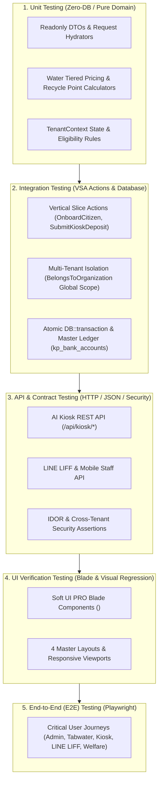
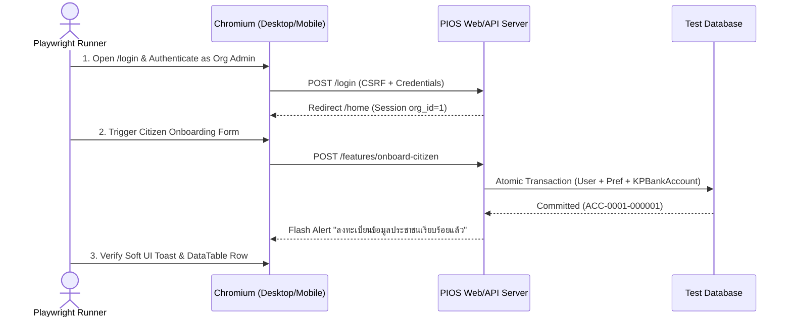

# แผนแม่บทการออกแบบระบบทดสอบแบบครบวงจร (Comprehensive Testing Master Plan)
**โปรเจกต์:** `qa_envsogo_pios` (Local Government Environmental & Public Service Platform)  
**สถาปัตยกรรมอ้างอิง:** Vertical Slice Architecture (VSA) + Shared Kernel + Soft UI Dashboard PRO Laravel  
**อ้างอิงการตัดสินใจ:** [ADR-0007](../adr/0007-comprehensive-testing-strategy-and-qa-pyramid.md)

---

## 1. ภาพรวมสถาปัตยกรรมการทดสอบ (Testing Pyramid & Strategy)

เพื่อให้สอดคล้องกับโครงสร้าง **Vertical Slice Architecture (VSA)** และระบบแยกข้อมูลหลายองค์กร (**Multi-Tenancy `org_id_fk`**) ระบบการทดสอบของโปรเจกต์ `pios` จึงถูกแบ่งออกเป็น **5 เลเยอร์** ที่ทำงานสอดประสานกันตั้งแต่ระดับ Domain Logic จนถึงระดับหน้าจอผู้ใช้งานจริง (Browser E2E)



### สัดส่วนและเป้าหมายประสิทธิภาพ (Target Metrics)

| เลเยอร์การทดสอบ | เครื่องมือหลัก (Tooling) | โฟลเดอร์เป้าหมาย | ความเร็วเป้าหมาย | เป้าหมาย Coverage |
| :--- | :--- | :--- | :---: | :---: |
| **1. Unit Test** | PHPUnit 11 / Pest | `tests/Unit/` | `< 0.2 วินาที` (ทั้งชุด) | `>= 90%` ของ DTOs & Calculators |
| **2. Integration Test** | PHPUnit + SQLite `:memory:` | `tests/Integration/` | `< 2.0 วินาที` (ทั้งชุด) | `>= 85%` ของ VSA Actions & Scopes |
| **3. API Testing** | Laravel HTTP Test (`postJson`) | `tests/Feature/Api/` | `< 3.0 วินาที` (ทั้งชุด) | `100%` ของ Public/Kiosk/LIFF Endpoints |
| **4. UI Verification** | Laravel `$this->blade()` + Playwright | `tests/Feature/Ui/` | `< 2.0 วินาที` (Blade) | `100%` ของ `<x-soft-ui.*>` & Master Layouts |
| **5. E2E Testing** | Playwright (TypeScript) | `tests/e2e/` | `< 90 วินาที` (5 Journeys) | `100%` ของ Critical Business Flows |

---

## 2. โครงสร้างไดเรกทอรีการทดสอบ (Target Test Directory Structure)

```text
tests/
├── TestCase.php                                      # Base TestCase พร้อม SQLite In-Memory Guard
├── CreatesApplication.php
├── Support/
│   └── Concerns/
│       ├── BuildsTestSchema.php                      # Trait สร้างตาราง SQLite เฉพาะโมดูลอย่างรวดเร็ว
│       └── InteractsWithTenancy.php                  # Trait จำลององค์กร (Org A / Org B) และผู้ใช้
├── Unit/                                             # [Layer 1] ทดสอบระดับหน่วย (ไม่ต่อ DB)
│   ├── Shared/
│   │   └── TenantContextUnitTest.php
│   ├── Features/
│   │   ├── IdentityAndOnboarding/
│   │   │   └── OnboardCitizenDTOTest.php
│   │   ├── Waterworks/
│   │   │   └── TieredWaterPricingCalculatorTest.php
│   │   ├── RecycleBank/
│   │   │   └── WastePointAndPriceCalculatorTest.php
│   │   └── Welfare/
│   │       └── MembershipDurationRuleTest.php
├── Integration/                                      # [Layer 2] ทดสอบการทำงานร่วมกับ DB & Tenancy
│   ├── Tenancy/
│   │   └── BelongsToOrganizationScopeTest.php
│   ├── Features/
│   │   ├── IdentityAndOnboarding/
│   │   │   └── OnboardCitizenActionTest.php
│   │   ├── Kiosk/
│   │   │   └── SubmitKioskDepositActionTest.php
│   │   ├── Welfare/
│   │   │   └── CheckMemberEligibilityActionTest.php
│   │   └── LineLiff/
│   │       └── VerifyLineSessionActionTest.php
├── Feature/                                          # [Layer 3 & 4] ทดสอบ HTTP, API, Security & UI
│   ├── SecurityAndRuntimeHotfixesTest.php
│   ├── VerticalSliceArchitectureTest.php
│   ├── SoftUiComponentsTest.php
│   ├── Api/
│   │   ├── KioskTransactionApiTest.php
│   │   ├── KioskStateMachineApiTest.php
│   │   ├── LineLiffSecurityApiTest.php
│   │   └── CitizenOnboardingApiTest.php
│   └── Ui/
│       ├── SoftUiDesignSystemComponentTest.php
│       └── MasterLayoutsVerificationTest.php
└── e2e/                                              # [Layer 5] ทดสอบ E2E ผ่าน Browser จริงด้วย Playwright
    ├── playwright.config.ts
    ├── fixtures/
    │   └── auth-tenant.fixture.ts
    └── specs/
        ├── 01-citizen-onboarding.spec.ts
        ├── 02-tabwater-billing-flow.spec.ts
        ├── 03-kiosk-recycle-deposit.spec.ts
        ├── 04-line-liff-member-portal.spec.ts
        └── 05-soft-ui-visual-verify.spec.ts
```

---

## 3. การออกแบบการทดสอบแต่ละเลเยอร์ (Detailed Layer Specifications)

---

### Layer 1: การออกแบบ Unit Testing (`tests/Unit/`)

**วัตถุประสงค์:** ทดสอบตรรกะทางธุรกิจบริสุทธิ์ (Pure Domain Logic) และการแปลงข้อมูล (Data Hydration) โดยไม่แตะต้องฐานข้อมูล (`RefreshDatabase` ห้ามใช้ในชั้นนี้)

#### 1.1 ขอบเขตและรายการทดสอบ (Unit Test Matrix)

| หมวดหมู่ | คลาส/โมดูลเป้าหมาย | กรณีทดสอบ (Test Scenarios) |
| :--- | :--- | :--- |
| **DTO Hydration** | `OnboardCitizenDTO` | - สร้างจาก Constructor และตรวจสอบคุณสมบัติ `readonly`<br>- แปลงจาก Array (`fromArray`) พร้อมค่า Default ของ Flag โมดูลต่างๆ<br>- แปลงหมายเลของค์กรและโซนเป็น `int` อย่างปลอดภัย |
| **Waterworks Pricing** | `WaterPricingCalculator` | - คำนวณค่าน้ำแบบเหมาจ่าย (Flat Rate)<br>- คำนวณค่าน้ำแบบขั้นบันได (Progressive Tiered Pricing เช่น 0-10 หน่วยแรก, 11-20 หน่วยถัดไป)<br>- คำนวณค่ารักษามิเตอร์ + ภาษีมูลค่าเพิ่ม (VAT 7%)<br>- กรณีหน่วยใช้น้ำเป็น `0` หรือเลขมิเตอร์ปัจจุบันน้อยกว่าครั้งก่อน (ต้องโยน Domain Exception) |
| **Recycle Bank Points** | `RecycleDepositCalculator` | - คำนวณแต้มและจำนวนเงินจากน้ำหนัก/จำนวนชิ้น (`qty * price_per_unit`, `qty * point_per_unit`)<br>- การปัดเศษทศนิยม 2 ตำแหน่ง (`round(2)`) สำหรับยอดเงินสะสม |
| **Welfare Rules** | `WelfareEligibilityRule` | - คำนวณจำนวนวันเป็นสมาชิก (`diffInDays`) เทียบเกณฑ์ขั้นต่ำ 180 วัน<br>- ตรวจสอบกรณีวันครบกำหนดตรงกับวันปัจจุบันพอดี (Boundary Value: 179, 180, 181 วัน) |
| **Shared Kernel** | `TenantContext` | - การอ่าน/เขียน/ล้างค่า `orgId` ในหน่วยความจำ Static |

#### 1.2 แนวทางการเขียน Unit Test (Code Blueprint)
```php
<?php

namespace Tests\Unit\Features\Waterworks;

use PHPUnit\Framework\TestCase;

class TieredWaterPricingCalculatorTest extends TestCase
{
    /**
     * @dataProvider waterUsageProvider
     */
    public function test_calculates_progressive_water_bill_correctly(
        int $unitsUsed,
        float $maintainFee,
        float $vatRate,
        float $expectedTotal
    ): void {
        // ทดสอบ Boundary values: 0 หน่วย, 10 หน่วย, 25 หน่วย
        $baseCharge = $unitsUsed <= 10
            ? $unitsUsed * 5.0
            : (10 * 5.0) + (($unitsUsed - 10) * 8.0);

        $subTotal = $baseCharge + $maintainFee;
        $total = round($subTotal * (1 + ($vatRate / 100)), 2);

        $this->assertSame($expectedTotal, $total);
    }

    public static function waterUsageProvider(): array
    {
        return [
            'zero usage (maintenance fee only)' => [0, 10.00, 7.0, 10.70],
            'tier 1 boundary (10 units)'        => [10, 10.00, 7.0, 64.20],
            'tier 2 overflow (20 units)'        => [20, 10.00, 7.0, 149.80],
        ];
    }
}
```

---

### Layer 2: การออกแบบ Integration Testing (`tests/Integration/`)

**วัตถุประสงค์:** ทดสอบว่า Vertical Slice Actions (`*Action.php`), Eloquent Models, Global Scopes (`BelongsToOrganization`), และ Database Transactions (`DB::transaction`) ทำงานร่วมกับฐานข้อมูลได้อย่างถูกต้องและรักษาความสมบูรณ์ของข้อมูล (Data Integrity)

#### 2.1 กลยุทธ์จัดการฐานข้อมูลทดสอบ (Test Database Strategy)
เนื่องจากโปรเจกต์มีไฟล์ Migration เดิมกว่า 140 ไฟล์ที่มีความขัดแย้งกันเมื่อรันตั้งแต่ต้น เราจึงออกแบบ Trait `Tests\Support\Concerns\BuildsTestSchema` เพื่อสร้างเฉพาะตารางหลักที่ใช้ใน Bounded Context นั้นๆ บน SQLite In-Memory (`:memory:`) ใช้เวลาสร้างตารางเพียง `~5ms` ต่อการทดสอบ

#### 2.2 ขอบเขตและรายการทดสอบ (Integration Test Matrix)

| Bounded Context | คลาสเป้าหมาย | กรณีทดสอบ (Integration Scenarios) |
| :--- | :--- | :--- |
| **Multi-Tenancy Kernel** | `BelongsToOrganization` Trait & `TenantContext` | - **Auto-Assign:** เมื่อสร้างเรคคอร์ดใหม่ขณะที่ `TenantContext::setOrgId(10)` เรคคอร์ดต้องได้ `org_id_fk = 10` อัตโนมัติ<br>- **Tenant Isolation:** เมื่อสลับเป็น `TenantContext::setOrgId(20)` การคิวรี `Model::all()` ต้องไม่เห็นข้อมูลขององค์กร `10` เลย<br>- **Explicit Scope:** การเรียก `Model::forOrg(10)->get()` ต้องดึงข้อมูลขององค์กร `10` ได้อย่างแม่นยำ |
| **Unified Onboarding** | `OnboardCitizenAction` | - **Full Onboarding:** ลงทะเบียนประชาชน 1 คน พร้อมเปิดใช้ Recycle Bank + Welfare + FoodWaste ต้องสร้าง `users`, `kp_user_waste_preferences`, `kp_bank_accounts` (พร้อม `account_no` และ `member_number`), และ `food_waste_user_preferences` ครบถ้วนใน Transaction เดียว<br>- **Transaction Rollback:** หากการสร้างตารางลูกเกิดข้อผิดพลาด ข้อมูลในตาราง `users` ต้องถูก Rollback ไม่ค้างในระบบ |
| **Kiosk & Master Ledger** | `SubmitKioskDepositAction` | - บันทึกหัวบิล `kp_purchase_transactions` และรายการย่อย `kp_purchase_transaction_details`<br>- อัปเดตยอดเงิน (`balance`) และแต้มสะสม (`points`) ในตารางหลัก `kp_bank_accounts` แบบ Atomic Increment |
| **Welfare Eligibility** | `CheckMemberEligibilityAction` | - ทดสอบสมาชิกที่สมัครมากกว่า 180 วัน (`eligible = true`, คืนยอด `balance` และ `member_number`)<br>- ทดสอบสมาชิกใหม่ที่สมัครไม่ถึง 180 วัน (`eligible = false` พร้อมข้อความแจ้งจำนวนวันที่ขาด)<br>- ทดสอบกรณีค้นหาสมาชิกข้ามองค์กร (`eligible = false`) |

---

### Layer 3: การออกแบบ API & Contract Testing (`tests/Feature/Api/`)

**วัตถุประสงค์:** ทดสอบ HTTP Endpoints ทั้งหมดในระบบ ทั้งด้านความถูกต้องของ Request Validation, JSON Response Structure, HTTP Status Codes, และความปลอดภัย (Security & Access Control)

#### 3.1 ขอบเขตและรายการทดสอบ (API Test Matrix)

| Endpoint / Route | Method | กรณีทดสอบ (API & Security Test Cases) |
| :--- | :---: | :--- |
| `/features/onboard-citizen` | `POST` | - `201 Created`: ส่ง JSON ครบถ้วน ได้รับ `user_id`, `account_no`, `member_number`<br>- `422 Unprocessable`: ไม่ส่ง `firstname` หรือ `lastname` ต้องติด Validation errors |
| `/api/kiosk/submit-transaction` | `POST` | - `200 OK`: ส่ง `userId`, `machineId`, `totalPoints`, `totalPrice`, `items` (ทั้งแบบ JSON string และ Array)<br>- `422 Unprocessable`: ไม่ส่ง `userId` และไม่ได้ล็อกอิน (ป้องกันบั๊กเดิมที่เคย Hardcode `userId = 10`)<br>- `400 Bad Request`: ส่ง `items` เป็นค่าว่าง `[]` หรือ JSON ผิดรูปแบบ<br>- `404 Not Found`: ส่ง `userId` ที่ไม่มีอยู่ในระบบ |
| `/api/kiosk/wake-up`<br>`/api/kiosk/ready`<br>`/api/kiosk/check-command`<br>`/api/kiosk/sleep` | `GET` / `POST` | - ทดสอบ State Machine ของตู้ AI Kiosk (`idle` -> `active` -> `ready` -> `sleep`)<br>- ตรวจสอบโครงสร้าง JSON ตอบกลับสำหรับไมโครคอนโทรลเลอร์ / กล้อง AI |
| `/line/dashboard/{pref_id}/{org_id}` | `GET` | - `404 Not Found`: เมื่อ `pref_id` ไม่มีอยู่จริง หรือ `org_id` ไม่ตรงกับองค์กรของสมาชิก (Cross-Tenant Tampering)<br>- `403 Forbidden`: เมื่อพยายามเข้าถึงบัญชีที่มีสิทธิ์ `Super Admin` หรือ `Admin` ผ่านลิงก์สาธารณะ<br>- `403 Forbidden`: เมื่อส่ง `X-Line-User-Id` ไม่ตรงกับ `line_user_id` ที่ผูกไว้กับบัญชี |
| `/api/health-check` | `GET` | - `200 OK`: ตรวจสอบโครงสร้าง `status: online`, `timestamp` |

---

### Layer 4: การออกแบบ UI Verification Testing (`tests/Feature/Ui/`)

**วัตถุประสงค์:** ตรวจสอบว่า Blade Components และ Master Layouts ที่ออกแบบตามมาตรฐาน **Soft UI Dashboard PRO Laravel** เรนเดอร์ HTML, CSS Classes, Attributes และข้อความภาษาไทยได้อย่างถูกต้อง ไม่เกิดปัญหา Layout แตกหรือ Component พัง

#### 4.1 รายการตรวจสอบ UI Components (Soft UI PRO Component Matrix)

| Blade Component | สิ่งที่ต้องตรวจสอบ (DOM & Class Assertions) |
| :--- | :--- |
| `<x-soft-ui.card>` | - มีคลาส `.card` และ `.shadow-blur`<br>- เรนเดอร์ `.card-header` เฉพาะเมื่อส่ง `title` หรือ `action`<br>- เรนเดอร์ `.card-footer` เฉพาะเมื่อส่ง slot `footer` |
| `<x-soft-ui.stat-card>` | - มีคลาส `.icon.icon-shape.bg-gradient-{color}.shadow.border-radius-md`<br>- แสดงตัวเลขหลักใน `h5.font-weight-bolder` และเปอร์เซ็นต์การเปลี่ยนแปลงพร้อมสี (`text-success` / `text-danger`) |
| `<x-soft-ui.button>` | - รองรับโหมด Gradient (`.bg-gradient-primary`), โหมด Outline (`.btn-outline-info`), และขนาด (`btn-sm`, `btn-lg`)<br>- เรนเดอร์ไอคอน `<i class="...">` ด้านหน้าข้อความเมื่อระบุ `icon` |
| `<x-soft-ui.badge>` | - มีคลาส `.badge.badge-sm.bg-gradient-{color}` |
| `<x-soft-ui.alert>` | - มีคลาส `.alert.alert-{color}.text-white` และปุ่มปิด `.btn-close[data-bs-dismiss="alert"]` เมื่อ `dismissible=true` |
| `<x-soft-ui.modal>` | - ผูก `id` กับ `aria-labelledby="{id}Label"` อย่างถูกต้อง<br>- รองรับขนาด `modal-sm`, `modal-lg`, `modal-xl` และ `modal-dialog-scrollable` |
| `<x-soft-ui.datatable>` | - สร้าง `<table class="table align-items-center mb-0" id="{id}">`<br>- วนลูปสร้าง `<th>` จาก prop `:headers="[...]"` ครบทุกคอลัมน์ |

#### 4.2 รายการตรวจสอบ Master Layouts & Visual Standards
1. **Master Layout Rendering (`layouts.soft-ui-pro`)**:
   - ตรวจสอบการโหลดฟอนต์ `Sarabun` และ `Open Sans`, ไฟล์ `soft-ui-dashboard.css`, `nucleo-icons.css`, และ `dataTables.bootstrap5.min.css`
   - ตรวจสอบการแสดงผลป้ายชื่อองค์กรปัจจุบัน (`.tenant-badge`) บน Sidebar และ Navbar (`Org #{id}`)
   - ตรวจสอบการทำงานของ `@include('layouts.partials.flash')` เมื่อมี `session('success')`, `session('error')`, และ `session('warning')`
2. **Responsive Viewport Matrix (ตรวจสอบผ่าน Playwright Visual Snapshot)**:
   - **Desktop Backoffice:** `1440 x 900` (Sidebar แสดงผลคงที่ด้านซ้าย, ตาราง DataTables แสดงครบ)
   - **Tablet Field Staff:** `768 x 1024` (Sidebar ซ่อนเป็น Hamburger menu `#iconNavbarSidenav`)
   - **Mobile LINE LIFF:** `390 x 844` (iPhone 14 viewport — แสดงผลการ์ดสรุปยอดเงินและปุ่มสแกน QR ขนาดใหญ่)
   - **AI Kiosk Touch Screen:** `1080 x 1920` (Portrait Fullscreen — ปุ่มกดขนาดใหญ่พิเศษ ไม่มี Sidebar)

---

### Layer 5: การออกแบบ End-to-End (E2E) Testing (`tests/e2e/`)

**วัตถุประสงค์:** จำลองพฤติกรรมผู้ใช้งานจริงผ่านเว็บเบราว์เซอร์ด้วย **Playwright** เพื่อยืนยันการทำงานตั้งแต่การคลิกปุ่มบนหน้าจอ, การส่งฟอร์ม, การทำงานของ JavaScript/AJAX, จนถึงการบันทึกข้อมูลลงฐานข้อมูลและการแสดงผลลัพธ์กลับสู่หน้าจอ



#### 5.1 รายละเอียด 5 Critical User Journeys (E2E Specs)

| รหัสสเปก | ชื่อ Journey | ขั้นตอนการทดสอบ (Step-by-Step E2E Flow) |
| :--- | :--- | :--- |
| **`01-citizen-onboarding.spec.ts`** | **การลงทะเบียนประชาชนแบบรวมศูนย์ (Unified Onboarding)** | 1. ล็อกอินด้วยบัญชี Admin ของ อปท.<br>2. เปิดโมดัล/ฟอร์มลงทะเบียนประชาชน กรอกชื่อ-นามสกุล เลขบัตรประชาชน และติ๊กเลือกเปิดใช้งาน "ธนาคารขยะ" + "กองทุนสวัสดิการ"<br>3. กดบันทึก ตรวจสอบการแสดงผล Soft UI Alert สีเขียว<br>4. ตรวจสอบว่าตารางรายชื่อแสดงรหัสบัญชี `ACC-xxxx` และสถานะสมาชิกถูกต้อง |
| **`02-tabwater-billing-flow.spec.ts`** | **วงจรจดมิเตอร์และออกบิลค่าน้ำประปา (Tabwater Billing Cycle)** | 1. เจ้าหน้าที่จดมิเตอร์เข้าสู่หน้าบันทึกเลขมิเตอร์ประจำงวด<br>2. กรอกเลขมิเตอร์ปัจจุบัน ระบบคำนวณหน่วยใช้น้ำและยอดเงินอัตโนมัติ<br>3. กดบันทึกและเปลี่ยนสถานะเป็นออกใบแจ้งหนี้ (`invoice`)<br>4. กดรับชำระเงินและเปิดหน้าพิมพ์ใบเสร็จรับเงิน (`print.blade.php`) ตรวจสอบว่าไม่มีเมนู Sidebar ปนเปื้อนในหน้าพิมพ์ |
| **`03-kiosk-recycle-deposit.spec.ts`** | **การฝากขยะรีไซเคิลผ่านตู้ AI Kiosk (AI Kiosk Deposit Flow)** | 1. เปิดหน้าจอตู้ Kiosk จับคู่กับสมาชิก<br>2. จำลองเหตุการณ์กล้อง AI ตรวจพบขวดพลาสติก PET 5 ขวด และกระป๋องอะลูมิเนียม 2 กระป๋อง<br>3. กดยืนยันจบรายการฝากขยะ<br>4. ตรวจสอบว่าหน้าจอสรุปแต้มสะสมและยอดเงินเพิ่มขึ้นตรงตามเรตราคา |
| **`04-line-liff-member-portal.spec.ts`** | **หน้าพอร์ทัลประชาชนผ่าน LINE LIFF & Security Check** | 1. เปิดหน้า LINE LIFF Dashboard ด้วย Viewport มือถือ (`390x844`) พร้อม Header/Session ยืนยันตัวตน<br>2. ตรวจสอบการแสดงผลยอดเงินคงเหลือและประวัติการขายขยะเฉพาะของตนเอง<br>3. **Security Negative Test:** ลองเปลี่ยน `org_id` บน URL เป็นองค์กรอื่น หรือเข้าถึงบัญชี Admin ต้องได้รับหน้า `403` / `404` ทันที |
| **`05-soft-ui-visual-verify.spec.ts`** | **การตรวจสอบมาตรฐาน UI & Visual Regression** | 1. ตรวจสอบหน้า Dashboard หลักว่าไม่มี Console Errors หรือ Broken CSS/JS (`404`)<br>2. ตรวจสอบความถูกต้องของตาราง DataTables (ค้นหา, เรียงลำดับ, แบ่งหน้า)<br>3. ถ่ายภาพ Screenshot เปรียบเทียบ Layout (Visual Snapshot) ทั้งโหมด Desktop และ Mobile |

---

## 4. มาตรฐานคำสั่งรันการทดสอบ (Standard Test Execution Commands)

### 4.1 รันชุดทดสอบฝั่ง Backend & Blade UI (PHPUnit)
```bash
# รันชุดทดสอบทั้งหมดที่ออกแบบใหม่ (Unit + Integration + API + UI Components)
/opt/homebrew/Cellar/php/8.5.10/bin/php vendor/bin/phpunit \
    tests/Unit \
    tests/Integration \
    tests/Feature/Api \
    tests/Feature/Ui \
    tests/Feature/SecurityAndRuntimeHotfixesTest.php \
    tests/Feature/VerticalSliceArchitectureTest.php \
    tests/Feature/SoftUiComponentsTest.php

# รันเฉพาะเลเยอร์ที่ต้องการระหว่างพัฒนา
/opt/homebrew/Cellar/php/8.5.10/bin/php vendor/bin/phpunit tests/Unit
/opt/homebrew/Cellar/php/8.5.10/bin/php vendor/bin/phpunit tests/Integration
/opt/homebrew/Cellar/php/8.5.10/bin/php vendor/bin/phpunit tests/Feature/Api
/opt/homebrew/Cellar/php/8.5.10/bin/php vendor/bin/phpunit tests/Feature/Ui
```

### 4.2 รันชุดทดสอบฝั่ง Browser E2E & Visual Verify (Playwright)
```bash
# รัน E2E ทุกสเปกแบบ Headless
npx playwright test

# รันเฉพาะการตรวจสอบ UI / Visual Verify
npx playwright test tests/e2e/specs/05-soft-ui-visual-verify.spec.ts

# เปิดดูรายงานผลการทดสอบพร้อม Trace & Screenshots
npx playwright show-report
```

---

## 5. เกณฑ์การผ่านคุณภาพก่อน Merge เข้าสู่ `main` (Quality Gates)

1. **Gate 1 — Zero Syntax & Route Compilation Errors:** ทุก Route ใน `routes/*.php` และ `app/Features/*/*/routes.php` ต้องคอมไพล์ผ่านโดยไม่มีพารามิเตอร์ว่างหรือ Controller Method ตกหล่น
2. **Gate 2 — 100% Pass on Unit & Integration Suites:** การคำนวณตัวเลขทางการเงิน (ค่าน้ำ, แต้มขยะ, เงินสวัสดิการ) และการทำธุรกรรม `DB::transaction` ต้องผ่าน 100%
3. **Gate 3 — Multi-Tenant & IDOR Security Verification:** การทดสอบข้ามองค์กร (`org_id_fk`) และการป้องกันการสวมรอยผ่าน LINE LIFF / Kiosk API ต้องไม่มีช่องโหว่หลุดรอด
4. **Gate 4 — Soft UI PRO Component Integrity:** ทุก `<x-soft-ui.*>` component และ Master Layout ต้องเรนเดอร์ผ่านโดยไม่มี Blade exception
