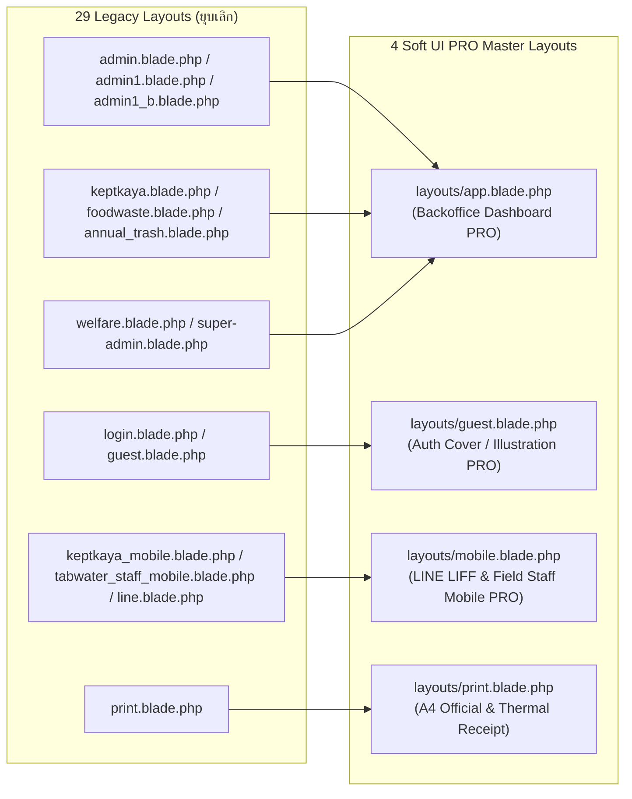

# มาตรฐานการออกแบบ UI/UX และระบบ Component อ้างอิง Soft UI Dashboard PRO Laravel

**เอกสารอ้างอิง:** `@https://soft-ui-dashboard-pro-laravel.creative-tim.com/documentation/getting-started/installation.html`  
**โปรเจกต์:** `qa_envsogo_pios`  
**ADR ที่เกี่ยวข้อง:** [ADR-0005](../adr/0005-soft-ui-dashboard-pro-design-system-standardization.md)

---

## 1. การวิเคราะห์ช่องว่างระหว่าง UI ปัจจุบัน กับ Soft UI Dashboard PRO Laravel

### 1.1 สถานะปัจจุบันในโปรเจกต์ (`As-Is UI State`)
1. **มีไฟล์ Layout แตกกระจายถึง 29 ไฟล์ใน `resources/views/layouts/`:**
   - `admin.blade.php`, `admin1.blade.php`, `admin1_b.blade.php`, `keptkaya.blade.php`, `foodwaste.blade.php`, `annual_trash.blade.php`, `super-admin.blade.php`, `welfare.blade.php`, `tabwater_staff_mobile.blade.php`, `user_mobile.blade.php`, `keptkaya_mobile.blade.php`, `keptkaya_mobile2.blade.php`, `liverwire.blade.php` ฯลฯ
   - ทุกไฟล์คัดลอก `<head>`, การคำนวณ `$pageTitle` / `$crumbParent`, Navbar, และ Script tags ซ้ำกันทั้งหมด
2. **การปะปนของไลบรารี CSS/JS 4 ยุคสมัย:**
   - โหลด **Soft UI Dashboard Free v1.0.7** (`public/soft-ui/assets/css/soft-ui-dashboard.css`)
   - โหลด **AdminLTE 3** (`public/adminlte/plugins/fontawesome-free/css/all.min.css` และปลั๊กอินใน `public/adminlte/plugins/`)
   - โหลด **Tailwind CSS 3** ในหน้า Breeze Auth (`layouts/app.blade.php`, `layouts/guest.blade.php`)
   - โหลด **jQuery 3.7.0** และ **DataTables 1.13.6** จาก CDN บ้าง จาก Local บ้าง ไม่ตรงกันในแต่ละโมดูล
3. **การปิดกั้น Flash Alert ใน Layout:**
   - ใน `layouts/admin1.blade.php` บรรทัด 149 มีการคอมเมนต์ `{{-- @include('layouts.partials.flash') --}}` และใน `layouts/keptkaya.blade.php` บรรทัด 143 คอมเมนต์ปิด `@if (session('error'))` ทำให้เมื่อคอนโทรลเลอร์ทำคำสั่ง `redirect()->with('error', ...)` ผู้ใช้ไม่เห็นข้อความแจ้งเตือนใดๆ

---

## 2. สถาปัตยกรรมตามมาตรฐาน Soft UI Dashboard PRO Laravel (`To-Be UI Architecture`)

ตามเอกสารทางการของ **Soft UI Dashboard PRO Laravel** (พัฒนาโดย Creative Tim ร่วมกับ UPDIVISION) โครงสร้าง UI จะถูกแบ่งออกเป็นชั้นของ **Layouts**, **Navbars/Footers/Sidenavs**, **Reusable Blade Components**, และ **Integrated Plugins** ดังนี้:

### 2.1 การยุบรวม 29 Layouts สู่ 4 Master Layouts มาตรฐาน



*หมายเหตุเพื่อความเข้ากันได้ย้อนหลัง (Backward Compatibility ช่วงเปลี่ยนผ่าน):*  
ไฟล์เดิม เช่น `layouts/admin1.blade.php`, `layouts/keptkaya.blade.php`, `layouts/foodwaste.blade.php`, `layouts/annual_trash.blade.php`, `layouts/welfare.blade.php`, `layouts/super-admin.blade.php` จะถูกเปลี่ยนไส้ในให้เหลือเพียง `@extends('layouts.app', ['module' => '...'])` เพื่อไม่ให้ View เดิมกว่า 400 ไฟล์พังระหว่างทยอยย้ายเข้า Vertical Slices

---

## 3. ระบบ Design Tokens & Color Palette ตามโมดูลของ PIOS

ใช้ระบบสี Gradient และ Shadow เอกลักษณ์ของ **Soft UI Dashboard PRO** (`bg-gradient-*`, `shadow-*`, `border-radius-xl`) โดยกำหนดสีประจำโมดูลเพื่อให้เจ้าหน้าที่ อปท. แยกแยะบริบทการทำงานได้ทันที:

| โมดูล (Bounded Context) | Soft UI PRO Theme Accent | คลาสปุ่มและไอคอนหลัก | คลาส Badge สถานะ |
| :--- | :--- | :--- | :--- |
| **Core Admin & SuperAdmin** | **Primary (Magenta-Purple Gradient)** | `bg-gradient-primary`, `btn-primary` | `badge bg-gradient-primary` |
| **Tabwater (ระบบน้ำประปา)** | **Info (Cyan-Blue Gradient)** | `bg-gradient-info`, `btn-info` | `badge bg-gradient-info` |
| **RecycleBank (ธนาคารขยะ)** | **Success (Green-Teal Gradient)** | `bg-gradient-success`, `btn-success` | `badge bg-gradient-success` |
| **AnnualTrash (ขยะรายปี)** | **Warning (Orange-Amber Gradient)** | `bg-gradient-warning`, `btn-warning` | `badge bg-gradient-warning` |
| **FoodWaste & IoT Compost** | **Success / Dark Emerald** | `bg-gradient-success`, `icon-shape` | `badge bg-gradient-success` |
| **Welfare (สวัสดิการชุมชน)** | **Danger / Rose Gradient** | `bg-gradient-danger`, `btn-danger` | `badge bg-gradient-danger` |
| **Kiosk & SmartUtility** | **Dark (Slate-Navy Gradient)** | `bg-gradient-dark`, `btn-dark` | `badge bg-gradient-dark` |

### Typography & Thai Localization
- **Font Stack:** `"Open Sans", "Sarabun", sans-serif`
- **Heading Scales:** ใช้ `font-weight-bolder` (`700`) สำหรับหัวข้อการ์ดและยอดเงินสำคัญ และใช้ `text-sm` / `text-xs text-secondary mb-0` สำหรับคำอธิบายรองและรหัสอ้างอิง

---

## 4. มาตรฐาน Blade Components (`resources/views/components/soft-ui/`)

ทุกหน้าใน Vertical Slice ใหม่จะต้องประกอบสร้างจาก Blade Components มาตรฐานของ Soft UI Dashboard PRO ดังต่อไปนี้:

### 4.1 `<x-soft-ui.stat-card>` (Mini Statistics Card)
ใช้แสดง KPI บนหน้า Dashboard ของทุกโมดูล (เช่น ยอดเก็บค่าน้ำประจำเดือน, น้ำหนักขยะรีไซเคิลสะสม, จำนวนผู้ค้างชำระ `owe_count >= 2`):
```html
<x-soft-ui.stat-card
    title="ยอดรับชำระค่าน้ำวันนี้"
    value="฿14,520.00"
    growth="+12.5%"
    icon="ni ni-money-coins"
    color="info"
/>
```

### 4.2 `<x-soft-ui.card>` & `<x-soft-ui.datatable>` (PRO DataTables Card)
ตามมาตรฐาน Soft UI Dashboard PRO ตารางข้อมูลทั้งหมดจะอยู่ใน `.card.mb-4` ที่มี `.card-header.pb-0` พร้อมปุ่ม Action (เพิ่มข้อมูล / นำเข้า Excel / ส่งออกรายงาน) และใช้ `.table.align-items-center.mb-0`:
- หัวตาราง (`<th>`) ใช้คลาส `text-uppercase text-secondary text-xxs font-weight-bolder opacity-7`
- แถวข้อมูล (`<td>`) ใช้ Avatar/Icon คู่กับชื่อ-นามสกุลและรหัสสมาชิกในคอลัมน์เดียวกันเพื่อประหยัดพื้นที่แนวนอน

### 4.3 `<x-soft-ui.wizard>` (Multi-Step Onboarding Wizard)
อ้างอิงปลั๊กอิน **Multistep Form Wizard** จาก Soft UI Dashboard PRO สำหรับหน้า `OnboardCitizen` (สร้างผู้ใช้งานและผูกบริการ 5 โมดูลในหน้าเดียว):
- **Step 1: ข้อมูลประชาชน (Citizen Profile)** — ชื่อ-สกุล, เลขบัตรประชาชน 13 หลัก, เบอร์โทรศัพท์, โซน/ซอย
- **Step 2: ผูกมิเตอร์น้ำประปา (Tabwater Meter)** — เลือกเปิดใช้น้ำประปา, ระบุเลขมิเตอร์/ประเภทมิเตอร์
- **Step 3: บริการขยะและสวัสดิการ (Waste & Welfare Services)** — สวิตช์เปิดธนาคารขยะรีไซเคิล, ขยะเปียก, ถังขยะรายปี, และกองทุนสวัสดิการชุมชน
- **Step 4: ยืนยันและพิมพ์บัตรสมาชิก/QR Code (Summary & QR Print)**

### 4.4 Integrated Plugins มาตรฐานตาม Soft UI Dashboard PRO
1. **SweetAlert2 (`sweetalert2`):** แทนที่ `alert()` และ `confirm()` แบบดั้งเดิมทั้งหมด ใช้สำหรับยืนยันการลบข้อมูล การอนุมัติจ่ายเงินสวัสดิการ และการแจ้งเตือน Toast มุมขวาบน
2. **Select2 / Choices.js Soft UI Theme:** ปรับแต่ง CSS ให้ `.select2-selection` มีความสูง `calc(1.4rem + 1rem + 2px)` ขอบโค้ง `.5rem` (`border-radius-md`) และขอบสี `#cb0c9f` เมื่อ Focus ตามสไตล์ Soft UI PRO
3. **Chart.js v3/v4:** ใช้กราฟเส้นแบบมี Gradient Fill (`ctx.createLinearGradient`) สำหรับแสดงสถิติปริมาณการใช้น้ำและปริมาณขยะลดคาร์บอน
4. **Leaflet GIS Soft UI Overlay:** แผงควบคุมแผนที่โรงผลิตน้ำและเส้นท่อประปาใช้การ์ดแบบ Glassmorphism (`blur shadow-blur bg-white/80`) ลอยเหนือแผนที่
