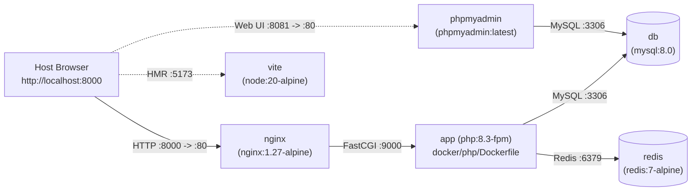

# Implementation Plan: 010 Local Docker Compose Micro-containers Environment

**Specification Ref**: `specs/010-local-docker-compose/spec.md`  
**Design Document Ref**: `docs/superpowers/specs/2026-11-05-local-docker-compose-design.md`  
**Status**: Planned — Awaiting Approval Before Coding

---

## 1. Technical Architecture (Approach 3: Full Micro-containers Only)

### 1.1 File Structure to Create / Modify (During Implementation Phase)

| File Path | Action | Responsibility |
| :--- | :---: | :--- |
| `docker-compose.yml` | Modify | Define 6 micro-containers (`nginx`, `app`, `db`, `redis`, `vite`, `phpmyadmin`), named volumes (`mysql_data`, `redis_data`), healthchecks, and environment overrides. |
| `docker/php/Dockerfile` | Create | Build `php:8.3-fpm` image with Composer, PHP extensions (`pdo_mysql`, `mbstring`, `exif`, `pcntl`, `bcmath`, `gd` with FreeType/JPEG/WebP, `zip`, `xml`, `intl`, `redis`), and `tesseract-ocr` + `tesseract-ocr-tha`. |
| `docker/php/entrypoint.sh` | Create | Zero-touch bootstrap script: ensure `.env`, run `composer install` if `vendor/autoload.php` missing, generate `APP_KEY`, fix `storage`/`bootstrap/cache` permissions, wait for MySQL, and run conditional `migrate --seed`. |
| `docker/php/local.ini` | Create | PHP configuration (`upload_max_filesize=100M`, `post_max_size=100M`, `memory_limit=512M`). |
| `docker/nginx/default.conf` | Create | Nginx virtual host serving `/var/www/html/public` and proxying `.php` to `app:9000`. |
| `docker/mysql/initdb.d/00-init-grants.sql` | Create | Grant full multi-database privileges (`GRANT ALL PRIVILEGES ON *.*`) to support `SetTenantConnection` dynamic `org_database` switching, and serve as drop-in directory for user `.sql` dumps. |
| `.env.docker` | Create | Default Docker environment template pointing to `DB_HOST_S_ADMIN=db`, `DB_DATABASE_S_ADMIN=pios`, `REDIS_HOST=redis`. |
| `config/database.php` | Modify | Add standard `'mysql'` connection alias alongside `'envsogo_main'` and `'tenant'` for compatibility. |
| `database/seeders/DatabaseSeeder.php` | Modify | Enable idempotent execution of core seeders (`ProvincesSeeder`, `DistrictsSeeder`, `TambonsSeeder`, `OrganizationsSeeder`, `ZonesSeeder`, `SubzonesSeeder`, `RolesSeeder`, `PermissionsSeeder`, `AdminSeeder`) when database is empty. |
| `vite.config.js` | Modify | Configure `server: { host: '0.0.0.0', port: 5173, hmr: { host: 'localhost' } }` for Docker HMR compatibility. |

---

## 2. Verification Strategy

1. **Automated Configuration & Spec Test (`tests/Feature/DockerComposeConfigTest.php`):**
   - Verify `docker-compose.yml` defines all 6 micro-containers (`nginx`, `app`, `db`, `redis`, `vite`, `phpmyadmin`).
   - Verify `docker/php/Dockerfile`, `docker/php/entrypoint.sh`, and `docker/nginx/default.conf` exist and are properly configured.
2. **Container Runtime & Smoke Verification:**
   - Run `docker compose config` to validate Compose syntax.
   - Run `docker compose up -d --build` and verify all containers reach `healthy` / `running`.
   - Verify `curl -I http://localhost:8000/login` returns `HTTP/1.1 200 OK`.
   - Verify login with `superadmin` / `123456` succeeds.
   - Verify `http://localhost:8081` (phpMyAdmin) responds with `HTTP/1.1 200 OK`.
